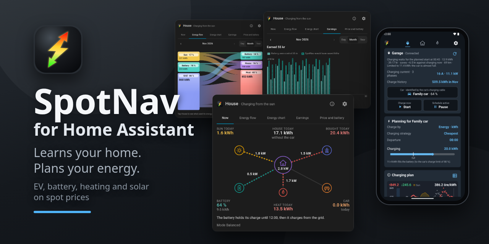
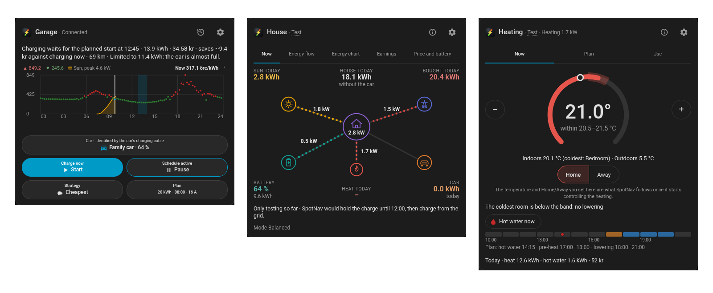

  

# SpotNav for Home Assistant

**Learns your home. Plans your energy.**

Local control for your EV, battery and heating, planned around spot prices, solar and weather. Built for Home
Assistant.

## What it does

- **Charges your car in the cheapest hours** before you leave, to the level you ask for, within your main fuse.
- **Uses your solar surplus** for the car, and plans around the solar forecast.
- **Plans your home battery** against the spot price, in shadow first: it shows what it would do before it controls
  anything.
- **Moves heating and hot water** away from expensive hours, behind an opt-in and its own checks.
- **Runs locally** in Home Assistant, with a dashboard card for the car, the house and the heat, and an Android app.

## Install

1. In Home Assistant, open **Settings → Marketplace** (HACS on versions before 2026.11), search for **SpotNav** and
   install it.
2. Add SpotNav with this button, or go to **Settings → Devices & services → Add integration → SpotNav**. Add your
   charger or your site: SpotNav finds your charger, grid meter, battery and heat pump.

   
3. Add the **SpotNav** card to a dashboard. The card comes with the integration: there is
   no dashboard resource to add.

**[Read the documentation](https://spotnav.sensnology.se)** (the same pages are in [docs/](docs/index.md)).

## Support SpotNav

- **Report a problem.** Open an issue with the [bug report form](https://github.com/henrikekblad/spotnav-home-assistant/issues/new/choose).
  Then send the debug info from the card (**Settings, Support, Send debug info**) and mention the reference it
  shows in the issue. The file holds your entity names and charging times, so please don't attach it to the public
  issue. [Troubleshooting](docs/troubleshooting.md) covers the common problems.
- **Become a beta tester.** In the card, **Settings, Support, Beta tester** sends the redacted debug info once a
  night for 14 days and offers a short hardware test; see [Beta testing](docs/beta-testing.md).
- **Tell how your hardware works.** A short [hardware report](https://github.com/henrikekblad/spotnav-home-assistant/issues/new/choose)
  moves a charger, meter, battery or heat pump from "supported" to "confirmed" and helps the next person decide.
- **Contribute.** Pull requests are welcome, for code as well as [translations](docs/translating.md); see
  [Development](docs/development.md).
- ⭐ **Star the repository.** Stars help others find SpotNav on GitHub and in HACS.
- 💖 **Sponsor.** If SpotNav saves you money, [GitHub Sponsors](https://github.com/sponsors/henrikekblad) takes a
  one-time or monthly contribution and keeps the project going.

SpotNav sends nothing about your installation unless you ask it to. See [Privacy](docs/privacy.md).

## License

[MIT](LICENSE). Copyright Sensnology AB.
