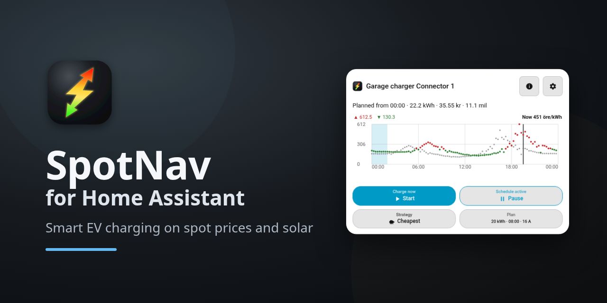
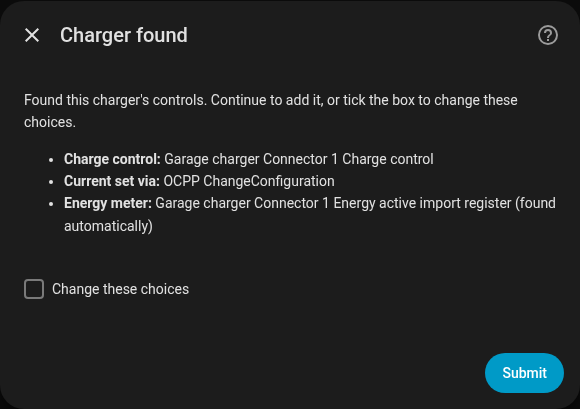
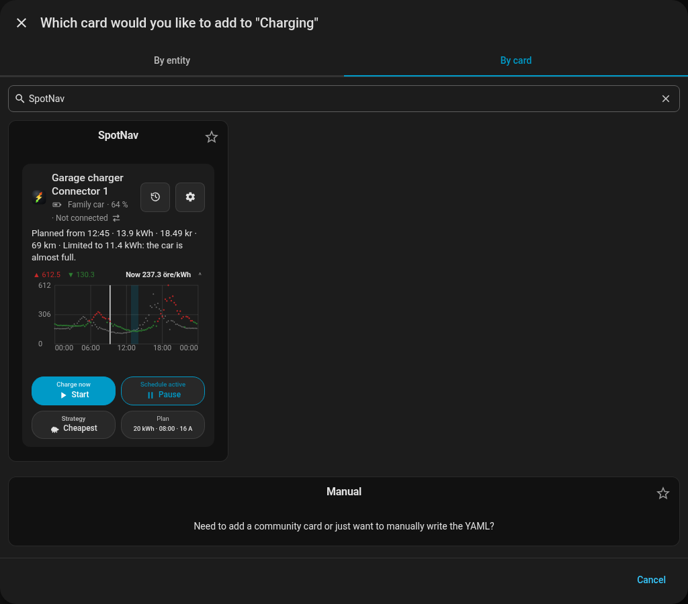

[](https://my.home-assistant.io/redirect/hacs_repository/?owner=henrikekblad&repository=spotnav-home-assistant&category=integration)

SpotNav plans and runs your EV charging inside Home Assistant. Tell it when the car must be ready, or
what charge level you want, and it charges in the cheapest hours, on your solar surplus, and within your
main fuse. It runs locally in Home Assistant and gets going in minutes: the setup finds your charger, your
meter and your cars.

- **Cheapest quarter-hours before departure.** It plans from the spot prices, fees and tax included,
  and starts and stops the charger to follow the plan.
- **Learns your car.** It learns the car's real charging power and the energy one percent of its
  battery takes, so a target such as "80 % by 07:00" gets the right amount of time.
- **Solar and hybrid.** Charge from surplus, or hold back grid energy when the forecast promises sun.
  Chargers that can switch between one and three phases do so to follow the sun.
- **Load balancing under your main fuse.** Several chargers share one fuse, with priority first,
  normal or last, also beside a [home battery](docs/home-battery.md) that charges from the grid.
- **Knows which car is plugged in.** With several cars at one charger it reads what the cars report and
  asks you only when that is not enough.
- **Prices from your own Home Assistant.** Nord Pool, PVPC (Spain), Octopus Agile (Great Britain),
  Zonneplan (Netherlands) or your own free ENTSO-E key, plus your grid fee, also as a percentage of the
  spot price or higher in high-load hours.
- **Cheap and sunny hours for the rest of the house.** Two ready-made [blueprints](docs/automations.md)
  raise or lower a thermostat or heat pump setpoint by the price, and run a pool pump or water heater on
  solar surplus. Price sensors, "cheap now" and "expensive now" and the `spotnav.get_prices` action serve
  your own automations ([The electricity price](docs/price-device.md)).
- **Card, app and nine languages.** A Lovelace card is included and the SpotNav Android app
  ([Google Play](https://play.google.com/store/apps/details?id=se.sensnology.spotnav),
  [GitHub](https://github.com/henrikekblad/spotnav)) pairs with it. English, Swedish, Danish, Norwegian,
  Finnish, German, Dutch, Spanish and French, following Home Assistant's language.

## Does my hardware work?

You need Home Assistant 2026.9 or newer with [HACS](https://hacs.xyz), and a charger Home Assistant can
switch on and off. Confirmed on real hardware: OCPP (Charge Amps HALO) and Easee; almost 30 more
charger integrations are supported, and any charger that exposes a switch works through the manual path. A grid meter is
optional, needed for load balancing and solar. The full lists of chargers, meters, batteries and cars
are in [Supported hardware](docs/supported.md). Rows marked "detected from the integration's source"
are not yet confirmed on real hardware: SpotNav follows the integration's documented behaviour, and
reports on how they work are welcome.

## Quick start

1. Open this repository in HACS with the button above and choose **Download**, then restart Home Assistant.
2. Go to **Settings, Devices & services, Add integration** and add **SpotNav**. Choose **A charger**,
   then **Automatic (recommended)**, and pick the charger's device.
3. Confirm what SpotNav found. If you have a main fuse to share or want solar, also add **A site**:
   it finds your grid meter.
4. Add the card: on a dashboard choose **Add card** and search for **SpotNav**. The integration serves
   the card itself, so there is no dashboard resource to add.
5. If the setup did not already ask for it, add a price source: the card has an **Add Nord Pool**
   button where Nord Pool trades your area, or enter your own free ENTSO-E key under
   **Settings, Electricity price**.
6. Set the energy or target and the departure in the card. That is all.





Every dialog is described in [Set up SpotNav](docs/setup.md), including pairing the app.

## Documentation

**Getting started**
- [Set up SpotNav](docs/setup.md): every setup dialog, the manual path, and when detection finds nothing.
- [Supported hardware](docs/supported.md): chargers, meters, batteries, cars, solar forecasts and price areas.
- [The card](docs/card.md): graph, plan, buttons, status lines and settings.

**Everyday use**
- [Charging strategies](docs/strategies.md): cheapest, solar and hybrid.
- [Target state of charge](docs/target-soc.md): vehicles, estimates and stopping at a target.
- [Which car is plugged in?](docs/vehicle-identification.md): several cars at one charger.
- [Prices](docs/prices.md): where prices come from, taxes and fees.
- [The electricity price](docs/price-device.md): the area and fees for every charger, and `spotnav.get_prices`.
- [Automations](docs/automations.md): blueprints for heating by price and for a pool or water heater on solar.
- [Notifications](docs/notifications.md): what SpotNav tells a phone through the Home Assistant app.

**Hardware**
- [Site and load balancing](docs/site-and-load-balancing.md): main fuse, measurement sources, active control.
- [Home batteries](docs/home-battery.md): the "charging from the grid" signal for Predbat, EMHASS and automations.
- [OCPP chargers](docs/ocpp.md): entity model, current control, connectors.

**Advanced**
- [Diagnostics and troubleshooting](docs/troubleshooting.md).
- [Apps and API](docs/api.md): pairing, webhook and WebSocket contracts.

**For developers**
- [Charge ownership: the session model](docs/architecture-state.md): how charger control is structured.
- [Translating SpotNav](docs/translating.md): where the texts are, and the glossary for each language.

## Something wrong?

Download the debug file from the card (**Settings, Support, Download debug info**) and attach it as a
file to a bug report. [Troubleshooting](docs/troubleshooting.md) covers the common problems and what
the file contains.

## Development

```sh
pip install -r requirements_test.txt
pytest tests/
cd frontend && npm ci && npm test && npm run check-dist
```

The card source is in `frontend/`. The compiled bundle in `custom_components/spotnav/www/` and its
language files in `www/i18n/` are committed; `npm run build` regenerates both, and
`npm run check-dist` fails while either is stale.

## Licence

[MIT](LICENSE)
