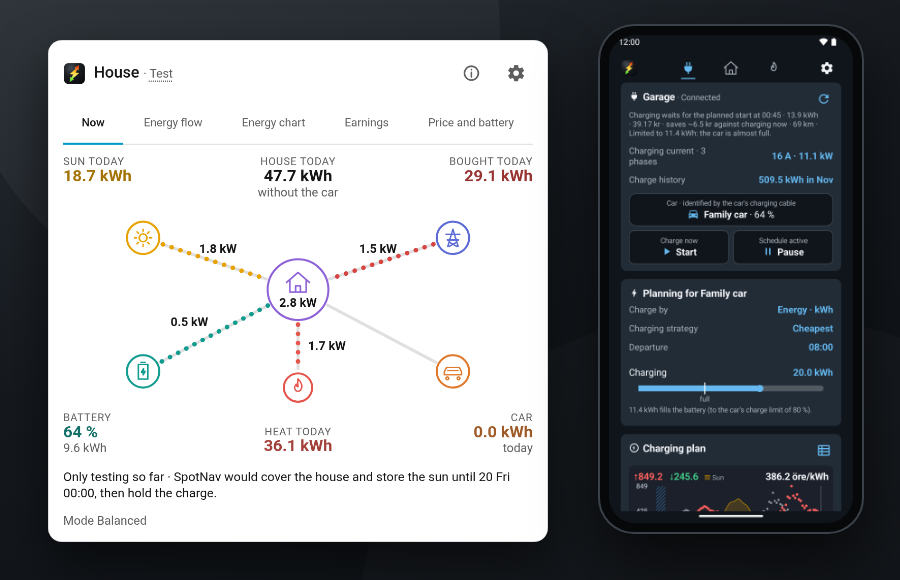

# The SpotNav app

The SpotNav app for Android shows your chargers, the house and the heat on your phone. It talks to your own Home
Assistant. Get it on [Google Play](https://play.google.com/store/apps/details?id=se.sensnology.spotnav); the source
is on [GitHub](https://github.com/henrikekblad/spotnav). The app has its own user guide.

## Pair the app

1. In the app, choose **Log in to Home Assistant** and enter your Home Assistant address.
2. The app shows a six-digit code. Home Assistant shows a new item under **Settings → Devices & services**, named
   after the phone, with the same code.
3. Check that the codes match and choose **Approve**.

A pairing request expires after five minutes. Start again on the phone if it does.

No Home Assistant password or token is stored on the phone. Approving hands the app one private webhook per
charger. Treat it as a secret: anyone with it can control that charger.

A home needs at least one SpotNav charger to pair the app.

## What the app can do

Over the charger's webhook the app reads and changes the same things as the cards:

- **Charging**: the plan, start, stop and pause, the car, the charge history and the prices.
- **House**: the live flows, the energy history and the battery plan. It can change the battery mode.
- **Heat**: the wanted temperature, home or away, the cooler night, offsets, and the **Hot water now** button.

Settings that need an administrator, such as **Battery control** and **Control the heat**, are changed in Home
Assistant only. The app shows them read-only.

## Notifications

The app can show SpotNav's notifications itself, woken instantly. See
[Notifications](notifications.md#instant-notifications-in-the-spotnav-app).

## For developers

The webhook and its actions are described in [Apps and API](api.md#charger-webhook).
