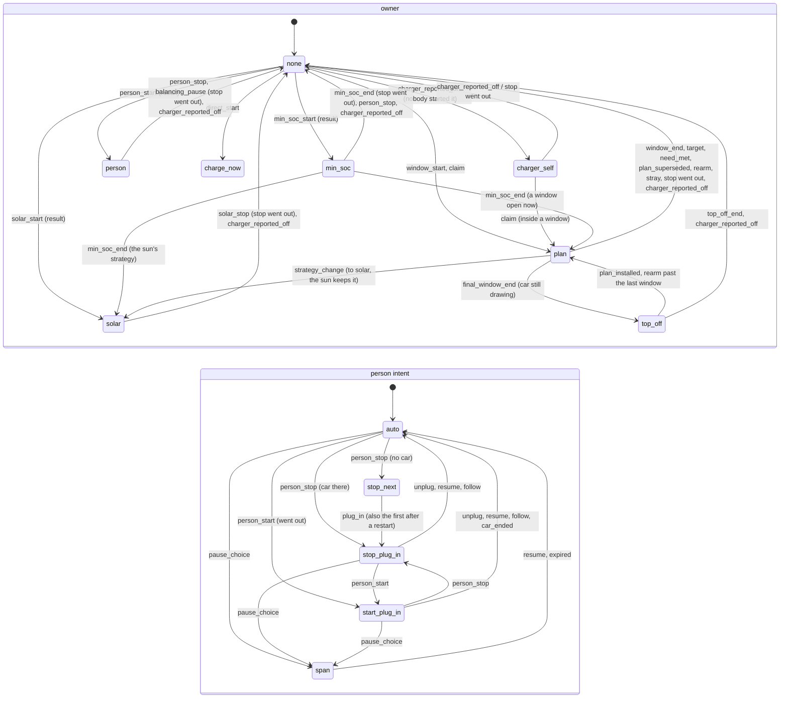

# Charge ownership: the session model

> **Developer documentation.** Who owns a charger's charge and which person intent holds is one record per charger,
> changed only by one pure decision. Names and fields below follow the code.

For developers. Who owns a charger's charge, and which person intent holds, is one explicit record (`ChargeSession`)
and one pure decision (`decide`). The controller (`execution/controller.py`) and the execution boundary
(`execution/auto_execution.py`) feed every happening to the decision through a runner (`execution/session_runner.py`),
act on the commands it decides and read ownership from the record. How it came to be is at the end.

## The session (`core/session.py`)

`ChargeSession` is one frozen record per charger, serialised as JSON with a version field. Nothing else holds any of
it: the controller's accessors (`_owner_origin`, `_is_plan_charge`, `_balancing`, `_safety`, `_c7`, `_car_ended`,
`_hold_state`, `_plugged`) are read-only views of it (`execution/ownership_state.py`).

| Field | Meaning |
|---|---|
| `plugged` | The last connection the charger stated (`None` until one is known, as after a restart). |
| `owner` | `none`, `plan`, `solar`, `person` (a Start through the execution boundary), `charger_self` (it began by itself), `top_off` (past the plan's last window), `charge_now` (a start through the controller with no boundary). |
| `manual` | A person's Start or Stop pausing Auto for the plug-in session: `action` and `scope` (`plug_in`, or `next_plug_in` for a Stop given with no car). |
| `span_pause` | A pause the person picked for a span (`next_period`, `until_tomorrow`, `until_resumed`). Never beside `manual`. |
| `held`, `overridden` | The hold of a charge that began by itself outside a window, and a person's override of it. |
| `car_ended` | The car ended a charge by itself in this plug-in (R3): a person's, or the plan's in an open window (`car_ended` with `plan`). One record (`CarEnded`): when, its level read then (never an estimate), which car was read, and what the plan waits for (`CarEndedWait`: the target then, the level it ended at, whether that was an estimate). Version 2 of the record; version 1 kept only the instant (`car_ended_at`) and is still read. |
| `balancing_paused`, `paused_origin` | Load balancing holds a charge back, and whose it was. |
| `held_for_safety`, `safety_stopped_at` | That hold was a safety stop, resumed no sooner than its gap. |
| `hold_stop_*` | The stops under a person's Stop (C7): when they went out, the last try, the give-up, one on its way. |
| `pending` | A command the core asked for whose result has not come back. |

## Events, commands and the decision (`core/events.py`, `core/ownership.py`)

`decide(session, event, now) -> (session, commands)` is pure, deterministic and total. An event carries the facts
the decision needs that are not the session's own (the plan's windows, the sun's phase, what the charger reports).
Commands are intents: `Start(reason)`, `Stop(reason, clear_schedule)`, `Keep()`, `Notify(code)`. What became of a
start or stop comes back as `CommandResult(executed, balancing_held, unobserved)`, and only then does the owner
change: a stop that never went out keeps the owner (I4), a start that never went out owns nothing.

Events: `plug_in`, `unplug`, `connection_unknown`, `window_start` (timer, re-arm, plug-in, or `retry`: a start that has not taken sent again, decided as a plug-in's), `window_end`,
`final_window_end`, `rearm` (outside every window, or past the last), `person_start`, `person_stop`,
`direct_start`/`direct_stop` (no boundary), `resume` (resume, follow, an expired span pause), `pause_choice`,
`strategy_change`, `solar_start`, `solar_stop` (also the take-over of a self-started charge), `min_soc_start`,
`min_soc_end` (the car's minimum charge level), `charger_reported_on`,
`charger_reported_off`, `car_ended` (a person's charge, or with `plan` the plan's: the car stopped taking it in an open
window; a car full for the plan then also gives `target_reached`, or `need_met` without a target; one that ended the
plan's charge short of the target on a level nobody read then makes the plan wait for the car's level; the event
carries the record's facts: the level read then, the car, the wait), `car_level_read` (a level read after the end that
is not full for the plan ends the wait), `charger_reported_unreadable` (a report whose control cannot be read, fed when it states no car: it decides nothing of the charge and only ends the hold), `balancing_pause`, `balancing_resume`, `balancing_dropped` (the regulator
finds the charge it holds back no longer wanted), `target_reached`, `need_met`, `plan_superseded` (a settings change
answered by a wait: the plan's own charge is stopped, as for `need_met`),
`top_off_end`, `plan_installed`, `plan_dropped`, `restart`, `timer`, `command_result`.

The car-ended rule (R3, `ownership.car_ended_holds_window`) decides from the session's record and the car facts
(`CarFacts`, `events.CAR_FACTS`) on `window_start`, `charger_reported_on` and `recheck`: the plan's target, its car, the
level a car read at the end must have reached to be known full (the car's ceiling when the plan charges to it, else the
target), and the car's level read now, when, and whether it says full. A car known full holds every later window of
the plug-in unless its level dropped by `SOC_DROP_PCT` since (the sun's hysteresis); else a plan that waits for the
car's level holds every window until a level read since the end is below the target (a target raised above the one it
ended at, or another car's plan, waits for nothing); else only the window open at the end holds. The controller reads
the car's level only when the rule reads it (`car_ended_reads_level`): a reading may move its estimate's anchor.

The rules are today's (`plans/ha_manual_override_and_fixes.md` and its three review rounds): the gate every
automatic decision asks, the manual pause and its scopes (C1, C2, C6), C7 with its gap and give-up (R5), the
car-ended rule (R3), load balancing's resume of a person's charge (C5, R4, P3), the hold, the claim, the stray
stop, the re-arm, the window ends, the top-off, the target and need-met stops, and the sun's start, stop and
take-over: the core began as a copy of the logic before it, and was then decided on rule by rule. Decided since: a
readable off report with no start of ours on its way
leaves the charge nobody's, whoever owned it, so a charge the charger later begins by itself does not inherit the
ended one's owner (inside a window the plan claims it again). A claim sends nothing and keeps a balancing pause,
as today's `_claim_locked` always did: a charger that reports its charge once more before it answers a pause is
still the charge load balancing holds back (the night of 2026-11-01). A window's end stops only the plan's own charge (I3):
a person's Start, a Charge-now start and the sun's charge go on, and so does one load balancing holds back for
them; the last window's end then ends the plan with no stop and no top-off. The re-arm outside the windows (a new
plan installed between windows, a restore, a follow) spares the same charges: only the plan's own charge is the
plan's to stop. A charge balancing held back that was nobody's is resumed as nobody's (the charger's own once seen
charging), not as a Charge-now start. A window's end at which the next plan takes over (the execution boundary holds
it, waiting for that boundary, with a window open then: a best-effort plan ending at its departure while the next
departure's plan begins) stops nothing and records no end (`continued` on `window_end` and `final_window_end`;
`ChargingController._successor_continues`): the boundary installs the next plan at once, and its re-arm keeps the
charge. Installed first, the next plan cancels the end's timer and keeps the charge the same way, so the order of
the two does not matter; one that is not installed after all leaves the end as it always was. A strategy change
hands a running charge over instead of stopping it: to `solar`, the plan's charge goes to the sun with no stop when
the sun's rules keep it (`sun_keeps` on `strategy_change`: the surplus at or above the charger's stop level on the
reading at hand, and, running beside the plan, its own state `on`, never `disarming`), and is stopped once
otherwise. The other way, a plan window open when the sun runs a charge takes it over at its start
(`window_start`, no command), and the sun leaving it does not stop it. A charge started by hand (owner `person` or
`charge_now`, `WINDOW_START_SPARED`) is never taken over by a window's start, whatever its trigger: the owner is kept
and nothing is sent, so the window's end does not stop it. A person's intent normally holds the window back already;
this covers a restart that read the person's owner but not their intent (Home Assistant died between the Start's own
save and the settings store's pause). The claim, the stray stop, the re-arm and the window's end leave both alone too.
The car's minimum charge level (`execution/min_soc_floor.py`) is an owner of its own, `min_soc`: while the car's
known state of charge is below it, `min_soc_start` starts the charge at once at the full current set (also one the
plan or the sun runs, or one the charger began by itself), but never through a pause a person chose or their Stop,
and never a charge a person started. A window's end, a re-arm, the hold, the stray stop, the sun's stop and a
strategy change leave it alone. At the floor `min_soc_end` hands it to a plan window open now or the sun with no
command (`handed_to`), or stops it once.

## The runner (`execution/session_runner.py`)

`SessionRunner` is the one place `decide` is called for a charger. At each happening that may change who owns the
charge or which person intent holds, or send a start or stop because of it, the controller or the boundary opens a
feed (`begin`), reads the event's facts right before the decision (never across an `await`), and takes the core's
verdict (`verdict(event, token)`, or `begin(early=event)` for an event whose facts are all known up front: a plug-in,
an unplug, a person's Start or Stop, a start through the charger's own entry, load balancing's pause). What happens
inside the feed (a report that lands while the command is on its way, a task Home Assistant starts eagerly) is a feed
of its own, decided when it happens: a command in flight is the session's `pending` until its result comes back. The
feed closes with `end(token, event, outcome=...)`, which feeds back what became of the start or stop the core asked
for (`CommandOutcome`, as the core's `CommandResult`); a feed that ends with nothing told means its command did not go
out. Between a start or a stop of ours going out and its feed's end the owner reads as that command makes it
(`ownership.owner_as_sent`, `ChargingController._command_unfed`). Open feeds are counted per asyncio task: once none is
open, readers are told an owner that changed after the feed's own notification (`_owner_settled`) and the session is
handed to the keeper of the stored record (`_persist_session`); and a command through the controller's entry inside a
boundary's feed is that feed's, not an event of its own (`depth`). A person's Start's result is decided as soon as
its command returns (`SessionRunner.result`), before the boundary stores their pause, so a balancing pause landing
meanwhile holds the person's charge back; a balancing pause's stop whose result comes back while a start asked for
after it awaits its own holds nothing back: that start ends it, as a start always did.

Every decision site acts on the verdict alone:

* a window's start (timer, re-arm, plug-in, retry), its end and the last one's (with the top-off), the re-arm outside
  the windows and past the last, the need met, the top-off's end, load balancing's resume, a report's hold, claim and
  stray stop, the stop under a person's Stop (C7) and its give-up, the sun's start, stop and take-over, the floor's
  start and end, and a strategy change's stop;
* a task a report or a timer spawns (the hold's stop, a stray charge's stop, the claim of a window charge, the stop
  under a person's Stop) decides again under the boundary's lock and the operation lock: a `Recheck` event, whose
  verdict sends its command;
* a person's Stop takes the plug-in session the core decides, and a plug-in or an unplug leaves the manual pause the
  core decided for it (`core_connection_manual`).

A person's own Start, Stop, pause and resume are their commands: they go out as asked, and the core decides who owns
the charge and which intent holds from them. Load balancing's pause and safety stop never wait for the core: the site
regulator's `_regulated_stop` sends them whatever the core decides, and the core is only told (`balancing_pause`,
decided before the stop goes out, its result after), so the fuse is never left unprotected.

The person intent stays persisted where the card and the gate read it: the boundary's `PauseIntent` in the Auto
settings store. The session's `manual` and `span_pause` are the decision's copy; the boundary writes `PauseIntent` from
the core's decisions, and the two are checked equal after such a write (`check_intent`): a difference is a failure,
and the session takes the boundary's. Whether an automatic decision may act and whether a person's Stop holds the
charger off are read from the session (`ownership.automatic_allowed`, `held_off_by_person`).

## Failures

A decision that could not be taken is a failure (`SessionRunner.failed`): `decide` raised, the facts for an event could
not be read, the stored session could not be read, or the person intent the boundary wrote differs from the session's.
Each one:

1. logs a warning once per (charger, where, event kind) per run, then counts silently (`counts["failures"]`, the
   coverage tally's `failures`, diagnostics and the debug bundle);
2. raises the Repairs issue `core_decision_failed_<entry_id>` only when three fall within a day on one charger
   (`repairs.CoreFailureRepairs`), gone after a day without one and at the charger's unload or removal;
3. acts as the core's `Keep`: nothing automatic is sent for that event, the session is left as it was, and the next
   event decides again. A plug-in or an unplug whose decision failed still moves the connection the session keeps
   (what the charger stated), so the reports after it do not feed it again.

## Stored state and restart

The core's session is kept across restarts as one versioned record per charger (`charge_session` in the charger's
store, `ChargeSession.to_store`), leaving out what a restart clears anyway (`TRANSIENT_FIELDS`). Today's ownership
keys (`plan_charge`, `charge_origin`, `balancing_pause`, `hold`, `car_ended_*`) are still written beside it, derived
from the session, for one more release, so a rollback to the release before reads a correct state; the release after
stops writing them. One writer (`ChargingController._async_save`) writes the record and the keys together. A change of
the owner or of the person intent is saved at once, in a task off the decision's path; any other change by the first
decision at least `SESSION_SAVE_DELAY_S` after it, by any other save, at Home Assistant's stop
(`async_flush_session`) and at an unload's shutdown. A report that changes nothing stored writes nothing.

At a restart the core decides from its record alone. A charger with no record (one an earlier release ran with the
previous logic), one whose record cannot be read (a failure, told), or one an earlier build's order marks say is older
than its keys (`charge_session_order`, read once and no longer written) is migrated once from today's keys by
`core.migration.migrate_from_keys`, which reads the stored dict only (the owner, a top-off, load balancing's memory,
the hold, the car-ended record), and written at once. The person intent is the boundary's stored pause in both cases
(or a `person_stopped` an older release stored), and whether the charger charges by itself (`charger_self`) is seen
again, not stored. An entry that still carries `core_ownership` has it dropped at setup, before the controller reads
it and without a reload, with an info line in the log if it had kept the previous logic.

## Diagnostics, coverage and replay

Diagnostics and the debug bundle (version 9) carry `ownership`: the counts (`events`, `quiet`, `errors`, `failures`,
`last_failure`), the session, and the last 200 events (facts only: no entity ids, no secrets), each with the session
it was decided from (`pre`), the commands, the result and its place on the decision clock (`order`, `early`). A
charger's report of its control is recorded only when the core decided something or something moved (`quiet` counts
the others). `coverage` is a tally per event kind kept across restarts (`execution/ownership_coverage.py`): the events
decided, errors and failures, when one was first and last seen, a window start's triggers, per release, with the
release before under `previous`; the comparison's counts of the earlier releases stay in its shape at zero.
`core/replay.py` feeds a bundle's events to the core again (`python -m custom_components.spotnav.core.replay
[--no-line-up] bundle.json`), and still reads the bundles before version 9 (`ownership_shadow`, with what the previous
logic did).

## How we got here

Before the core, who owned a charge was the product of about fifteen fields across the controller, the window hold and
the Auto settings' pause. Step 1 ran the core beside that logic in shadow mode: fed at every happening, lined up with
the controller's fields before each event, compared after it, never acting, with every disagreement and drift kept in
the debug bundle and a test run that failed on any. Step 2 let the core decide by default, with a per-charger way back
under **Configure** (`core_ownership`), the previous logic still computed beside it and compared, and its failures
surfaced. Steps 3 to 8 (the core end state plan) moved one group at a time into the session (C7 and the safety hold,
load balancing's memory, the hold's memory, the car-ended record and the connection, the owner), then restarted from
the session alone with one store writer. The deletion step removed the previous logic's branches and rule helpers, the
line-up and the comparison (drift, mirror drift, disagreements, differing verdicts, write-backs, the queue of feeds),
the controller's mirrored fields and the way back; a failure since sends nothing automatic instead of handing the
event to the previous logic.

## Tests

* `tests/test_core_ownership.py`: table tests of every rule.
* `tests/test_core_properties.py`: Hypothesis stateful tests over random event sequences (a person's Stop holds, one
  owner and one pause, I4, a person's Start is never stopped by automation, the pause ends at the unplug, a restart
  changes nothing).
* `tests/test_core_migration.py`: `migrate_from_keys` for each owner, a top-off, a balancing pause, a held session, a
  car-ended wait, `person_stopped` and the boundary's pause.
* `tests/test_core_replay.py`: replay of a synthetic bundle and of a real charger's recording, and the runner's own
  guarantees (bounded, never raising, a failure deciding nothing, a feed inside another decided when it happens).
* `tests/test_core_failures.py`: failures warned once, Repairs at the third within a day and gone after a day, nothing
  sent for a failed event, the fuse's stop going out all the same.
* `tests/test_core_ownership_option_gone.py`: an entry that had kept the previous logic upgrades with its running plan
  charge kept, and Configure no longer offers the choice.
* `tests/test_core_drives.py`, `tests/test_core_owner.py`, `tests/test_core_balancing_memory.py`,
  `tests/test_core_hold_memory.py`, `tests/test_core_car_ended_memory.py`, `tests/test_core_recheck.py`,
  `tests/test_core_plan_ends.py`: each group in the controller and the boundary: what sets, keeps and clears it, the
  keys saved derived from it, restarts in both kinds, recordings replayed with no line-up.
* `tests/test_core_session_store.py`: the stored record: round trip, migration from today's keys, an unknown version,
  an earlier build's order marks, one writer, no save at every report, and the core taking over at an update during a
  plan's and the sun's charge.
* `tests/test_ownership_access.py`: the controller keeps no ownership field of its own, and its accessors are read-only.
* Every restart test runs twice (`both_restarts`): after an unload (`World.restart`) and as Home Assistant's own
  stop, which unloads nothing (`World.ha_restart`).
* Every test fails on a failure of the core or an error of its runner (`tests/conftest.py`, `core_never_fails`), unless
  marked `core_failure_expected`.
