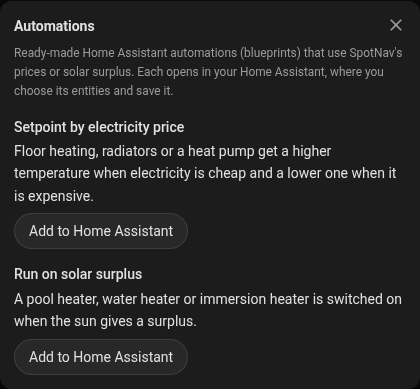

# Automations

SpotNav ships two Home Assistant **blueprints**: ready-made automations that use SpotNav's
[electricity price](price-device.md) and a site's solar surplus for the rest of the house. You import a
blueprint once, then make as many automations from it as you like, each with its own entities.

| Blueprint | What it does |
|---|---|
| [Setpoint by electricity price](#setpoint-by-electricity-price) | Floor heating, radiators or a heat pump get a higher temperature when electricity is cheap and a lower one when it is expensive. |
| [Run on solar surplus](#run-on-solar-surplus) | A pool heater, water heater or immersion heater is switched on when the sun gives a surplus. |

## Importing a blueprint

Use the button under each blueprint below, or, as an administrator, the card's **Card settings**,
**Support**, **Automations**, where each has an **Add to Home Assistant** button. Either opens
my.home-assistant.io, which forwards to your own Home Assistant (it asks for its address the first
time) and shows **Import blueprint** with the blueprint's address filled in. Choose **Preview** and
**Import blueprint**. Then, under **Settings**, **Automations & scenes**, **Blueprints**, choose the
blueprint and **Create automation**, pick your entities and save.

The blueprints are fetched from this repository's main branch. Home Assistant keeps the copy you
imported; **Re-import blueprint** in its menu fetches the newest one.

## Setpoint by electricity price

Sets one or more thermostats from the electricity price's **Cheap now** and **Expensive now** sensors. The
temperature is chosen in this order, the first that applies:

1. **Away**: the away entity is in its away state → the away temperature.
2. **Price now** is above the max price → the expensive temperature.
3. **Cheap now** is on → the cheap temperature.
4. **Expensive now** is on → the expensive temperature.
5. Otherwise → the normal temperature.

It runs when one of these sensors changes, when Home Assistant starts and at a regular interval. A
thermostat is written only when its setpoint differs, one that is unavailable is skipped, and one that
cannot be set does not stop the others. A setpoint you change by hand lasts until the next run, at most
the interval.

| Input | Default | |
|---|---|---|
| **Thermostats** | | Climate entities, one or more. |
| **Cheap now**, **Expensive now** | | The electricity price's binary sensors, for example `binary_sensor.electricity_price_se4_cheap_now`. How many hours count as cheap or expensive is the price's own **Cheap hours per day** and **Expensive hours per day** ([how they are chosen](price-device.md#how-the-hours-are-chosen)). |
| **Price now** | | The electricity price's `sensor.electricity_price_se4_price_now`, with fees and VAT. |
| **Max price** | 0 (off) | Above this price per kWh, in the unit of Price now, the expensive temperature is used whatever the hours say. |
| **Cheap**, **Normal**, **Expensive temperature** | 21, 19, 17 °C | |
| **Away entity**, **Away state**, **Away temperature** | none, `armed_away`, 17 °C | Optional. Any entity: an alarm panel (`armed_away`), a person or a group (`not_home`), an input boolean (`on`). |
| **Also run every** | 15 minutes | 5, 15 or 30 minutes, or once an hour. |

### Example: floor heating in SE4

Three floor-heating thermostats (`climate.hall`, `climate.bathroom`, `climate.kitchen`) and an alarm panel
(`alarm_control_panel.home`):

- **Thermostats**: the three; **Cheap now**, **Expensive now** and **Price now**: the SE4 electricity price's.
- **Cheap** 21 °C, **Normal** 19 °C, **Expensive** 17 °C.
- **Max price** 1.5 (kr/kWh): on a day when even the ordinary hours cost more than that, the floors keep to 17 °C.
- **Away entity** `alarm_control_panel.home`, **Away state** `armed_away`, **Away temperature** 17 °C.
- **Also run every** 15 minutes.

With the electricity price's default 6 cheap and 4 expensive hours a day, the floors store heat in the
cheapest quarter of the day and coast through the most expensive hours. Floor heating in a concrete slab
is slow, so a difference of two degrees either way is felt little; radiators react faster and suit a
smaller difference.

### Heat pumps

Give a heat pump a lower or higher **setpoint** with this blueprint; do not switch it on and off. A heat
pump that is started and stopped by the hour wears its compressor and runs less efficiently than one
that is allowed to modulate.

## Run on solar surplus

Switches a load on and off from a SpotNav site's **Solar surplus** sensor (see
[Site and load balancing](site-and-load-balancing.md#solar-and-forecast-settings)), so it needs a site
whose solar surplus can be measured. It is switched on when the surplus is at or above the on threshold
and off when it is at or below the off threshold. The surplus is never below zero: 0 means the site
takes power from the grid. A minimum on time and a minimum off time keep it from switching back and
forth when a cloud passes. It runs when the surplus changes, every 5 minutes and when Home Assistant
starts; it does nothing while the surplus is unknown or the load is unavailable.

| Input | Default | |
|---|---|---|
| **Solar surplus** | | The site's sensor, for example `sensor.home_solar_surplus` (W). |
| **Load** | | A switch, an input boolean, or a climate entity (turned on and off). |
| **On at surplus** | 3 kW | About the load's own power, so that it runs on the sun and not on the grid. |
| **Off at surplus** | 0 kW | 0 switches off as soon as the site takes power from the grid; a little above 0 keeps a margin. |
| **Minimum on time**, **Minimum off time** | 10 and 5 minutes | |
| **Window starts**, **Window ends** | 00:00, 00:00 (no window) | With a window the load is only switched on inside it, and switched off at its end. |
| **Allowed when on** | none | Optional input boolean or switch: while it is off nothing is done, so you can run the load by hand. |

SpotNav counts what its own chargers draw as part of the surplus, so a load run by this blueprint comes
before a car that charges on [Solar](strategies.md#solar): the car's current goes down when the load
starts. Use a window, or the allowed entity, when the car should have the sun first.

### Water heaters and legionella

A water heater or an immersion heater that only runs on the sun can stand lukewarm for days. Keep the
heater's **own thermostat at 60 °C or more**, so the water is heated through when it runs, and let it
also heat from the grid at least once a week if the sun does not reach 60 °C. This blueprint does not
see to that; it only switches the power on and off.
