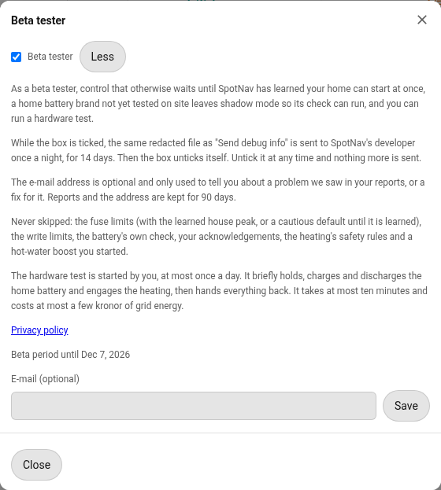

# Beta testing

An administrator can make the installation a **beta tester**: **Settings → Support → Beta tester**. It is off by
default. Its **Read more** says the same as this page. The hardware test (below) is a row of its own beside it,
**Settings → Support → Hardware test**, with its own dialog.

## What it unlocks

- Control that otherwise waits until SpotNav has learned your home can start at once. An example is the hot-water
  gate's week of shadow ([Hot water](hot-water.md)).
- A home battery brand not yet tested on a real plant leaves "shadow only", so its check can run
  ([Home batteries](home-battery.md)). Control still starts only after that check has passed. FoxESS, EcoFlow and
  Marstek need more than beta: a passed hardware test and a control code
  ([Becoming a tester](home-battery.md#becoming-a-tester-foxess-ecoflow-marstek-solis)).
- Control that a beta period started stays on after the period ends.

## What it never skips

- The fuse limits, with the house's learned peak per phase, or a cautious default until that is learned.
- The daily write limits.
- The brand's own check that every write reads back.
- Your acknowledgements, such as taking over Sigenergy's AI mode.
- Turning on a brand's control entities only after your confirm.
- The heating's safety rules.
- A hot-water boost you started.

## What is sent

While the box is ticked, SpotNav sends the same redacted file that **Send debug info** sends
([Troubleshooting](troubleshooting.md#send-debug-info)), marked as a beta report.

- Once a night, at a time of its own for each installation, for **14 days**. For a battery tester the reports run
  until 30 days after the control code was entered
  ([Becoming a tester](home-battery.md#becoming-a-tester-foxess-ecoflow-marstek-solis)).
- Then the box unticks itself and Support says "The beta period has ended – nothing is sent any more". There is no
  alert.
- Untick it at any time and nothing more is sent.
- A report that fails is skipped, not sent again later.
- You may give an e-mail address (beside its **Save**). It is optional and used only to tell you about a problem seen
  in your reports, or a fix for it. It is the installation's one address: an address given with **Send debug info**
  is the same one, and either dialog shows it filled in.
- Beta reports and the address are kept for **90 days**, then deleted.

See [Privacy](privacy.md) and the [privacy policy](https://spotnav.sensnology.se/privacy).

## The hardware test

**Settings → Support → Hardware test** shows the last result and its day (or "Not run"); its dialog's **Run hardware
test** tests your plant the way SpotNav controls it, then hands everything back. Any administrator can run it, beta
tester or not. The row is not shown on a site with nothing to test (no battery or heating control) and no earlier
test.

- The home battery holds, takes a small charge from the grid (under the fuse cap), discharges to the house and is
  handed back.
- The heating's control path is engaged for a minute and released.
- Each step is read back and shown as it runs.
- Any step that fails, or a write that does not read back, ends the test and hands everything back at once.

It takes at most ten minutes and costs at most a few kronor of grid energy. Only you start it: at most once a day
per site, and once more after a SpotNav update or a new plant firmware. **Pressing Start is all you do.** A test with a
battery part waits by itself for a moment that suits every step (the house using more than the sun gives, so the
battery covers it; its level between 30 and 80 %; no car charging; room under the fuse) and runs then; the dialog
says when that is likely ("Runs by itself, likely from about 17:00"). It waits up to three days. A step that could
not be judged (no room under the fuse, the sun came out) runs again by itself at the next suitable moment, up to
three times. **Stop the test** ends a waiting test too.

A battery brand's **first** test on your plant (FoxESS, EcoFlow, Marstek, Solis and Deye/Sunsynk wait for it before SpotNav writes
anything) starts only between 08:00 and 21:00. When it starts, each phone that is on for SpotNav's notices gets one
notification, "Hardware test of the battery is running now (about 10 min)", with a **Stop the test** button; it is
taken off when the test ends. Later checks after an update run by themselves, at any suitable hour, and tell no one.

While the battery part runs, SpotNav holds every charger on the site stopped: no plan, sun or Start starts one, and
a charge a charger begins by itself is stopped. An OCPP charger is set unavailable meanwhile (the `ocpp` integration's
**Availability** switch) and set back to available afterwards, also at the next start should Home Assistant stop in
the middle. A charge that starts in those minutes is paused. A test with a battery part waits while a car charges.
The chargers are let go as soon as the battery part is over, and a plan whose window is open starts again.

It needs the battery's (or the heating's) control switched on and its checklist done. A part that is not ready is
skipped. The result is then **partial**, or **skipped** when nothing ran, and such a test does not use up the day.
When a part is there but none can run just now (starting, busy, or waiting for an acknowledgement), the dialog says
the test cannot run right now, rather than asking you to turn control on.

The result goes into the debug info (`hardware_test`). With the beta box ticked it is sent by itself. Otherwise the
dialog offers **Send the result to the developer** under the result.
