# The SpotNav card

The card is the day-to-day view of one charger: the price graph, the charging plan, the buttons
and all of the settings. One card shows one charger. [Add it](setup.md#3-add-the-card) from the
card picker, and add one card per charger.

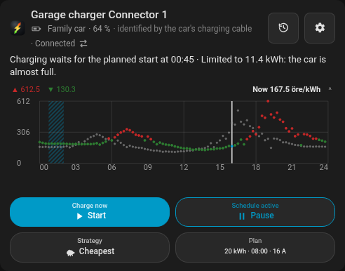

Reading is open to every Home Assistant user, and so are **Start**, **Stop**, **Pause** and **Resume**:
a wall screen signed in as an ordinary user can start a charge or pause the schedule. Changing a
setting (the strategy, the plan and everything in Settings) needs an administrator, except
**Display** in Settings, which belongs to the device and anyone can change. Other users see the
strategy and the plan with a note that only administrators can change them, unless an administrator
turned on **Let users who are not administrators change strategy and plan** for the charger (see
[Charger entities](#charger-entities)); then they change both as an administrator does.

The card speaks the language set in your Home Assistant profile (see
[Translating SpotNav](translating.md)). Other than English, the words are loaded from Home
Assistant when the card starts, so for a moment the card shows an empty loading line rather than
English. Change the language in your profile and the card follows once the new words are in. If they
cannot be loaded, the card is in English until the page is reloaded.

## Header

The header shows the charger's name and three icons.

- **About this card** (the information icon) opens **What this charger can do**: automatic price
  planning, dynamic current limit, load balancing, and vehicle state of charge and target, each
  marked available or unavailable for this charger. An item that is unavailable here cannot be
  switched on from the card. The list is taken from what the integration reports for the charger.
- **Charge history** (the clock icon) opens [the charge history](#charge-history).
- **Card settings** (the gear icon) opens [the settings popover](#the-settings-popover). It is shown to a
  user who is not an administrator only when the popover holds something they may change.

When something needs attention, a banner says so: a notice in a neutral colour, or a message in
red when something must be fixed before charging can be planned. The banner counts the items to
review and opens the full list with the integration's own wording.

## The price graph

The graph shows the price of every interval per kWh, in the price area's small unit (öre, cent) or, if
chosen under [Display](#display), its main unit (kr, €).

- By default (**Day**) the horizontal axis is one local day, labelled with the hour every three hours
  (00, 03, 06 ... 21, 24), with a line every six. Today is drawn over tomorrow, and an earlier day is
  subdued. Tomorrow's prices appear once they are published, usually
  in the afternoon.
- With **From now** (see [Display](#display)) and tomorrow's prices published, the axis runs in real
  time from the start of the current hour to the end of the last published day, about 32 to 35 hours,
  with the now line near the left edge. Every interval sits at its own time: nothing that has already
  ended is drawn, tomorrow is drawn like today, and a charging period across midnight is one band.
  The hours are labelled every three hours, with a line every six, and midnight is a dashed line
  labelled with the new day's weekday and date. On a narrow card the labels come every six hours
  instead, so they never run into each other. Until tomorrow's prices are published, **From now** looks
  exactly like **Day**.

  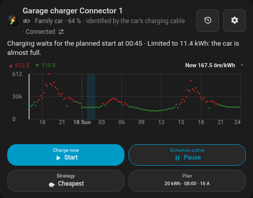

- Bars cheaper than the day's average are marked as cheap and pricier ones as expensive. A line
  marks now, and the current interval is highlighted.
- The plan is drawn on top of the prices. **Scheduled** bands are the charging periods Home
  Assistant has installed and will follow. **Proposal** bands are a newer plan that is ready but
  not installed yet, and are fainter. On **Day**, today's bands are solid and tomorrow's are hatched,
  so a period tomorrow night is not read as one already over just because it sits left of the now
  line. On **From now** every band is solid.
  When a new plan is waiting for the charging window under way to end, the graph shows the
  scheduled band only for that window and the waiting plan's proposal bands after it; the scheduled
  periods it replaces are not drawn.
- A summary line gives the highest price (▲), the lowest price (▼) and the price now. ▲ and ▼ cover
  the prices drawn at full strength: today's on **Day**, everything shown on **From now** (from the
  current hour to the end of the last published day).
- Touch or hover an interval to read its price. With the keyboard, the arrow keys step through the
  intervals, Home and End jump to the ends, and Escape clears the selection. Times follow the
  price area's time zone, and the autumn hour that repeats is shown with its offset.
- Press the summary line to fold the graph into a slim strip on the same axis: the charging
  periods as bars (the ones already over dimmed, tomorrow's hatched on **Day**), the line for now and the
  hours under it, with a dashed line at midnight on **From now**. Press it
  again to open the graph. The choice is remembered per charger in that browser. To start folded
  where nothing is remembered yet, add `chart: compact` to the card's YAML.

### Card options

Besides `type` and `charger`, the card's YAML takes two options for the graph. Each card has its own.

| Option | Values | What it does |
| --- | --- | --- |
| `chart` | `full` (default), `compact` | How the graph first shows where this browser remembers no choice: the full graph or the folded strip. |
| `chart_detail` | `false` (default), `true` | Draws the graph with finer detail: every hour labelled (00, 01 ... 23, and every hour of the range on **From now**, with the new day still named under midnight), about five or six price steps instead of three, smaller points, thinner lines and smaller axis text, and a slightly taller graph. The rest of the card and the folded strip are unchanged. |

`chart_detail` is for a card shown large, such as a wall screen's fullscreen view where the card is
laid out at its usual width and then enlarged: the enlarged graph reads fine-grained rather than
chunky. At normal size its text is small, so leave it off on an ordinary dashboard.

```yaml
type: custom:spotnav-card
charger: 01JABCDEF0123456789ABCDEFG
chart_detail: true
```

## The plan

Under the graph the card lists the charging periods: **Cheapest charging periods** for a
proposal, or **Scheduled charging periods** for the plan that is installed. Each period shows its
day and time, and a period that is running now is marked. The card also states the plan's energy
and cost and, when the vehicle's consumption is known, the distance the charge adds.

A plan that had to buy some energy before tomorrow's prices were published is flagged, because part
of it is charged without published prices.

## The buttons

A row of four cells sits under the plan. Each shows a state and opens or does one thing.

| Cell | What it shows | What it does |
| ---- | ------------- | ------------ |
| **Charge now** or **Charging** | Start when not charging, Stop while charging | **Start** starts a charge now and **Stop** stops it now. Either pauses automatic charging until the car is unplugged (a Start also until the car is full), and the Schedule cell then offers **Resume**. See [Start and Stop](strategies.md#what-every-strategy-shares). |
| **Schedule active** or **Schedule paused** | Pause or Resume | **Pause** suspends automatic charging and asks for how long: **Until the next planned period**, **Until tomorrow** or **Until I resume**. Only the choices the charger offers are listed. **Resume** clears the pause. |
| **Strategy** | The chosen strategy | Opens **Charging strategy**: **Cheapest**, **Solar** and **Hybrid**, see [charging strategies](strategies.md). A strategy that cannot work on this installation is listed with the reason, for example that Solar requires a site that can measure the solar surplus. |
| **Plan** | Energy, deadline and current, for example `20 kWh · No deadline · 16 A` | Opens the plan settings, see [Plan](#plan-settings). |

Start, Stop, Pause and Resume work for every Home Assistant user; the Strategy and Plan cells open
read-only for a user who is not an administrator, unless the charger lets such users change the strategy
and plan (see [Charger entities](#charger-entities)). Start and Stop are disabled while a start or a stop
is waiting for the charger to acknowledge it (at most 30 seconds): the cell then says **Starting…** or
**Stopping…**.

## Status lines

The card words what the integration reports; the integration decides which lines appear and how
serious each is. Examples:

| You see | Meaning |
| ------- | ------- |
| Waiting for tomorrow's prices (~13:45), will plan then. | Prices for the deadline are not published yet; SpotNav plans when they are. The time is the area's expected publication plus 45 minutes, and is left out once it has passed. |
| Buying 12 kWh now, the rest when the prices are published. | The deadline needs hours that are not priced yet, so part of the charge is bought now. |
| Charging is scheduled from 02:00. / Planned from 02:00. | The installed plan, or a plan that is proposed. |
| A new charging proposal is ready. | A newer proposal exists and is not installed yet. |
| Charging waits for the planned start at 22:30 · 16.6 kWh · 17.1 kr · 87 km | A car is plugged in and the installed plan waits for its first window (or a charge that started by itself outside the plan was stopped). The plan's energy, cost and distance follow while they are the installed plan's own. |
| Charging now; scheduled until 05:30. | A charge is running inside a planned period. |
| Automatic charging is paused. / Schedule paused until 07:00. | A pause of the schedule is in effect (a charge may still run beside it). |
| Stopped manually – until the car is unplugged. / Charging manually – until the car is full or unplugged. | You pressed Stop or Start: automatic charging is paused for this plug-in. A Stop given with no car plugged in reads *until the next plug-in ends*; on a charger that cannot tell when a car is plugged in, *until you resume automatic charging*. |
| Stopped at 80 % (estimated, reading 40 min old) | The target was reached; shows the level the charge stopped at and how old or estimated it was. |
| Charging is limited to 10 A by the site's load balancing. | Active load balancing has lowered the current. |
| The home battery charges from the grid and shares the main fuse: the car gets 11 A. / House consumption limits the car to 11 A. | The same, with the cause when SpotNav knows it. |
| Paused – the house is using the whole fuse; trying again at 04:30 | Load balancing paused the plan's charge inside its window for want of room for the car's minimum; it is tried again then ("when there is room" when no time is set; "the home battery charges from the grid and fills the main fuse" when that is why). |
| Charging to the minimum level (30 %) | The car is below its [minimum charge level](target-soc.md#minimum-charge-level), so SpotNav charges at once at the set current; the strategy takes over at the floor. |
| Solar · charging 9 A from surplus | The solar strategy's state: waiting for sun, surplus found and starting soon, surplus fading, charging, or no usable reading. |
| Solar · 1 phase · 2.9 kW | A solar charge the sun has switched to one phase (see *Phase switching for solar* below), with the power it charges at on that phase. |
| Solar · surplus available (4.2 kW) / Solar · no car plugged in | Solar with no car plugged in: the surplus is enough to start a charge (plug the car in now), or it is not. |
| Hybrid · 12 kWh from grid, 8 kWh expected from sun | The hybrid plan's split; with no forecast source it says it plans like Cheapest. |
| The energy meter cannot be read: 6.5 kWh remains, from its last reading. / No energy meter: 3 kWh remains, counted from this charger's recorded charges. | The requested energy is counted without the charger's energy register, see [counting the requested energy](strategies.md#cheapest). |
| Charging was started, but the vehicle is not requesting current. | The connector reports the car is not asking for current. It is an observation only: check the car's charging settings or reconnect the cable. |

<!-- Screenshot to add when available:  -->

<!-- Screenshot to add when available:  -->

<!-- Screenshot to add when available:  -->

## Charge history

Every charge is recorded as a session, from the moment the charger starts charging, whatever
started it, until it stops or the car is unplugged. A pause of a couple of minutes (load balancing,
a window boundary) stays in the same session. The **Charge history** dialog shows one month at a
time, this month first: pick another with the arrows or the list of months that have charges (up to
24 months back). It shows the month's energy, cost, average price, number of charges and solar share,
a bar for every day (the height is the day's energy; the colour is the day's average price against
the month, green for the cheapest to red for the most expensive; hover or tap a bar for that day's energy,
cost, price and solar share), and the month's charges with how each started: a planned window, by
hand, solar surplus, hybrid, or started elsewhere.

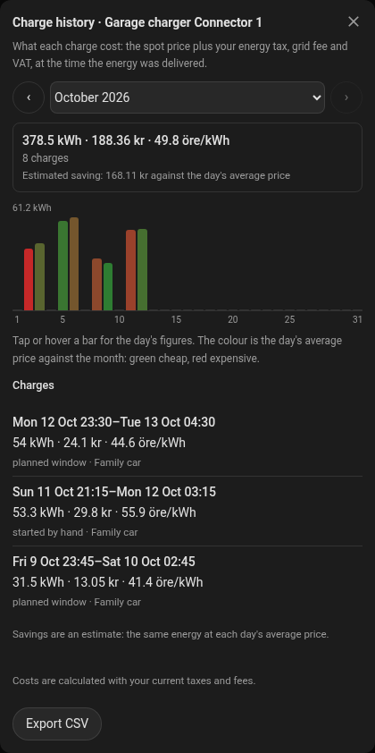

- **Energy** comes from the charger's energy register, or from the power SpotNav integrates for a
  charger behind a smart plug. A charger with neither is **estimated** from the current it was
  asked for, and every figure built on it says so.
- **Cost** is the energy of each stretch of the charge times the effective price in that interval:
  the spot price plus your energy tax and grid fee, times VAT, as in the plan. A charge keeps its
  energy and the spot prices, not a finished cost, so the cost is calculated with your **current**
  taxes and fees every time it is shown: correct a VAT or fee and the whole history follows. Energy in
  an hour with no published price is counted but not priced. A charge recorded by an earlier version
  that only has its cost keeps that cost until its prices can be rebuilt.
- **Earlier charges** are imported once per charger, in the background after start-up, from Home
  Assistant's hourly long-term statistics of the charger's energy register (up to 24 months back, and
  only before the first charge SpotNav recorded itself). Consecutive hours with at least 0.1 kWh form
  a charge. They are priced from the market's day prices (hours with no price yet are counted but not
  priced, and priced on a later start once the prices exist) and marked **imported (hourly)**: the start
  cause and solar share are unknown. They count in every total.
- **Savings** compare with the same energy at the day's average price. It is an estimate, shown
  as one, and is negative when a charge happened to cost more than the average.
- **Export CSV** saves the sessions of the month shown, one row per session, in local time.

Sessions are kept for two years, per charger, and survive restarts. Each charger also has sensors
for the energy and cost this month and last month and for the last charge, which can be used on
Home Assistant's own dashboards and in automations.

## The settings popover

The gear icon opens **Card settings**, built fresh each time you open it. The plan and the strategy
have their own cells on the card; everything else is here, in sections headed by what they are about
(**Electricity price**, **Car**, **Charger · …**, **Site · …**, **Solar**, **Notifications**, **Display**,
**Support**). Each value is one row; an administrator taps a value to open its own editor. **Display**
belongs to this device, and anyone can change it. A user who is not an administrator is shown only the
sections holding something they may change (today **Display**), and no gear icon when there are none.

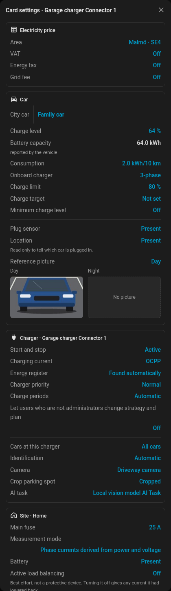

### Electricity price

The area and the VAT, energy tax and grid fee belong to the installation's
[electricity price](price-device.md), not to the charger: every charger that uses it follows a change.
SpotNav makes it from your Home Assistant country and location when the first charger is added, so a
new charger already has an area (see [first-run defaults](setup.md#first-run-defaults)).

The section shows, under its heading, which electricity price this charger uses and how many chargers
use it ("Electricity price SE4 · used by all 2 chargers"; with one charger only its name), and, when more
than one uses it, that a change here applies to every charger using it. Below are the area and the VAT,
energy tax and grid fee as the plan applies them. Tapping the area or a tax opens the editor.

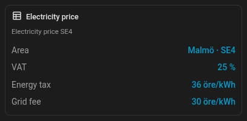

- **Price from** appears when there is more than one electricity price. An administrator chooses
  which one this charger uses; for a charger on a site the choice is the site's, and every charger
  on it follows.
- **Two electricity prices for SE4 with different fees. Use one?** is asked once, to an administrator,
  when an upgrade found an electricity price with the same area as a charger's but other fees (see
  [upgrading](price-device.md#upgrading-from-an-earlier-version)). Each **Use …** button shows that
  price's VAT, tax and grid fee on a second line, so you can see what differs. **Use …** moves every charger and
  site to that one; the other is not removed, and the card says it can be removed under **Devices &
  services**. **Keep both** keeps them as they are. Two prices with the same name are told apart by
  which one this charger uses.
- **Area** decides which prices are used and which taxes are suggested. The list is grouped by
  country and comes with SpotNav itself.
- **VAT** (as a percentage), **Energy tax** and **Grid transfer** (both in the area's smallest
  currency unit) can each be switched off, use the area's suggested value, or use your own value.
  **Reset to suggestion** returns to the suggestion when the area publishes one.
- A line names where the area's prices come from: *Prices from Nord Pool (via Home Assistant)*, *Prices
  from ENTSO-E (your key)*, *Prices from PVPC (Home Assistant)* or *Prices from Octopus Energy (your Agile
  tariff)*. When the area has no source of its own, a notice says what to add instead (**Add Nord Pool**,
  **Add your ENTSO-E key**, **Add PVPC**, **Add Octopus Energy**), with the button for an administrator, and
  the ENTSO-E key's field with its how-to. The key is one for the whole installation. See
  [Prices](prices.md#where-prices-come-from).
- Where the published price already includes VAT, energy tax or grid transfer (all three in Great
  Britain), that component is checked, locked and marked **Included in the price**, and nothing is
  added for it. For Great Britain, **Find my region** looks the region up from a postcode (see
  [Great Britain: Octopus Agile](setup.md#great-britain-octopus-agile)); amounts are in pounds and
  pence and distances in miles.
- How the additions are applied, and what is not included, is in [Prices](prices.md#what-you-pay).

### Vehicle

The **Car** section shows the car this charger plans for. With two or more cars detected it has a tab per car
under its heading; the car planned for is open first, and tapping another tab shows that car's rows.

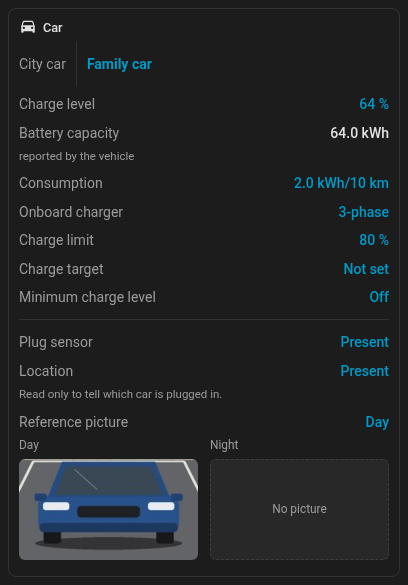

- The **vehicle charge level** sensor, and whether it is chosen automatically. **Change vehicle
  charge level** lets you pick another sensor or go back to automatic detection, which matters when
  a vehicle has several battery sensors.
- **Battery capacity** in kWh (1 to 500), unless the vehicle reports it, in which case it is shown
  as reported by the vehicle.
- **Consumption** in kWh per 10 km (0.1 to 50), used to show the distance a plan adds.
- **Onboard charger**: 1-phase or 3-phase (3-phase until you say otherwise). A charge uses the smaller of
  this and the charger's wiring, so a car with a single-phase onboard charger charges on one phase even
  on a three-phase wallbox.
- **Charge limit**: the limit the car reports, when it has one. Where Home Assistant can write it, an administrator
  can change it: its editor is a slider over the range and step the car's integration takes (50 to 100 % in steps
  of 10 on a Kia, for example; 1 to 100 % when the integration does not say), the value shown large above it.
  Nothing is written until you move the slider and save, and at most once a minute per car; the car takes the new
  limit when its integration next reads it.
- **Charge target**: the car's own target, 0 to 100 %, the same at every charger. Its editor sets it with a slider,
  the value shown large above it. A car with none stored shows **Not set**; its editor opens at the target it is
  planned with (80 %, or the car's charge limit when lower) marked **(default)**, and nothing is stored until you
  move the slider and save.
- **Minimum charge level**: **Off**, or 10 to 80 %. Its editor is a slider whose first stop is **Off**, then 10 to
  80 % in steps of 5. It never goes past the charge target: the track beyond is hatched, with the target marked.
  Below it SpotNav charges at once at full current, whatever the strategy, unless you paused or stopped the charge.
  It needs the car's charge level, and says so next to the value when the car has no level sensor. See
  [minimum charge level](target-soc.md#minimum-charge-level).
- **Wake the car for a reading**: **Off** (the default) or **On**, shown only for a car whose integration can wake
  it (Kia/Hyundai, Tesla Fleet, Teslemetry, Tessie). On, SpotNav asks the car itself to report at a charge's end
  when its last report is old, at most once per charge end and once per half hour. It uses the car's 12 V battery
  and the maker's request limit. See [waking the car](target-soc.md#waking-the-car-for-a-reading).
- **Plug sensor** and **Location**: the car's own "plugged in" sensor and tracker, which tell which car is
  plugged in at a charger more than one car can charge at. Each is **Automatic**, one of the car's entities,
  or **None**. They are read only for that.
- **Reference picture** (with a camera chosen for the charger): the car's day and night pictures for the
  camera, shown as two equal tiles, **Day** and **Night**, each cropped as it is compared (or *No picture*).
  Tapping either opens the reference editor. See [the camera](vehicle-identification.md#the-camera).

### Which car is plugged in?

Shown when more than one car is detected, in the charger's section: **Cars at this charger** and
**Identification** (**Automatic**, **Always ask** or **Off**), and where Home Assistant has a camera and an AI Task
entity, **Camera**, **Crop parking spot** and **AI task**.

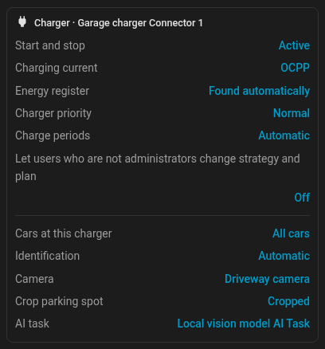

While SpotNav identifies the car after a plug-in, the status line leads with "Identifying the car…" and the car
line says "identifying…".

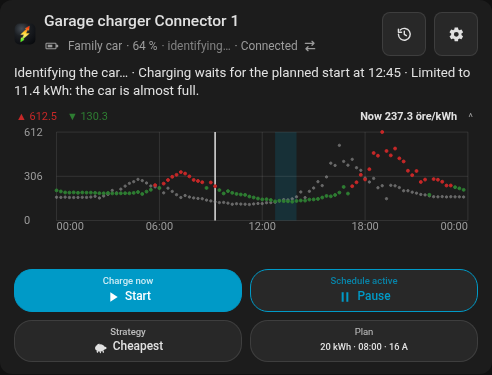

While SpotNav cannot tell which car was plugged in, the card shows "Which car is plugged in?" with one button
per car, the likeliest first; one tap is the answer, the same as on the phones.

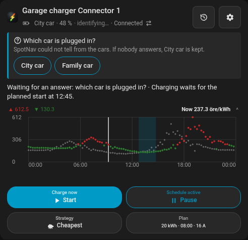

The car line says how the car was decided ("identified by the car's charging cable", "selected manually",
"assumed", ...). With two or more cars at the charger it ends in ⇄ and tapping it opens **Change car**, for
anyone signed in: with a car plugged in it corrects that car; with none it sets the plan's car for the next
plug-in (an administrator's settings write). See [Which car is plugged in?](vehicle-identification.md).

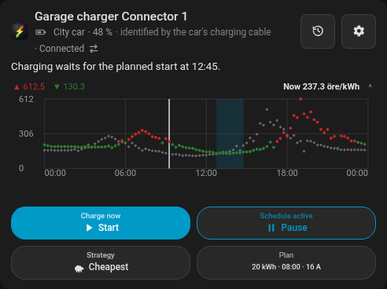

Saving each value asks Home Assistant to confirm it; the card never shows a value the integration
did not accept.

### Phases

The phases a charge uses are not chosen in the Plan dialog. They are the smaller of the charger's wiring
and the vehicle's onboard charger. The Plan dialog says how many ("Charges on 1 phase · nominal power
≈ 3.7 kW") and, when the car limits it, why ("The car charges on one phase."). A charger in a site takes
its wiring from the site, which the charger's entities dialog states ("The charger is wired for 3 phases
(from the site)") with a link to the site's entities; a charger in no site has **Phases the charger is
wired for** (1 or 3) in its entities dialog.

SpotNav also learns the phases from your charges. A charge on three phases confirms the wiring and the car
(a charger in no site whose wiring was never set is set to three phases by its first such charge). When a
car charges on one phase twice running on three-phase wiring, the card asks "This car seems to charge on one
phase. Set its onboard charger to 1-phase?" with **Set to 1-phase** and **Keep 3-phase**; nothing changes
until you answer.

### Charger entities

For administrators. Lists the charger's entities (**Charge control**, **Current limit**,
**Energy register** and **Vehicle charge level**) and how SpotNav controls the charger: how it
starts and stops a charge, how the current is set, where the charging state is read, the charger's
write limits, and whether load balancing can change the current during a charge. If the charger's
own smart mode is on, the card warns because it can fight SpotNav. **Change charger entities** opens
the editor, where a charger on a site also has its **Charger priority** (first, normal or last; see
[site and load balancing](site-and-load-balancing.md)). Under **Energy**, **None** is kept as your
choice: SpotNav then reads no energy register and looks for none, and lists one it finds on the charger
under **To check**.

**Phase switching for solar**, below the priority, is **Off** by default or **Automatic**. It is shown only for
a charger whose integration can switch between one and three phases (Peblar, Lektrico, NRGkick, go-e, Fronius
Wattpilot, and Easee when it is alone on its circuit; NRGkick, Wattpilot and Easee only before a start; see
[strategies](strategies.md#solar)), that is wired for three
phases, on a site with a solar source; no other charger has the row. Set to Automatic, a solar charge with too
little sun for three phases charges on one phase instead of drawing from the grid, and the status then says
so with its power (*Solar · 1 phase · 2.9 kW*). SpotNav then sets the charger's phases itself, so the charger's
own automatic phase mode is not used (an NRGkick needs phase switching allowed in its app). Some cars charge badly
after a phase change: turn it off if your car stops charging. The rules are under [Solar](strategies.md#solar).

**Charge periods**, below the charger's setup rows for administrators, is **Automatic** (the default) or
**1 period** to **8 periods**. Automatic splits the charge only where the saving is worth another start, and
each period is at least half an hour; a number is the most periods a plan may use. See
[strategies](strategies.md#cheapest).

**Let users who are not administrators change strategy and plan**, below it, is **Off** by default. Turn it
**On** for a screen signed in as an ordinary Home Assistant user (a wall screen, for example) that should
also choose the strategy and change the plan: the energy or target and its car, the finish-by time, date and
weekdays, and the current. It applies to this charger. Everything else (the electricity price's area and fees, charge
periods, cars, notifications, the site and this switch itself) stays an administrator's, and
Home Assistant refuses such a change from anyone else even when the card is bypassed.

### Site

The section is headed by the site's name and says whether its settings apply to one charger or to
several. A charger with no site says so.

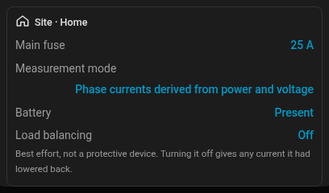

- **Solar priority**: **Car first** or **Battery first**.
- **Solar forecast sources**: the forecast integrations the site may use for Hybrid. Without one,
  Hybrid plans like Cheapest.
- **Load balancing**: a switch for administrators, best effort and not a protective
  device. The card says when it is not available: the charger is claimed by more than one site, no
  charger on the site accepts a current command, or the site's own power measurement is not healthy.
  Turning it off gives back any current it had lowered, and the card reports each charger it
  restored.
- **Change site entities**: the main fuse and its safety margin, the measurement mode, the per-phase sensors, the signs
  of the meter, the home battery power and the maximum measurement age. **Found in Home
  Assistant** lists the grid meters and home batteries SpotNav recognised, with **Use this** to
  apply one. The editor warns about a source that updates more slowly than the maximum measurement
  age and about devices that balance load by themselves. With a Sigenergy battery whose **Grid Import
  Limitation** number is enabled, it also warns ("Two limits on one fuse") when that limit and SpotNav's
  (the main fuse minus the safety margin) differ by more than 1 A per phase.

### Notifications

**Phones** and **Events** say who is told about what; **Change notifications** opens the choice. See
[Notifications](notifications.md).

### Display

How this device draws the card, marked "Only this device": nothing is sent to Home Assistant, and the
choice applies to every SpotNav card in this browser (on other devices and browsers each keeps its own).
**Chart time axis** is **Day** (00–24, tomorrow drawn over today; the default) or **From now** (from
this hour to the end of the last published day; see [The price graph](#the-price-graph)).
**Price unit** is the price area's small unit (**öre/kWh**, **cent/kWh**; the default) or its main unit
(**kr/kWh**, **€/kWh**), named from the area's own currency. It applies to every price per kWh on the
card: **Now**, the highest and lowest price (▲ ▼), the graph's price axis, the readout of a chosen
interval, and the average price in the charge history. The small unit shows a tenth (163,1 öre/kWh),
the main unit two decimals (1,63 kr/kWh), and the axis as many decimals as its range needs. Amounts of
money, such as the plan's cost, are always in the main unit. The choice is not offered for an area
without a small unit. Where the browser cannot store these choices, for example in a private window,
they hold until the page is reloaded and the card then starts on **Day** and the small unit.

## Plan settings

The **Plan** cell opens **Charging plan**. Its title names the car the plan is for, as the app's
planning card does: **Charging plan for EV6**. With a target SoC it is the car chosen under
**Vehicle**, and it changes as soon as another car is chosen, before you save. With energy it is the
car the charger plans for (the identified car, else the target car). With no car known the title is
just **Charging plan**.

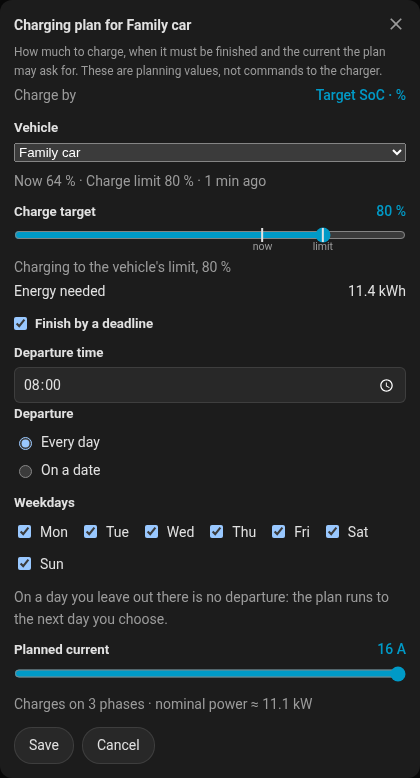

- **Charge by**: a value row showing **Energy · kWh** or **Target SoC · %**. Tap the value to switch
  to the other one; nothing is written until **Save**. The row is only there when a target can be
  planned, that is when the car's charge level can be read or the plan already uses a target. With a
  target SoC, see [target state of charge](target-soc.md).
- **Requested energy**: 0.5 to 100 kWh on the slider, in half-kWh steps; the number field accepts
  more.
- **Finish by a deadline** and **Departure time**. Without a deadline the plan covers the priced
  horizon.
- **Planned current**: the current the plan may ask for, in whole amperes, with the nominal power
  it means for the phases the charge uses (read-only, see below). It is a planning value, not a command
  to the charger.
- With a target SoC: the **Charge target** slider, the vehicle (when there are several), and one line with
  the car's reading: the level now (with ≈ when it is estimated), the car's charge limit when known and how
  old the reading is, for example *Now 75 % · Charge limit 80 % · 8 min ago*. Under the slider is the
  **Energy needed**; a target that is already met says *No charging needed now*, and a target at the car's own
  limit says *Charging to the vehicle's limit, 80 %* once, with no 0.0 kWh row. When the car has a minimum
  charge level, the slider's track is darker from 0 to it, with **min 30 %** under that part. Ticks on the
  track mark the level now (**now**, **≈ now** when estimated) and the car's charge limit (**limit**, only
  below 100 %); a word that would touch another drops to a second line.

If two clients change the settings at the same moment, the card says they changed elsewhere and
offers **Use the server values** or **Apply my change again**; nothing is overwritten silently.
