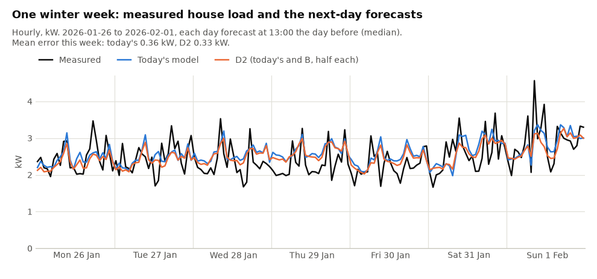
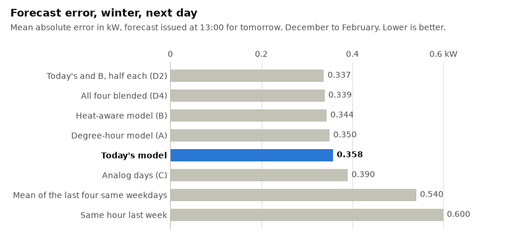
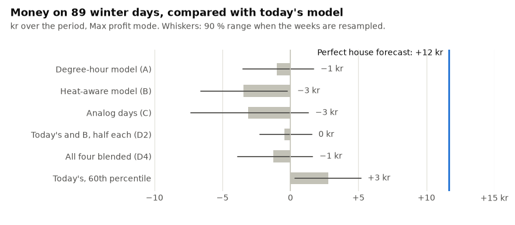
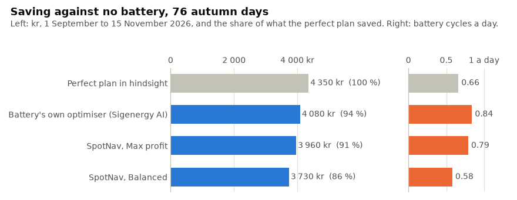
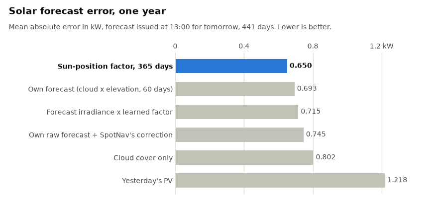

# How the forecasts are tested

SpotNav 3.0 plans the home battery, the cars and the heat from forecasts. This page explains how the house load
forecast was tested, what we tried, what we threw away and why. The model as it works today is described in
[The house load forecast](forecasts.md#the-house-load-forecast); this page does not repeat it.

All numbers come from one house: the developer's own house in southern Sweden (heat pump, home battery, EV).
Read them as one data point, not as a promise (see [Caveats](#caveats)).

## Why the forecast matters, and how much

A plan is only as good as what it expects. If the plan expects the house to draw 1 kWh less than it does during one
of the day's most expensive hours, the battery has too little left for that hour and the house buys the difference at the
top price. The error is real, but it is small money. The question is how small, and whether a better forecast is
worth its extra code.

We measured that. On the developer's house, over 89 winter days, a **perfect** house forecast (the real load,
known in advance) would have earned only **12 kr** more than today's model. So there is very little money in the
house forecast on this house. That is the headline of this page.

## Today's house model, in plain words

For each hour of the coming two days, SpotNav looks at the same hour on similar days: weekdays with weekdays,
weekends (and holidays) with weekends. It reads the last six weeks, and newer days count more: a day two weeks ago
counts half as much as yesterday. Then it takes the typical value of those hours. The battery plan uses the
median (half of the days were lower, half higher). The cars use a figure with some room: three days in four were
lower.

Example: tomorrow is a Tuesday and the hour is 18:00. SpotNav looks at 18:00 on recent weekdays, gives last
week's more weight than the week before, and takes the middle value, say 1.4 kW. If tomorrow is colder than those
days were, and the house really is electrically heated, it adds a little for each degree. If today so far runs
higher than usual, it nudges the rest of today.

## How we test

**Forecast error.** The simplest measure is the *mean absolute error* (MAE): for every hour, how many kW the
forecast was off, ignoring the direction, averaged. An MAE of 0.35 kW means the forecast is on average 0.35 kW from
what happened. SpotNav also gives a band around the figure, from the 10th to the 90th percentile; the band is
good when about 10 % of hours fall below it and 10 % above it. The chart below shows what an error of about 0.36 kW
looks like over one week.

<picture>
  <source media="(prefers-color-scheme: dark)" srcset="images/forecast-experiments/week-dark.png">
  
</picture>

*One real week, 26 January to 1 February 2026, each day forecast at 13:00 the day before. This week's error is close to the winter average: today's model 0.36 kW, D2 0.33 kW.*

**Money.** A small error is no use if it does not change what the plan does. So we also rerun the battery planner on
frozen real days, with each candidate forecast, and count what the day would have cost:

* 76 autumn days (1 September to 15 November) and 89 winter days (December to February).
* The planner runs as it would live. The forecast is *issued at 13:00 for tomorrow*, when the next day's prices
  are published, using only what was known at that moment. It never sees the future. The weather used is the
  forecast that was available then, not the weather that came.
* The result is compared with three references: **no battery**, **the battery's own optimiser** (Sigenergy AI,
  which really ran the battery those days) and **the perfect plan in hindsight** (the best the battery could have
  done if every hour had been known).

Because the differences between candidates are a few kronor, we also resample the days week by week to see whether
a result holds up or is luck.

## Results

Forecast error, next day as issued at 13:00, December to February (lower is better), and money on the winter days
against today's model, in kronor over 89 days (Max profit mode):

| Forecast | MAE, kW | Money vs today's |
| --- | ---: | ---: |
| Same hour last week | 0.600 | not run |
| Mean of the last four same weekdays | 0.540 | not run |
| **Today's model** | **0.358** | **0** |
| Degree-hour model (A) | 0.350 | -1 |
| Heat-aware model (B) | 0.344 | -3 |
| Analog days (C) | 0.390 | -3 |
| Today's and B, half each (D2) | 0.337 | 0 |
| All four blended (D4) | 0.339 | -1 |

<picture>
  <source media="(prefers-color-scheme: dark)" srcset="images/forecast-experiments/error-dark.png">
  
</picture>

*Forecast error per approach, December to February, next day as issued at 13:00. The same figures as the MAE column of the table.*

<picture>
  <source media="(prefers-color-scheme: dark)" srcset="images/forecast-experiments/winter-money-dark.png">
  
</picture>

*Money against today's model over 89 winter days, Max profit mode. Even a perfect house forecast would add only 12 kr.*

What the table says:

* The best candidate (D2) cuts the error by about 6 % in winter. In kronor it is worth nothing: every candidate
  is within 3 kr of today's model over 89 days.
* Against the battery's own optimiser, today's model is about level in winter: 1 672 kr against 1 663 kr, and
  we treat that as within plus or minus 20 kr, the error of the data itself. It is not a win.
* In autumn the battery's own optimiser saved 94 % of what the perfect plan could (4 080 of 4 350 kr over 76
  days). SpotNav, planning with today's forecasts, reached 91 % (3 960 kr), 125 kr less than the optimiser.
  Part of that gap was the data itself (car charging counted as house load in part of it); with that fixed, a
  perfect house forecast would have closed only about 20 kr of it.

<picture>
  <source media="(prefers-color-scheme: dark)" srcset="images/forecast-experiments/autumn-money-dark.png">
  
</picture>

*Saving against no battery, 1 September to 15 November 2026, and the share of the perfect plan (Max profit rules), with the battery cycles a day on the right.*

The battery's own optimiser cycles the most, 0.84 a day, 26 % more than the perfect plan. After a wear cost of 15 öre per kWh in and out, the gap narrows: net of wear, the perfect plan is 3 721 kr, Sigenergy AI 3 290 kr, SpotNav Max profit 3 206 kr and SpotNav Balanced 3 183 kr.

## Tried and rejected

* **Same hour last week.** Simple, but one week is noisy: the error is 0.600 kW against 0.358 kW.
* **Mean of the last four same weekdays.** Better, still far behind at 0.540 kW. A single odd day moves it too much.
* **Degree-hour model (A).** Adds a heating term from the outdoor temperature to the weekday profile. A slightly
  smaller error, no money (-1 kr), and a second model to keep running.
* **Analog days (C).** Find the past days that looked most like tomorrow and copy their load. The weakest single
  model (0.390 kW): after a change in habits or a cold snap there are few days to copy.
* **Four models blended (D4).** Not better than blending only today's model and B (D2): in winter the two are
  within half a percent of each other. Two more models for nothing.
* **Weights learned from recent errors.** Letting the blend give more weight to whichever model did best lately was
  no better than a plain 50/50 (the difference was under 0.1 %).
* **A fading correction from the last hours.** It helps for the next few hours and does nothing for tomorrow,
  which is what the battery plan needs.
* **Planning on the 60th or 70th percentile instead of the median.** It lowers the error over the most expensive hours,
  but in the money it is not a robust win: +3 kr in winter, -2 kr or worse in autumn. Today's median is kept.
* **A correction of the forecast's typical bias, on by default.** It helps a house whose temperature history and
  forecast come from different sources, but less than fixing the temperatures themselves (0.372 against 0.363 kW),
  and it does not pay elsewhere. The temperature fix below was kept instead.
* **The first round's "+9 kr".** An early result said the four-model blend (D4) earned 9 kr more than today's
  model over the autumn days. It was withdrawn: the car's charging had been counted as house load in part of the data, and one lucky day
  did the rest. We keep the withdrawal here on purpose. With the car taken out properly, no candidate changes the
  money.

## What we kept, and what comes next

* **Logging the temperatures.** SpotNav keeps the outdoor temperature history for about 400 days and logs the
  temperature forecast it used for each hour. A past forecast cannot be fetched later, so without the log a
  future test is impossible.
* **Same-source temperature.** If the history comes from a heat pump's own outdoor sensor and the forecast from a
  weather service, they disagree by a degree or two. Moving the forecast by the last 14 days' difference removed
  the error that the mismatch caused in the test (0.402 to 0.363 kW). That test used a garage sensor standing in
  for a heat-pump sensor, so the gain on a real heat pump is expected, not proven.
* **The heat-aware model (B)** runs in the background only. It feeds no plan. It is promoted only if a season of
  logs, or another house, shows that it earns money.

## The solar forecast

The battery and the cars also plan on tomorrow's sun. We tested whether SpotNav can make that forecast itself, so
that a site without a solar forecast integration gets one, and how it compares with a provider's forecast (Solcast
on the developer's house).

**What was compared**

* The provider forecast as it is, and with SpotNav's correction (a clear/cloudy ratio learned from the panel's own
  history).
* Our own forecast: an irradiance forecast (from Open-Meteo), turned into power for panel planes learned from the
  history, times a learned ratio per cloudiness and sun elevation.
* Simpler variants of it: irradiance times a recent factor, our own raw forecast with SpotNav's correction, cloud
  cover only.
* Naive baselines: yesterday's PV, and a clear-sky curve.

**How.** As for the house load: each forecast is *issued at 13:00 for tomorrow*, using the weather as it was
forecast then. Constants were chosen on a tuning year and scored on later days. Only a rounded position was sent to
the weather service. The money test reruns the battery planner on the 76 frozen autumn days; the provider's
forecast exists for 47 of them (30 September to 15 November), and only a day total survives from before SpotNav
logged it, so the provider's hourly shape is an estimate that flatters it.

**Results**

* **Our own forecast is indistinguishable from the provider's corrected forecast.** On the 47 days the hourly error
  is 0.506 kW against 0.508 kW, and in money the difference is within about 15 kr on both data sets, with no
  consistent sign.
* **The raw provider forecast is the costly one.** It forecast 1.57 times the PV that was measured in autumn. On
  the data set where the car's charging is taken out of the house load it lost 42 kr (Max profit) and 28 kr
  (Balanced) to the corrected forecast, every week the same way. On the other data set the loss was 18 and 7 kr
  and not significant. The true loss is probably larger, because of the estimate above.
* **Over a year our own forecast beats the simple alternatives** (441 days, hourly error).

<picture>
  <source media="(prefers-color-scheme: dark)" srcset="images/forecast-experiments/solar-error-dark.png">
  
</picture>

*Solar forecast error per approach, 13:00 for tomorrow, 441 days. Yesterday's PV is the naive baseline.*

* **The low sun is shaded, and a learned factor catches it.** Measured over modelled PV is about 1.0 above 20
  degrees of sun elevation in every season, and 0.2 to 0.6 below 15 to 20. In October to February the loss is
  deepest with the sun due south to south-southeast, which looks like an obstruction. A factor learned per sun
  elevation and direction, from a year of the panel's own history, cuts the error from 0.693 to 0.650 kW (about 6 %).
  It is better in every season and in 100 % of resamples. With only 60 days of history it gains nothing: it needs
  to have seen each sun position. Most sites can start from the Energy dashboard's statistics.
* **A new site starts well.** With no history the first week's error is about 40 % above a full history's, and
  still well under yesterday's PV. It is within about 5 % from week 2 to 4.

Autumn has little sun, so the money at stake was small: a perfect sun forecast would have earned 34 kr (Max profit)
over today's on the 76 days. Summer is untested at decision level; the forecast-level result above covers the year.

**Tried and rejected**

* **Fitted panel planes as an orientation check.** The idea was to tell a user when the panel directions they
  entered look wrong. On this house the fit cannot tell the direction (a nearly flat array fits almost equally well at
  any azimuth from 15 to 75 degrees) and it mistakes shading for tilt. It is not used.
* **A faster start for the provider correction.** An early read blamed the five weeks it took to come down from
  +57 % on the correction being slow. It was not: the correction reaches a fixed target in about 14 nights, but the
  target itself fell from about 0.67 in October to 0.45 in November as the sun sank. The sun-position factor is the
  remedy, not a faster correction.
* **"The provider is misoriented."** A first round said so, because the azimuths in the provider's setup did not
  match the panels' names. It was withdrawn as a finding and is a hypothesis. The provider's low-sun overshoot is
  not an orientation effect (changing the directions leaves the day total unchanged). Still, check that a provider
  setting was not typed in the wrong azimuth convention: Solcast counts from north, east negative.

**What comes next.** Both our own forecast and the sun-position factor run in the background only, and feed no
plan. The irradiance is fetched from Open-Meteo by the user's own install, at a position rounded to 0.1 degrees.
They are promoted only after a season of logs shows they earn money.

## Caveats

* One house and one winter (plus an autumn). The battery, the prices and the heating are those of one household.
* The house heats with a heat pump. On a house with direct electric heating, the heat is a larger share of the load,
  and a heat-aware forecast may pay where it did not here. That is what the background log is for.
* The comparison with the battery's own optimiser is within plus or minus 20 kr in winter. Do not read a few
  kronor of difference as a win or a loss.
