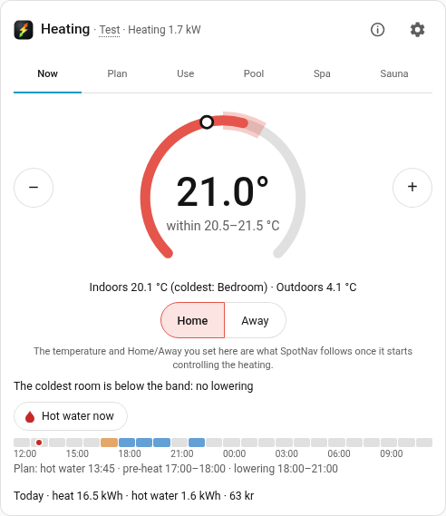

# Heat pumps

SpotNav finds a heat pump by its Home Assistant integration, with no setting, and reads what the pump reports. It
writes nothing to a heat pump unless you turn on **Control the heat** (see
[below](#spotnavs-own-heat-control-relay-off-by-default)). Then it steers through the one control path you chose: a
**relay** that lowers the pump's curve, SG Ready's two contacts, or, on some pumps, SG Ready or the heating curve
offset through the pump's own integration (see
[Control through the pump's own integration](#control-through-the-pumps-own-integration-not-yet-tried-on-a-real-pump)).
It never writes a setpoint. What it reads is shown in the diagnostics (`heat_pump`).

Which other pumps and Home Assistant integrations can be controlled, and which can make hot water on command, is
in [Supported heat pumps](supported.md#supported-heat-pumps).

## Which pumps are read

| Pump | Integration | Notes |
| --- | --- | --- |
| NIBE F series (F730, F750, F1155, SMO 40, VVM ...) | NIBE Heat Pump (`nibe_heatpump`, local) | Its entities are disabled by default: enable the readings under "What is read" to have them read. |
| NIBE S series (S1155, S320, VVM S ...) | NIBE Heat Pump (`nibe_heatpump`, local) | As above. |
| NIBE (F series, SMO 20) | myUplink (`myuplink`, cloud) | Read through NIBE's cloud. |
| CTC (EcoZenith, EcoLogic, EcoAir ...) | CTC Heat Pump (BMS) (`ctc_bms`) or CTC Local Easyconf (`ctc_ecozenith`) | Local Modbus. |
| Panasonic Aquarea | HeishaMon (`aquarea`, MQTT) | Needs the HeishaMon board. The HeishaMon YAML package is not read. |
| Thermia Genesis (Diplomat Inverter, Mega, Calibra, Atlas ...) | Thermia Genesis (`thermiagenesis`, local Modbus) | Its numbers and sensors are disabled by default, and the integration reads only the enabled ones: enable the readings under "What is read". Pumps on Thermia's older controller or on the Athena platform are not covered. |

## What is read

Where the pump has it: the outdoor, supply, calculated supply (NIBE F 43009, NIBE S 31018, CTC 62007, Thermia's
"System Supply Line Calculated Set Point"), return, room
and hot water temperatures,
the degree minutes, the
compressor's speed and whether it runs, the immersion heater's power or state, and whether the pump is heating the
house or the hot water now. A reading that is `unknown` or `unavailable`, belongs to a disabled entity, or is out of
any plausible range (NIBE's "no sensor" -3276.8, for example) is left out, and the diagnostics say why.

SpotNav also lists the controls a pump offers (heat curve offset, setpoint, SG Ready through the integration, extra
hot water, compressor limits) with their entities and ranges. Most are only listed; the ones SpotNav can steer
through are in the table further down.

## The pump's own price control

When the pump runs its own price control (NIBE Smart Price Adaption, CTC's SmartGrid or spot price mode), or
EffektGuard is set up, the diagnostics mark the pump as **watch only**: a later SpotNav heat control will leave such
a pump to it and only watch.

## The heat card

The heat card (`type: custom:spotnav-heat-card`, with `site:` or `charger:`) has a header and three tabs. The header
says after the card's name what the heating does now: **Heating 2.1 kW**, **Hot water 2.9 kW** or **Resting** from the
heat pump's own facts or its meter, and **Lowered until 06:00** or **Raised until 15:00** while SpotNav's own control holds
the heat down or up. Before SpotNav controls anything, **Test** stands first (tap it for what that means). The **i**
opens the details, the gear (administrators) the settings. On a site where nothing heat-related is found, the card
shows only the header and one line, **No heating found – Settings → Heating**. Where SpotNav can only read the
heating (no control path it steers yet), the dial shows the wanted temperature without + and −, **Home** and **Away**
are left out, and one line points at **Settings → Heating → Control**; the setback, night and offset settings are left
out until there is a path SpotNav steers.

* **Now**: the dial for the wanted temperature with its band, the coldest room and the outdoor temperature, **Home**
  or **Away**, what SpotNav would do (or does) and what the relay does, a thin strip of **the plan's next twelve
  hours** (a cell an hour: a lowering, a pre-heat or raise, the cooler night, hot water as a dot) with the same in
  words under it, and today's heat, hot water and cost. The strip ends at midnight until tomorrow's prices are in.
  The sensors, the zones and how the pump is controlled are in the gear's settings.
  **Away** holds the house **3 °C below the wanted temperature** (never below 16 °C) until two hours before the
  return time, then warms it up. The gear's **Setback when away** sets those degrees, 1 to 6
  in half degrees; the warm-up before the return is the same.
  The site also has a switch, **Heat away**, for an alarm or presence automation: on is
  Away until it is turned off (the return time is set 90 days ahead), off is Home again at once. Away set by date on
  the card reads as on. Its entity id is `switch.<site>_heat_away` on a Home Assistant in English; in another
  language Home Assistant names it in that language when it is first created (as SpotNav's other entities), so pick
  it from the site's device and rename it if the automation should read the same everywhere.
* **Plan**: the day's chart: the rooms, the comfort band, the setpoint, SpotNav's lowerings (what it did solid, what it
  plans lighter), the relay, hot water and the car. The arrows step back through past days (tap the day to choose
  one); this tab shows days only. Tap or point at the chart for a time's figures.
* **Use**: bars per hour, day or month (the period picker: Day, Month, Year), in **kWh or money** (the switch at the
  right, remembered). Each bar is stacked by **what is actually measured**: the **heat pump** (its meter less the hot
  water), **hot water** (the meter's plateaus of about 3 kW, on the days Home Assistant still has in 5-minute detail;
  on older days it stays in the heat pump's part and the card says for how many days it is split out), each **zone
  with a meter of its own** by its name (an air-to-air heat pump; the four largest), and **other heating** (every
  other heat counted: further zones, a meter moved to Heat in the house card's pie). A zone without a meter is in no
  bar: nothing is guessed. The parts in the legend are toggles with their sums (remembered). The headline is **what
  SpotNav saved on heat** over the period, the same figure as *Heat* in the house card's Earnings tab; a period
  without one is headed by the heat's total.

Plan and Use share the period: a day chosen in one is the day in the other, and a month or year chosen in Use is
still there after a look at Plan. The tab, the unit and the hidden parts are remembered per card in the browser.

**The details** (the **i**) use the same period picker and show everything at once: the cost with what SpotNav's plan
would have saved hatched on top, the use in figures (the immersion heater too, where its power is read), **degree
days** and kWh per degree day with the monthly trend, **comfort** (the coldest room and the hours under the band),
**what SpotNav would have done** in shadow, a day's review of the relay beside SpotNav's plan, **the house model**
(how far its forecast of the heating was from the meter, in kW, over the reviewed days) and a day's hot-water runs.

A wall screen can show one tab only, without the tab row: `tab: now`, `plan` or `use` (the card editor's **Show only
tab**). It is a setting of this card, not of SpotNav. In a box of fixed height the dial, the chart or the bars take
the box's spare height and the explaining lines and notes go. Every tab fits a 650×520 box with the tab row shown.

## The heat's figures: the heat pump and the zones

The heat pump's meter (found by itself, or chosen in the site settings) is the heat card's own measure: its
hot-water split and runs, the pump state, the degree-day figure and its trend, and SpotNav's control all read it alone.

Electricity used for heat elsewhere counts as heat too: the chosen **zones** (electric floor heating, an air-to-air
heat pump) with a meter of their own on the thermostat's device (an energy sensor, else a power sensor; no setting),
and any Energy dashboard meter moved to Heat in the house card's pie. Each is counted once (a zone whose sensor is the
heat pump's meter, or nested inside it, is left out), and a zone without a meter is listed in the diagnostics only.

* **Today** on the heat card: *heat* holds the zones (and says how much as *of which zones*); *hot water* stays the
  heat pump meter's split, and the cost counts the zones at each period's price.
* **The Use tab and the details**: each bar, the total and the cost hold the zones in the hours the heat pump's meter
  has, a zone with its own meter as a part of its own and the rest as *other heating*, with *Of which zones* beside
  the total in the details. The zones count from the day their meter has readings, so the use takes a step
  up there; the history says from which day. The **degree-day** figure and its trend stay the heat pump's alone, so a
  zone added does not look like a worse house.
* **The house card**: its flow's Heat is the same sum, with its own pie where it holds more than one source
  ([house card](house-card.md#heat-in-the-flow)).

## SpotNav setting the zones' thermostats (off by default)

A zone (an electric floor's thermostat, an air-to-air heat pump in heat mode) can follow the same heat plan as the
heat pump. Each zone has its own switch, **Let SpotNav set this thermostat**: open the zone's row under **Zones** in
the settings popover's **Heating** section. Off, the zone is **Watched**: read and counted, never written. A site with
zones only, and no heat pump path, can use them.

**From your own setting.** SpotNav keeps the setpoint it reads while it holds nothing as *your* value, and every write
is relative to it: change the thermostat yourself and that is your new value. The zone's old offset no longer acts.

| The plan's hour | What SpotNav sets |
| --- | --- |
| normal | nothing: your value stands |
| lowered (an expensive or tight hour) | your value − 1 °C |
| pre-heat, the warm-up before the return | your value + 0.5 °C |
| the cooler night | your value − the night's degrees |
| away | your value − the away setback |

Each value is rounded to the thermostat's step and kept within its own limits. One degree is enough for the element
to stop, and small enough that the thermostat keeps the room within a degree if Home Assistant stops mid-lowering.

* **The zone's own comfort**: a lowering ends at once when the zone reads more than half a degree below your value,
  and none starts there; a pre-heat ends at your value + 0.5 °C. The cooler night and away are what you asked for:
  they are not released.
* **The rules** are the relay's: a lowering lasts 45 minutes to 3 hours, an hour between, at most 6 hours a day, never
  at −15 °C or colder, nothing while the plan or the outdoor reading is missing. At most 24 setpoint writes a day per
  zone; then your value is written back and the zone is left for the day.
* **Which thermostats**: one setpoint (not a range), in **heat** mode (not auto, which runs its own schedule, nor cool
  or off: an air-to-air pump in summer is left alone), reading its temperature. SpotNav never changes the mode, the
  fan or a preset.
* **A check** on the first write: it must show on the thermostat within 90 seconds, and where the zone heats (its
  power sensor draws, or it says it is heating) the heating must stop within 10 minutes of the first lowering. A
  failed check says so under the zone's switch; turn it off and on to try again.
* **Someone else's change wins.** A setpoint changed by hand (or the mode changed) while SpotNav holds one: SpotNav
  writes nothing back, takes the new value as yours and leaves the zone until tomorrow.
* **An automation that sets the thermostat blocks it** (one note on the card). A price automation that rewrites the
  setpoint on every run would fight SpotNav: turn it off first. SpotNav never turns an automation off. An alarm that
  set the house to away can drive the **Heat away** switch instead.
* **Every way out writes your value back** where the thermostat still shows SpotNav's: the switch turned off, a
  pause, a block, unload, Home Assistant stopping, and at the next start after a stop that could not.
* A lowered zone with its own meter counts in the house forecast: its last day's mean power off over the lowering and
  the same energy back over the two hours after, so the cars and the battery see it.

The diagnostics (`heat_settings.control.zones`) show each zone's kept state, whether it qualifies and why not, the
writes and a log.

## Indoor sensors and their offsets

In the heat settings (the settings popover's **Heating** section) you choose one or more indoor temperature sensors.
The room **closest to too cold** rules, not the mean: when it is below the comfort band (the wanted temperature less
half a degree), SpotNav lowers nothing. A sensor that rises fast while the others stay flat (a wood stove, the sun
through a window) is left out while it lasts.

Each chosen sensor has an **offset** against the house temperature, from −3 to +3 °C in half degrees (0 by default),
edited on its own row under the sensors. Use it for a room that is meant to be cooler (an
upstairs kept at −1.5) or for a sensor that reads wrong (one that shows half a degree too warm: +0.5). SpotNav then
compares each room's reading less its offset with the house's band, both in the coldest-room rule and in the
comfort figures of the day's review and the heat history. The card still shows each room's own reading.

## SpotNav's own heat control (relay, off by default)

With the heat pump's lowering input wired to a relay in Home Assistant (NIBE's external contact set to shift the curve
down, or an SG Ready pump's first contact), SpotNav can switch that relay itself on its own heat plan, the same plan
the heat card's day chart shows. **It is off by default.** The switch, **Control the heat**, is in the **Heating** section of
the settings popover (administrators only) and is shown when the control path is **Relay**, **SG Ready**, **SG Ready
through the integration** or **Heating curve offset**. Off, nothing is written and SpotNav only shows what it would
do. A setpoint written to the pump is not part of this. What follows is written for the relay; the two paths through
the pump's own integration follow the same rules, and their own section says what differs.

**Open relay = the pump's normal curve.** That is the fail-safe state, and every way out ends there: the switch turned
off, a block or a pause (below), a safety reason, another relay chosen, SpotNav unloaded, and Home Assistant stopping.
A relay SpotNav could not open at a stop is opened at the next start before anything else.

**First a check.** Switching on starts a short check, again after the relay entity changes: at a moment when the pump
is heating, SpotNav closes the relay and looks for an effect within 20 minutes (the heat pump meter's power drops to
at most 70 % of what it was, or, where the pump reports it, the calculated supply temperature falls by 1.5 °C or more;
a NIBE showed 40.3 → 35.7 °C), then opens it and looks for the return within 30 minutes. A moment that cannot be
judged (a hot-water run starts, the readings go, a room gets cold) is tried again at least an hour later, at most
three times a day. Without a heat pump meter and without a calculated supply reading nothing can be judged, and the
line under the switch asks you to choose the meter. A failed check stops control; turn the switch off and on to try
again after checking the wiring.

**The rules** (fixed, no settings):

* SpotNav lowers only where its plan lowers (the expensive hours, the hours the import target or the fuse is tight, or
  while the house is too warm: below), and each lowering lasts at least **45 minutes** (no quarter-hour blips), at most **3 hours in a row**, with at least
  **1 hour** of normal heat between lowerings and at most **6 hours a day**.
* **Too warm indoors lowers too, whatever the price.** When the coldest counted room (its offset counted) has been
  above the comfort band (the wanted temperature plus half a degree) for **an hour**, the plan lowers the running hour
  and the next, until the room is back **0.2 °C** inside the band; then the lowering ends once its 45 minutes have
  passed. A room whose own sensor rises fast (0.6 °C in half an hour: a sensor warmed by sun or a stove) does not
  count as warm while it rises, also with a single sensor. All the other rules hold, and an hour both expensive and warm
  is one lowering, not two. The day's band shows these hours as lowered with the reason **too warm indoors**, as "would lower" while the switch is off. The hour above the band is counted in memory and starts again
  after a restart.
* Never at **−15 °C or colder** outdoors.
* **Released at once** when a counted room (its offset counted) falls below the comfort band, when the plan or the
  outdoor reading is missing or old (and nothing starts again until they have been good for 10 minutes), when SG
  Ready's second contact is on by someone else, or, on the relay and SG Ready paths, when a hot-water boost is on
  (the hot-water entity in the settings, or the pump's own boost such as NIBE's temporary lux): a block can stop hot
  water too, so a boost you started is never cut off and no lowering starts while it runs. On those paths also while
  the pump makes hot water by itself, and while a tank sensor reads under 40 °C (until it reads 45 °C): see
  [Blocks and the hot water](hot-water.md#blocks-and-the-hot-water). A curve offset does not touch hot water and goes on beside
  it.
* At most 6 switchings a day (both SG Ready contacts together).
* On the relay path pre-heating stays planning only: one relay can lower the curve, not raise it. SG Ready with both
  contacts can raise as well (below).

### SG Ready: the four states and what SpotNav uses

An SG Ready heat pump has two inputs, A and B. An electrician wires a relay that Home Assistant can switch to each:
one to input 1 (**A**, the **Control output** in the settings) and one to input 2 (**B**, the **Second contact**).
The pair gives four states, written (A, B):

| State | A | B | What the pump does | SpotNav |
|---|---|---|---|---|
| Blocked or lowered | closed | open | blocks the compressor or lowers its curve, as set in the pump | the plan's lowered hours |
| Normal | open | open | its own curve | every other hour, and every way out |
| Recommended raise | open | closed | raises its curve or its hot water, within its own limits | the plan's pre-heat hours |
| Forced raise | closed | closed | heats as hard as it may | **never** |

**(1,1) never happens**, not even for a moment: SpotNav switches through the normal state, opening one contact and
reading it back as open before it closes the other. A contact that does not open in time keeps the other one open.
With only A chosen, SG Ready works like the relay path: it lowers, never raises.

**When SpotNav raises** (with the switch on and the check passed): in the plan's **pre-heat** hours (the cheap hour
before a lowered run, when it costs at most 85 % of the run's mean price) and in the warm-up hours before the return
from away. Each raise lasts at least **30 minutes** and at most **3 hours in a row**, with at least an hour between
raises and at most **6 hours** in 24 hours, and a raise starts only while the day's switchings leave room for the
lowering that follows it. **Never** into a warm house: no raise while any room (its offset counted) is at or above
the comfort band's upper edge or the too-warm rule is lowering, and a raise ends at once when a room reaches the
edge. Never during the cooler night or while away, except the warm-up before the return. Nothing raises while the
plan or the outdoor reading is missing or old.

**The raise is checked on its first runs**, like the lowering: within 20 minutes the calculated supply temperature
should rise by 1 °C, or the heat pump meter's power by a fifth. A pump whose supply does not rise is noted as **raise
not observed** in the diagnostics (`heat_settings.control.raise`); SpotNav then stops raising and keeps lowering,
without a note on the card. The power alone never fails the check (the compressor starts and stops by itself), and
it passes only after two raises that both show it. Turning the switch off and on tries the raise again.

The day chart shows SpotNav's raises as solid warm columns (**SpotNav raised**) and the planned ones lighter
(**Planned raise**, or **Would raise** while the switch is off), and the line under the switch says **Controlling: raising
the heat until …** while a raise runs.

**Every write is read back**: the relay must show the new state within 90 seconds. A switching that fails or is not
seen pauses control for the rest of the day; an opening is tried again every five minutes until the relay reads open.

**Someone else's change wins.** If the relay is switched by anyone but SpotNav (by hand, from another automation), SpotNav
gives it up at once, writes nothing, and pauses until the next day. While an enabled automation of yours references
the relay (the SpotNav relay blueprint, for example), control does not start, and one note says which one to turn off.
SpotNav never turns an automation off. Another heat optimiser (EffektGuard) or the pump's own price control also keeps
control from starting.

**What you see**: the line under the switch (off; checking; controlling and until when; or what it waits for), the
heat card's header saying what the control does now after its name (**· Lowered until 19:00**, **· Raised until 15:00**
for SG Ready's raise, else what the heat pump does) with no **Test** before it, and SpotNav's own lowerings as solid
columns in the Plan tab's chart (**SpotNav lowered**), beside the plan's lighter ones, the rooms and the setpoint. Tap
or point at the chart for a time's figures. The diagnostics (`heat_settings.control`) keep the switchings, the check's
results and why each decision was made.

## Control through the pump's own integration (not yet tried on a real pump)

The control paths below need no relay and no electrician: SpotNav writes to an entity of the heat pump's own
integration. **None of them has run on a real heat pump yet.** The registers, their ranges and what the integrations
do with them are read from the integrations' sources, and the settings say under the switch that the path is untried.
If you run one, watch the first days and tell us what you see.

Everything in the section above holds for them as well: off by default behind **Control the heat**, the check before
control starts, the same plan and rules (45 minutes to 3 hours, 6 hours a day, never at −15 °C, released when a room
gets cold), every write read back, and someone else's change wins: a value you or another automation set is left as
it is and SpotNav pauses until the next day. "Closed" in that section is the lowering as SpotNav wrote it, "open" the
pump's normal state. SpotNav's own lowerings on these paths count in the house forecast (the heat taken away and
its rebound after), and so in the battery's and the cars' plans and the day's review, as a relay's closings do.

| Path | Pump and integration | What SpotNav writes | Writes a day | Handed back by |
| --- | --- | --- | --- | --- |
| SG Ready through the integration | NIBE S series, NIBE Heat Pump (`nibe_heatpump`, local) | number 46009 "Requested operating mode (SG Ready)", with switch 43033 "Activate SG Ready via API" on | at most 6 mode changes; the switch on at most 4 times | mode normal, then the switch off |
| Heating curve offset, stored | NIBE F series 47011 "Heat Offset S1", NIBE S series 40031 "Heating offset climate system 1" (`nibe_heatpump`, local); any other number you choose | the offset: the value found less 2 steps (1 step below −5 °C outdoors), plus 1 step for a raise | at most 24 | the value found written back |
| Heating curve offset, volatile | CTC, CTC Heat Pump (BMS) (`ctc_bms`) 1023 "Curve adjustment override" | the override: −3 °C (−2 °C below −5 °C outdoors), +2 °C for a raise | at most 24 changes; renewed every 2 minutes while held | the override released |
| Heating curve offset, stored | Thermia Genesis, Thermia Genesis (`thermiagenesis`, local) "Comfort Wheel Setting" | the comfort wheel: the value found less 2 steps (1 step below −5 °C outdoors), plus 1 step for a raise, within 10..40 | at most 12 | the value found written back |

SpotNav finds these entities on the pump: under **Control** a path the pump has is marked **Found on the heat pump**,
and choosing it fills its entities in. Through NIBE's cloud (myUplink) nothing is steered, and CTC Local Easyconf
(`ctc_ecozenith`) has no curve adjustment among its controls, so it has no offset path.

**NIBE's and Thermia's entities are disabled by default.** When you turn **Control the heat** on, the dialog lists the
path's entities that are still disabled in NIBE Heat Pump or Thermia Genesis (the ones written, and the calculated
supply the check reads; on a Thermia also "First Prioritised Demand", so the check knows when the pump heats). Saving
enables exactly those and reloads the integration once. Nothing is enabled before you save, and turning control off
leaves them enabled.

### SG Ready through the integration (NIBE S series)

The number holds the mode the pump is asked for, and acts only while the switch is on. Only the pump's own SG Ready
number and switch (found by NIBE Heat Pump's register numbers) are accepted for this path, also when the settings
are written another way than through the card, so SpotNav never writes a mode to another number. On no path is
anything written through a heat pump integration that runs through the maker's cloud.

| Mode | SG Ready state | SpotNav |
|---|---|---|
| 0 | blocked or lowered, (1,0) | the plan's lowered hours |
| 1 | normal, (0,0) | every other hour, and every way out |
| 2 | low price, the recommended raise, (0,1) | the plan's pre-heat hours |
| 3 | overcapacity, the forced raise, (1,1) | **never written**, and never taken over when someone else set it |

The integration's register list does not name the four values. The table follows SG Ready's own order and NIBE's
menu, with the register's default (1) as normal. **Confirming this mapping is the first thing to do on a real pump.**

The rules are SG Ready's own, above: every change goes through normal (mode 1 is written and read back, and has to
have read for 10 seconds, before the other mode is written), raises only in the plan's pre-heat hours, and no raise
at all while the number or the switch only assumes its state. SpotNav turns the switch on before its first block or
raise and leaves it on while it controls. When control stops (the switch off, a pause that lasts, another path
chosen, Home Assistant stopping while a block or raise holds, SpotNav removed) it writes mode normal first and then
turns the switch off. A restart while the mode reads normal leaves the switch on (the pump runs as without SpotNav
then), so a day of restarts does not use up the four turnings on. If the mode does not go
back to normal (the write fails at the stop, or three openings in a row are not read back), SpotNav turns the switch
it turned on off anyway: with the switch off the pump no longer acts on the mode, so the block ends by that second
way, and the mode is written back to normal once it can be. A switch that was on before SpotNav came is not
SpotNav's to turn off. Whether the pump keeps these two registers through a power cut is
not said in the integration's register list, so they are written as stored settings: a few times a day.

### The heating curve offset

SpotNav moves the offset from the value it finds, in whole steps, never further than 3 steps from that value, never
further than 3 steps from your own value (below) whatever it finds, and never outside the number's own range (an
offset already at the end of its range is not moved at all).

Why 2 steps: the plan lets the house move half a degree around its temperature in runs of at most three hours. One
NIBE offset step is about 1 °C of room temperature once the house has settled, and a house follows slowly, so three
hours at 2 steps move a light house about 0.4 °C and a heavy one about 0.1 °C. Three steps would take the light
house out of the band. Below −5 °C outdoors the lowering is 1 step, and a raise is 1 step. CTC's adjustment is in
degrees of supply temperature, where a degree of room is 2 to 3 °C: −3 °C is about one NIBE step, shallower on
purpose since the path is new, and still twice what the check needs to see on the calculated supply.

**NIBE (stored).** A stored setting is written sparingly: a new move (a lowering or a raise) waits until 15 minutes
after the last write and 45 minutes after the last write the other way, so a raise that ends into a lowering puts
the value back at once and lowers it a quarter of an hour later. Putting the value back never waits: the end of a
lowering, a room gone cold or any other way out goes at once.

The offset is a stored setting, so a lowering would stay if nobody put it back. SpotNav keeps the
value it found before it writes, and writes it back when the lowering ends, when control is turned off, paused or
blocked, when SpotNav is unloaded and when Home Assistant stops. If Home Assistant went down without that (a crash, a
power cut), the value is put back at the next start, before anything else. If the offset is no longer the value
SpotNav wrote (you changed it meanwhile), nothing is put back: your value stands.

SpotNav also keeps **your own value** of the offset in the site's settings, not beside its kept state: the value it
read when the path was first chosen, and again each time the offset changes while SpotNav holds nothing on it (you
or the pump's menu changed it). Should SpotNav's kept state be lost while a lowering stands (an old backup restored,
a dead SD card), SpotNav does not write anything by itself. The settings then show a row, **Offset not put back**,
with the value it reads and yours ("−2 (was 0)"); open it to put your value back or to keep the one it reads as your
own. The row also shows when the offset was changed while Home Assistant was down, and it goes away by itself once
the offset reads your value again. A lowering never goes further than 3 steps below your value, so a lowering left
standing is never the start of a deeper one.

**CTC (volatile).** CTC's controller forgets the override five minutes after the last write, and CTC Heat Pump (BMS)
rewrites a held override every minute by itself while Home Assistant runs. SpotNav also writes its value again every
2 minutes, so the hold never rests on the integration's rewrite alone (these renewals cost no write cycles and are
counted apart, at most 1000 a day), and ends the lowering for the day if its renewals have failed for 5 minutes.
They are no dead-man: while Home Assistant runs, the integration keeps the hold even if SpotNav stops. It hands back by setting the override to 0,
which the integration takes as "release": nothing more is written and the pump is back on its own curve within five
minutes. So if Home Assistant or the link to the pump stops, the lowering ends by itself within five minutes; while
Home Assistant runs, it is SpotNav's rules that end it. An override that someone else holds is left alone.

**Thermia Genesis (stored, comfort wheel).** The Genesis controller has no curve offset register: its comfort wheel
(holding register 5, the heat climate entity's target) is the only single value that moves the heat curve, and
what one step does to the room is not confirmed yet. SpotNav therefore treats it as NIBE's stored offset above, with
these differences:

* **The check needs the calculated supply.** The check looks only at "System Supply Line Calculated Set Point", and
  only while the pump says it heats ("First Prioritised Demand" 4; a hot-water or anti-legionella run ends a try
  unjudged and the wheel goes back at once). The heat pump meter's power is not taken as proof here. If the
  calculated supply does not fall by 1.5 °C within 20 minutes of the lowering, the wheel does not move the curve on
  that pump: the check fails, the value found is written back and nothing more is written.
* **At most 12 writes a day.** Thermia's manual says nothing about where the registers are kept or how often they may
  be written, so every one is treated as flash memory, at half the NIBE cap until a field test shows more is safe.
* **Only from a whole step between 10 and 40**, the range of the integration's own heat climate entity (its number
  says −40..100, which is no limit). A wheel found outside that range, or between steps, is not moved.
* **A write shows only at the integration's next poll** (every 30 seconds), and the integration does not report a
  write that failed: SpotNav's read-back, up to 90 seconds, is the only proof that a write took. One not read back
  puts the value found back and pauses control for the day.
* There is no dead-man: if Home Assistant or the network goes down during a lowering, the wheel stays lowered until
  SpotNav puts it back at the next start.

Nothing else on a Thermia is ever written: not its operational mode, the heat or hot-water enable switches, its gear
limits, its supply limits, or its hot-water start and stop temperatures. A turn of the wheel on the pump's display,
or through the integration's heat climate entity, while SpotNav holds a lowering is your change, and it wins. This
path has not run on a real Thermia yet.

The diagnostics (`heat_settings.control`) show the path's write class and the day's counts (`writes`), the kept
offset moves (`kept.snapshots`) and whether SpotNav holds the SG Ready switch (`kept.activation`).

## Hot water

SpotNav learns when the household uses hot water and plans the tank's reheat into the cheap hours before it, in
shadow first. Where the pump can start a run that ends by itself, the heat card has a **Hot water now** button.
See [Hot water](hot-water.md).
