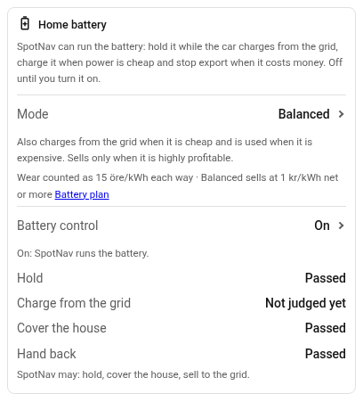

# Home batteries

## In short

- **What it does for you.** SpotNav can run your home battery: hold it so it does not empty into the car, charge it
  in cheap hours, let it cover the house, and (where the mode allows) sell from it when that pays. By default it does
  none of that: it only tells your own battery planner (Predbat, EMHASS or an automation of yours) when the car
  charges from the grid, and plans the battery in shadow as a comparison ([The battery plan](battery-plan.md), the
  [house card](house-card.md)).
- **What you need.** A battery SpotNav reads (the table below) and a site with your main fuse and grid meter. For
  control, also: the battery's integration must allow writes, a few of its entities must be enabled (SpotNav offers to
  do it), and no other system may run the battery.
- **What to do.** For the signal only, point your planner at `binary_sensor.<site>_charging_from_the_grid` (see
  [The signal](#the-signal)). For SpotNav's own control, turn on **Battery control** in the settings' **Home battery**
  section and follow its checklist. On every brand but Sigenergy you first [become a tester](#becoming-a-tester): a
  hardware test on your plant and a control code by e-mail.
- **Safe by default.** [SpotNav's own battery control](#spotnavs-own-battery-control-off-by-default-in-testing) is
  **off by default and still in testing**. Switching it on starts a check, not control. Every write is read back, a
  grid charge is kept under your main fuse, and anything unexpected hands the battery back.

## Brands at a glance

*Hold* stops the battery discharging (into the car, say). *Grid charge* charges it from the grid in cheap hours.
*Cover the house* lets it run the house and store nothing. *Sell* discharges to the grid when that pays. Every brand
in the table is also read for the battery plan in shadow. Brand by brand in detail:
[Home battery brands in detail](battery-brands.md).

| Brand | Integration SpotNav controls through | What SpotNav can do | Run on a real plant | Notes |
| --- | --- | --- | --- | --- |
| Sigenergy | Sigenergy Local Modbus (HACS) | Hold, grid charge (also per phase), cover the house, sell | Yes: on-site tests in November 2026 | The recipe is marked tested once those tests are rerun on the reworked control; until then it only logs what it would do, except on a [beta tester's](beta-testing.md) installation. No dead-man, so a grid charge is capped; on a small fuse see [below](#grid-charging-on-a-small-main-fuse-sigenergy). |
| SolarEdge | Modbus Multi (HACS) | Hold, grid charge, cover the house, sell | No: mapped, waiting for a first tester | Only in Remote Control, with its command timeout. |
| Huawei | Huawei Solar (HACS) | Hold, grid charge, cover the house, sell | No: mapped, waiting for a first tester | Needs the installer password. |
| SolaX | SolaX Modbus (HACS) | Hold, grid charge, cover the house, sell | No: mapped, waiting for a first tester | Remote control, renewed by its autorepeat. |
| Solinteg (also M-TEC, Wattsonic) | SolaX Modbus, Solinteg plugin | Hold, grid charge, cover the house, sell | No: mapped, a pilot is planned | Keeps the last command: a grid charge is capped as all on one phase. |
| Victron (GX with ESS) | Victron GX (core) or Victron MQTT (HACS) | Hold, grid charge (also per phase), cover the house, sell | No: mapped, waiting for a first tester | The community Modbus integration is read only. |
| GoodWe (ET, EH) | GoodWe (HACS, mletenay) | Hold, grid charge, cover the house | No: mapped, waiting for a first tester | Core's `goodwe` is read only. The hold is not confirmed on a device. |
| Tesla Powerwall | Tesla Fleet or Teslemetry (core, Tesla's cloud) | Hold, grid charge, cover the house: the plan's own actions only | No: mapped, waiting for a first tester | Slow: no hold for a car, no peak cover, at most 24 writes a day. |
| Ferroamp (EnergyHub) | Ferroamp (HACS) | Hold, grid charge, cover the house, sell | No: mapped, waiting for a first tester | Overrides the hub's EnergyCloud strategy once you accept it. |
| FoxESS (H1, KH, H3, AC; 1KOMMA5) | FoxESS Modbus (HACS) | Hold, cover the house: limits only | No: mapped, waiting for a first tester | No grid charge and no sale. Only in *Self Use*. |
| Deye, Sunsynk, Sol-Ark | Solarman (HACS) or the Sunsynk add-on | Hold, cover the house: limits only | No: mapped, waiting for a first tester | No grid charge and no sale. Only with Time of Use off. |
| Solis (hybrids) | Solis Modbus (HACS) | Hold, grid charge, cover the house, sell | No: mapped, waiting for a first tester | The inverter's remote-control force, which ends by itself after 5 minutes. |
| Marstek (Venus E, C, D, A) | Marstek Venus Modbus (HACS); the Local API is read only | Hold, grid charge, cover the house | No: mapped, waiting for a first tester | No dead-man: a grid charge is capped. |
| EcoFlow PowerOcean | EF-PowerOcean-TcpModbus (HACS) | Hold, grid charge, cover the house, sell | No: mapped, waiting for a first tester | The EcoFlow app is locked while SpotNav controls. |
| Kostal Plenticore | Kostal Plenticore Battery Control (HACS) | Hold, grid charge, cover the house | No: mapped, waiting for a first tester | Needs the installer setting *External via protocol (Modbus TCP)*. |
| Fronius Gen24 (BYD, Reserva) | Fronius (core, Home Assistant 2026.11 or later) | Hold, grid charge, cover the house | No: mapped, waiting for a first tester | No sale yet. |
| Sofar, Growatt, Sungrow, Enphase, SMA, E3/DC, SENEC, GivEnergy, SAJ, Alpha ESS, sonnen, Homevolt, Zendure, Anker Solix, Omnibattery | See [Supported hardware](supported.md#hybrid-inverters-and-home-batteries-overview) | Read only: plan in shadow and the signal, no control | Not yet confirmed on a battery | Tell us how yours reads. |

"Mapped" means SpotNav has the commands, read from the integration's source, behind the same switch and the same
check: nothing is written until a hardware test has passed on your plant and its result was approved with a control
code. The full list with every integration is on [Supported hardware](supported.md#hybrid-inverters-and-home-batteries-overview).
The export limit at negative prices is a separate switch with its own brands: [No export at negative prices](solar-export.md).

## Why SpotNav does not write to batteries by default

Battery integrations differ in which settings they expose, and firmware does not always obey them.
On some Sigenergy systems, for example, the discharge limit is ignored in AI mode, and a "hold"
done through the discharge cut-off SoC can make the inverter import several kW from the grid, next
to your main fuse. A planner such as Predbat or EMHASS already owns the battery, and two writers on
one battery fight each other. So SpotNav only publishes a signal, and the planner or an automation of
yours acts on it.

One limit to know before any controller (SpotNav's own or yours) writes to a Sigenergy plant:
Sigenergy has no dead-man. If Home Assistant stops (not restarts) during a command, the plant keeps that command
until Home Assistant is back and the controller restores what it found (SpotNav does that first after a
start).

## SpotNav's own battery control (off by default, in testing)

SpotNav can run the battery itself: hold it while the car charges from the grid, charge it in cheap hours, and
stop export when selling costs money. **It is off by default.** What happens when you switch it on depends on
whether the brand's recipe has been tested on a real plant: for a tested recipe the check below runs and control
starts once it passed; no recipe is marked tested yet (Sigenergy will be once its on-site tests are rerun), so for
every brand it only logs what it would do (the line under the switch says "Test: SpotNav controls nothing
yet and only logs what it would do"), unless the installation is a
[beta tester](beta-testing.md), when the check runs for them too. Every brand but Sigenergy also waits for a passed
hardware test and a control code ([Becoming a tester](#becoming-a-tester)). Either way control runs only once
the brand's check passed, and every fuse rule below applies (beta or not). The switch is in the
settings popover's **Home battery** section, shown when SpotNav finds a battery: from the house card's gear, the heat
card's gear or the charging card's **Settings** (administrators only). The section also has:

* one line under the switch saying what control does now (off, test mode, checking, waiting for a suitable moment and
  why, on, stopped, or only watching while the AI mode, or a battery's own strategy SpotNav cannot read, is not yet accepted);
* the checklist of what you still have to do (enable an entity, turn on the firmware sensor, accept the AI-mode
  takeover or, for a Ferroamp hub, that SpotNav overrides its own strategy, or, for a brand that waits for one, run
  the hardware test first), each in plain words;
* the check's progress while it runs, and its result per step (hold, charge from the grid, cover the house, hand back:
  passed, failed or not judged yet) with what SpotNav may then do;
* the reminder to turn AI mode on again after a takeover ended;
* a line when the battery's cells are cold and its own preheating is off (see [Cold battery](battery-brands.md#cold-battery));
* **Mode**: **Self-consumption**, **Balanced** (the default) or **Max profit**
  ([the three modes](battery-plan.md#the-three-modes)). **Max profit** lets control sell from the battery to the
  grid whenever that pays, **Balanced** only surplus and only when it is highly profitable, **Self-consumption**
  never.



What SpotNav writes, what must be enabled first, what it never touches and how to restore by hand differ per
brand. Sigenergy (the Sigenergy Local Modbus integration) is the first brand: see
[Home battery brands in detail](battery-brands.md), which has every brand's recipe.

### Turning on the control entities

Some integrations ship the entities SpotNav's control writes disabled (the
Sigenergy one does). When you turn **Battery control** on and any of them are disabled, the dialog says "SpotNav needs
to turn on N control entities in <integration>" with the list folded, and a button that turns them on and control with
them. Only your confirm does it: SpotNav clears the entities' "disabled" mark in Home Assistant's entity registry (exactly
those, nothing else) and reloads the integration once, so it restarts for a moment; the check then runs as usual. They stay
on if you turn control off later. The same button is in the checklist's step for the disabled controls. Only
administrators can confirm, and never over the webhook. The entities per brand are listed under
[Control entities per brand](battery-brands.md#control-entities-per-brand).

**Switching on starts a check, not control.** SpotNav first checks that the battery obeys, each step through the
same write path control uses: hold (the battery stops discharging), charge 2 kW from the grid, cover the house, and
hand back (every setting back as found). Each step waits up to 5 minutes for the writes, 5 minutes to settle and
takes three readings a minute apart: about 40 minutes in all. It runs at a suitable moment: the battery between 30
and 80 % and discharging (so a hold can be seen), no car charging, room under the fuse; a weekday evening is
typical. A step the battery cannot show at the moment (nothing to stop, nearly full) is tried again at a later
suitable moment, not counted as a failure; after five runs without an answer the check gives up.

**The check decides what SpotNav may do.** Hold and the hand-back must pass for any control; grid charging only if the
charge step passed, covering the house only if that step passed. Selling from the battery needs the house step;
on a battery whose one power target both charges and discharges by its sign (SolaX, Solinteg) it needs the charge
step too, since only that step shows which sign charges. A failed step leaves control off, with one line
saying what did not work (for example "the battery did not stop discharging when held"); turning the switch off and
on again runs the check again. The result is kept per firmware and integration version.

**An update never stops control by itself.** After a firmware update, a new version of the battery's integration or
a changed SpotNav recipe, SpotNav keeps running the battery with what last passed for that brand on your plant: the
same steps stay allowed, nothing more. Each step keeps the latest answer it has from an earlier version, so a
version that showed only some of the steps takes none of the others away, and a step a later version did not obey
stays off. It checks the battery again at the first suitable moment, at any hour: the
same conditions as the first check (30 to 80 %, discharging, no car charging, room under the fuse), at a time when
the plan leaves the battery to itself. Meanwhile the card says *On: SpotNav keeps running the battery. The check
after the update waits for a suitable moment*, with what it waits for. While the check itself runs (about 40
minutes) control steps aside, as for the first check. Each step counts as soon as it has an answer on the new
version: one that passes stays allowed, one the battery no longer obeys is switched off, and one that could not be
shown yet keeps its earlier answer until a later run. After five runs the answers on the new version stand alone:
steps never shown are then off, while those that passed keep running. If hold or the hand-back fails, or is still not
shown in five runs, control stops exactly as after a failed first check, with the same one line (for a brand that needs the
hardware test: the checklist asks for it again). After such a failure, or a failed hardware test, the earlier result
is no longer used: turning the switch off and on runs the check again and control waits for it. A result is never
carried to another battery brand, and a recipe a release holds back stays off whatever passed before. One thing is
measured again before it counts: where the battery's own timeout lifts the grid charge limit that applies while
Home Assistant is down, that limit is back until the timeout has been measured on the new version.

**What the plan itself shows on the new version counts.** The check does not have to show every step itself. When
the plan holds the battery, charges it from the grid or lets it cover the house on the new version, and the battery
is seen to do it (three readings in a row, as for any command), that step has passed on the new version. A hand-back
that leaves every setting as it was found counts as the hand-back. Only a clear case counts: a hold must stop a
battery that was discharging while the house draws from the grid, with the battery at 30 % or more, a charge or a
discharge must be at least 1 kW, and a charge must start on a battery that was not already charging and run while
the site draws from the grid (so that sun is not taken for it). A command written before the new version was read,
or before a restart, does not count. A command the battery did not follow is counted as
before but never fails the check: only the check itself does that, and its answer replaces the plan's. The check
then runs only the steps still open. What is still not shown seven days after the update is checked ahead of the
plan: at the next moment that suits the check (the same conditions as above) the plan steps aside for it, for at
most five minutes and at most once a day; a car that begins to charge ends it at once. The seven days never stop
control themselves; such a run counts toward the five runs like any other. The battery's own timeout, a charge per phase and the export limit
are never shown by the plan, only by the check.

The firmware is the integration's firmware entity, or, where the brand has none or it reads nothing, the software version
of the battery's device (SolaX Modbus keeps its firmware registers internal and has only that), so control never waits
on a firmware it cannot read.

**What control does.** It follows the battery plan's running quarter hour, and holds the battery when the car
charges from the grid in a quarter hour the plan leaves to the battery. Every write is read back; every command's
effect is judged; anything unexpected hands the battery back (in Maximum Self Consumption) and stops. Safety rules:

* **The fuse.** A grid charge is clamped to the live headroom under the main fuse. Because Sigenergy has no
  dead-man, it is also capped so that the charge and the house's peak stay under the fuse on every phase even if
  Home Assistant stops while it runs (see [Grid charging and the main fuse](battery-grid-charging.md), per phase where the plant can). Under a hold the battery is let go at once when a phase nears the fuse
  (a kettle, the oven), and a hold meant to leave the battery idle that charges it anyway is handed back within a
  minute.
* **What backs off first** when the fuse is short: the battery's grid charge, then the car; the car first when its
  departure has room. With the battery above the cars in the site's
  [priority list](site-and-load-balancing.md#the-priority-list) ("battery first") the car backs off before the battery.
* **Selling from the battery** (discharging to the grid) follows the mode: never in **Self-consumption**, only when it
  is highly profitable in **Balanced**, whenever it pays in **Max profit**. It needs the check's house step (above),
  and it is capped so that it and the sun's export keep every phase under the fuse.
* **At most 96 writes a day** to the plant's settings (limits, modes, switches), outside hand-backs. A grid charge
  leaves the last 12 of them untouched, so a hold can still start after a day of charges that kept starting. The
  targets per phase are setpoints made for an outside controller and have their own count, 500 a day on Sigenergy
  (its protocol does not say how often they may be written, so not more) and 3 000 a day on Victron (whose
  setpoints must be written again within a minute anyway; those renewals are not counted); reaching it ends charging
  per phase for the day and nothing else. The diagnostics show what is left of each.

**Turning off** hands the battery back at once: control mode to Maximum Self Consumption, Remote EMS off, the
limits to what SpotNav found (a limit that was never set comes back as the battery's rating). The export limit is
not the battery switch's: it has [its own](solar-export.md). A setting you or an app changed meanwhile is left as
you set it. The battery plan keeps running in
shadow. SpotNav also hands back when Home Assistant stops or the site is reloaded, before anything else of the site
stops, and restores first after a start.

**For the on-site tests only** (Developer tools, administrators): `spotnav.battery_control_test` runs one action
(`hold`, `grid_charge`, `discharge_house`, `export_discharge`, `curtail_export`, or `stop`) through the same write
path with every rule for some minutes and then hands back; it is refused while the site is shadow only unless
`force_test` is set. `spotnav.battery_control_settings` writes the site's battery control options, the owner's test
flags included (the card's section leaves those out). Neither is meant for everyday use.

The site's diagnostics show it all under `battery_control`: the options, the state, the check's report per firmware,
the actions allowed, what is missing, the notes, and the log of every write, refusal and would-do.

### Grid charging on a small main fuse (Sigenergy)

SpotNav caps a grid charge so that no phase passes the main fuse even if Home Assistant stops in the middle of it.
On a 16–20 A fuse that cap leaves little or nothing. A three-phase Sigenergy plant with *Independent phase power
control* on holds each phase under a third of its own grid import limit by itself (tested on site in November 2026).
Set that limit to at most 3 x (fuse − safety margin) x voltage (13.1 kW on 20 A with a 1 A margin; a button in the
card's battery settings does it) and SpotNav drops the cap: the grid charge then uses what the house leaves. The
steps, every condition and the risk that is left:
[Grid charging on a small main fuse](battery-grid-charging.md#grid-charging-on-a-small-main-fuse-sigenergy). How the
cap itself is worked out: [Grid charging and the main fuse](battery-grid-charging.md).

### Accepting the risk if Home Assistant stops (other brands)

Where the plant's own per-phase hold is no way, an administrator can accept the risk instead: **If Home Assistant
stops** in the card's battery settings. The cap is then what the fuse allows with an empty house. What you accept: if
Home Assistant stops, or loses contact with the battery or the grid meter, during a grid charge and the house draws a
lot before it is over, a phase may go over the main fuse and the fuse may trip. Everything that works while Home
Assistant runs is unchanged. When it is shown, what it changes and when it turns itself off:
[Accepting the risk if Home Assistant stops](battery-grid-charging.md#accepting-the-risk-if-home-assistant-stops-other-brands).

### Becoming a tester

Control of every brand but Sigenergy (SolarEdge, Huawei, SolaX, Solinteg, Victron, GoodWe, Tesla Powerwall, Ferroamp,
FoxESS, EcoFlow, Marstek, Solis, Kostal Plenticore, Fronius and Deye / Sunsynk) has not yet been tested on a real
plant. It is tested together with users, one plant at a time, so an untried recipe is never switched on by mistake
and every early plant is known and looked at. Sigenergy needs none of this.

**Control that already runs stays on.** A plant of SolarEdge, Huawei, SolaX, Solinteg, Victron, GoodWe, Tesla
Powerwall or Ferroamp where SpotNav's check had ever passed for the brand when this release came counts as tested and
as having its code: nothing changes for it, and the card shows no Tester row. It does not matter whether control was
switched on at the update, or whether the firmware or the integration was updated at the same time: the check then
runs on the new version by itself, and control runs on meanwhile. Every other plant of these brands goes through the steps below. A
plant's own hardware test stops its control only when a step fails, never when the test could not judge.

1. **Become a tester.** In the card's Settings, the home battery section shows a **Tester** row for these brands
   (administrators only): *SpotNav can read this battery. Control is being tested together with users.* Tap it, give
   an e-mail address (required here), tick the consent line and send. That sends a report with the debug file and
   the battery's brand, model, firmware, integration and version, recipe revision, phases and main fuse, and turns
   [beta testing](beta-testing.md) on with that address. Until the sign-up the hardware test is not offered for the
   battery (Support → Hardware test says why).
2. **Run the hardware test.** Settings → Support → Hardware test, then Start, once. Nothing else is asked of you: the
   test waits for a suitable moment by itself, runs only in waking hours (08–21), tells your phones while it runs
   (with a Stop button) and always hands the battery back. Part of that moment is room under the fuse for the
   small grid charge once the battery stops covering the house (at least 0.5 kW): while the house draws too much the
   card says *Waiting for the house to use less power, so the small grid charge fits under the fuse*, and the test
   starts by itself when it does. A wait that never ends (three days) ends as not run, never as a failure. The small
   grid charge is 2 kW, or less where the fuse leaves room for less, and it is judged against the power SpotNav
   actually commanded: a battery on a small fuse that charges at the 0.7 kW it was asked for has passed. It is
   judged against that also where the integration states no rated power for the battery
   (see [Home battery brands in detail](battery-brands.md)). Its result is sent by itself when it ends, with the
   battery's log and history over the test, while Beta tester is on. The card then says *The result has been sent. You get an answer by
   e-mail.* A test where nothing failed but a step the brand needs could not be shown (the small grid charge had no
   room under the fuse because the house drew a lot, say) ends as **not complete**, not as passed: the card names
   the steps still to be shown, the other steps still ran, and the test can be run again the same day.
3. **Enter the control code.** SpotNav's developer reads the test's log and answers by e-mail: with a **control code**
   when the test passed and looks right, otherwise with what was seen (and possibly a fix in a later release). Paste
   the code under Support → Hardware test (spaces and line breaks do not matter); it is taken only once the hardware
   test has passed on this battery. Control needs both: the passed hardware test on this plant and the code. Then switch control on as for any brand.

The code works only on this Home Assistant installation and this battery brand; it is checked in Home Assistant
itself (it is signed), nothing is asked of a server, and again at each start of Home Assistant (a code that no
longer checks out is dropped, and control waits for a code again). One code per plant and brand is enough: after a firmware,
integration or recipe update SpotNav checks the battery by itself while control runs on, as for every brand, and only if that check fails
does the checklist ask for the hardware test again (no new code). SpotNav is open source, so the code is no copy
protection: it is a safety belt.

**Stopping.** Untick Beta tester under Support at any time: from then on nothing more is sent, not even a hardware
test's result, and the sign-up ends (a first test then waits for a new sign-up). A beta period that runs out by
itself ends the sign-up the same way. A code already entered keeps working (it is your battery), and control can be
switched off as always. While beta testing is on, its nightly reports
run until 30 days after the code was entered, then stop by themselves.

**A problem found later.** There is no remote switch-off. If a problem shows up after codes went out, the next
release holds that brand, firmware or recipe revision back (the checklist then says *recipe blocked*), which also
voids the plant's stored pass: once the block is lifted the hardware test must pass again (the code already entered
stays). One code serves every SpotNav site of the same brand on one Home Assistant; each still needs its own passed
test.

## The signal

Two binary sensors, both named "Charging from the grid":

| Entity | Where | On when |
| --- | --- | --- |
| `binary_sensor.<charger>_charging_from_the_grid` | each charger | the charger is charging and the energy is meant to come from the grid |
| `binary_sensor.<site>_charging_from_the_grid` | each site | any charger of the site has its own sensor on |

Use the site sensor in most cases. The exact entity ids follow your charger and site names.

A charger's sensor is **on** during a planned (cheapest) window, the grid part of a hybrid plan and a
manual Start or Charge now. It is **off** when the charger is idle or paused, and while it charges
from solar surplus (the solar strategy, or the solar part of hybrid). A manual start is always on,
even under the solar strategy, because you asked for charging now.

If SpotNav cannot tell where a running charge comes from (a charger that started by itself), the
sensor is on only while the site meter reads grid import.

Attributes of a charger's sensor:

* `source`: `plan_window`, `hybrid_grid`, `manual`, or `grid_import` (not attributable, site importing).
* `window_end`: when the active plan window ends (ISO time), if there is one.
* `power_w`: the charger's power in watts, if the charger has a power sensor.

The site sensor has `charger_ids`, the entries of the chargers that are on now.

## Predbat

Predbat has a `car_charging_now` setting that accepts an on/off sensor. While it reads on, Predbat
holds the battery itself so that it does not discharge into the car (see Predbat's
[car charging documentation](https://github.com/springfall2008/batpred/blob/main/docs/car-charging.md)).
In `apps.yaml`:

```yaml
car_charging_now:
  - binary_sensor.<site>_charging_from_the_grid
```

Replace the entity id with your site sensor. If you want the battery to be allowed to supply the car,
turn on `switch.predbat_car_charging_from_battery` in Predbat.

## EMHASS

EMHASS has no input for this, so use an automation: while the sensor is on, hold the battery (see
below), and restore it when the sensor turns off. You can also subtract the planned car load from
the house load you give EMHASS.

## Your own automation

Replace the entities with what your battery integration offers.

```yaml
automation:
  - alias: Hold the battery while the car charges from the grid
    triggers:
      - trigger: state
        entity_id: binary_sensor.<site>_charging_from_the_grid
        to: "on"
    actions:
      - action: number.set_value
        target:
          entity_id: number.<battery>_max_discharge_power
        data:
          value: 0

  - alias: Release the battery
    triggers:
      - trigger: state
        entity_id: binary_sensor.<site>_charging_from_the_grid
        from: "on"
    actions:
      - action: number.set_value
        target:
          entity_id: number.<battery>_max_discharge_power
        data:
          value: 5000 # your battery's normal limit
```

Always restore the battery on every path. Trigger the release on `from: "on"` (as above, so it also
runs when the sensor becomes unavailable), and also on Home Assistant start, because a restart while
the battery is held would otherwise leave it held. Check that your battery integration really obeys
the setting you write: some firmware ignores it in some modes.

## Forecasts for other energy tools

SpotNav shows its forecasts in the shape energy optimisers such as HAEO and EMHASS read, and offers the
corrected solar forecast to the Energy dashboard. Nothing here is a setting: it is a view of figures SpotNav already
makes. The house forecast and the corrected sun do drive SpotNav's own plans; publishing them here changes nothing in
those.

| Where | State | Attribute `forecast` (`[{time, value}]`, never recorded) |
|---|---|---|
| **Price now** (the electricity price device) | The running interval's price, currency per kWh | The price of each interval from now on, in the sensor's unit |
| **House load forecast** (the site, diagnostic) | The running hour's expected load, kW | One row per hour for the next day, kW. `basis` says whether it is the whole load (`gross`) or the import less the chargers (`net`) |
| **Solar forecast** (the site, diagnostic; only where a solar forecast is chosen) | The running hour's expected sun, kW | One row per hour, kW (an hour's kWh is its mean kW). `basis` is `corrected` once the correction is learnt, else `raw` |

`time` is an ISO 8601 time with its time zone, `value` is in the sensor's unit. The house load also stays
on the site state sensor as `forecast: [{start, kw}]`.

The Energy dashboard can take SpotNav's corrected solar forecast as a solar source's forecast: choose the
site's entry as the forecast integration. It answers only once the correction is learnt (before that the
dashboard shows nothing from SpotNav, not an unchecked figure), as Wh per hour from the running hour, and
SpotNav never uses it as a source itself. The picker lists every SpotNav entry; only a site that has a solar
forecast chosen gives anything.

## Mirrored from another Home Assistant

Some inverters take only one Modbus client, so the battery's integration (SolaX Modbus, say) runs on another Home
Assistant and reaches this one through [Remote Home-Assistant](https://github.com/custom-components/remote_homeassistant)
(HACS). SpotNav reads such a battery, read only:

* **How the brand is found.** Remote Home-Assistant keeps the other instance's entity ids (after the entry's
  entity prefix, which SpotNav takes off) but not its unique ids or devices. SpotNav tries each brand it knows on the
  mirrored entities by the brand's own keys in those ids, with the unit each needs (the level in %, the size in Wh or
  kWh). A brand counts only when the level is found and the battery entity reads a power. Only keys of the brand's
  own name it: names many integrations share (`battery_soc`, `battery_power`, `battery_voltage`) or that another
  brand finds too count for nothing. The brand with the most keys of its own wins; when two have as many, the battery
  stays unknown. When none has a key of its own, no brand is named: the battery shows as *Mirrored battery (Remote
  Home-Assistant)*, with the level and power still read. Its size and ratings are then also read from common names
  on the same device (`battery_install_capacity` in kWh or Wh, a size in Ah, `max_charge_current` and
  `max_discharge_current` in A times the battery voltage, or `max_charge_power` in W); these never name a brand, and
  a value that reads nothing, 0 or out of range is learnt instead. The diagnostics say which (`detected` → battery →
  `mirror`: `reason`, `scores`, `specific`, `generic_roles`).
* **What you see.** The level, the size and the counters the brand's integration names, read on the other instance.
  A size or a rating that is not mirrored (SolaX Modbus disables its size by default) is learnt from the plan's own
  quarter hours, as for any battery. The firmware is not mirrored.
* **Never controlled.** The battery's settings card says *Read through Remote Home-Assistant: read only*. SpotNav plans
  with the battery as a comparison and writes nothing to it, whatever the brand: a write would go to the other instance
  outside its own integration's checks.
* **Keep the entity ids.** A renamed entity on the other instance is not found. Mirror the battery's power, level and
  size at least; the mode selects let SpotNav see who runs the battery.
* **The power's sign** is your site setting. Where the battery entity is the brand's own battery power entity, the
  diagnostics say whether the setting agrees with the brand's convention (`power_sign`).

## When another system runs your battery

Many home batteries are run by something else: the maker's own optimiser (Sigen AI mode, FusionSolar
time-of-use, SEMS), a service that sells the battery's flexibility (CheckWatt, Greenely, Tibber Grid
Rewards), a planner (Predbat, EMHASS) or an automation of yours. One controller per battery: SpotNav
notices the others and only watches. Unless you turn SpotNav's battery control on (off by default), SpotNav writes to
no battery at all, so every battery is only watched; with it on, the detection keeps SpotNav off a battery another
system runs.

* **A planner or CheckWatt set up in Home Assistant**: the battery is watch-only while it is there.
* **A command SpotNav did not write, seen standing** where a recipe holds the whole command in one place (Solis's RC
  force): marked watch-only at once, since SpotNav never leaves one of its own standing. It ends as the next point
  does (48 hours after the last sign, or **It was me – clear**).
* **The battery's settings change three times within 24 hours without SpotNav writing them, or in plain
  self-consumption it charges from the grid or discharges into export by more than 1 kW for ten minutes in a
  row** (and its level moves the same way): something outside SpotNav drives it, and SpotNav marks it watch-only. This ends by itself 48 hours after the
  battery last showed it. If it was you (you changed the battery's modes yourself, say during a test), an
  administrator can end it at once with **Det var jag – rensa** (It was me – clear) beside the note in the battery's
  settings; the changes counted so far are forgotten with it. Tibber or Greenely set up in Home Assistant is named as the likely source but
  never marks the battery by itself.

The behaviour rule is deliberately narrow: the site must also import (or export) more than 1 kW, the level must move at
least 1 point the same way, a charge within 5 points of the battery's own lowest level is ignored as its maintenance
charge, and under the battery's own optimiser only changes of mode count.

SpotNav does not raise a notice for this in Settings → Repairs: there is nothing you need to do. It
writes one line to the log (at INFO) when it starts watching only and one when it stops, and keeps it
in the diagnostics and in what SpotNav detected.

A watch-only battery still gets SpotNav's battery plan as a comparison, and SpotNav never writes to it.
The site's diagnostics show what was seen (`battery.outside_control`) and, under `detected`, what
SpotNav found for the site, the battery included, with what usually runs that brand.

For chargers, a short pause from such a service (Tibber Grid Rewards pauses a charge up to five times, about
ten minutes each) is expected: SpotNav keeps its plan and does not tell you (see
[notifications](notifications.md)).

## No export at a negative price

When an exported kWh would cost you money, SpotNav can set the inverter's export limit to zero and put it back
afterwards. It has its own switch (**Settings → Solar → No export at negative prices**) and its own page:
[No export at negative prices](solar-export.md). It works with or without a battery. The battery control switch
does not turn it on, and it does not wait for the battery's check, hardware test or control code.
