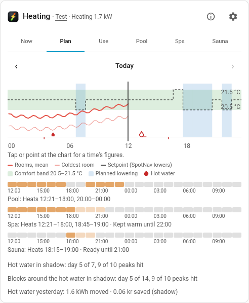

# Hot water

**Shadow by default.** SpotNav plans hot water from the first day but writes nothing until you turn on **Control the
heat** and the plan has passed its own gate. The **Hot water now** button works from the start.

| Part | What it does | Status |
| --- | --- | --- |
| **Planned runs** (level B) | Starts one run that ends by itself in the cheapest hour before each peak. Needs a pump with such a boost, or a relay on the pump's hot-water input. | Shadow until at least 7 days, each weekday seen, 10 peaks, 70 % hit and a saving. |
| **Blocks around hot water** (level A) | Keeps the heat plan's lowerings away from the pump's own reheats before a peak. Needs a relay or SG Ready path. | Shadow until at least 14 days, 10 peaks and 70 % hit. |
| **Hot water now** button | Starts a run on your press. | Live, for anyone who sees the card. |

Hygiene is the pump's job: keep its periodic hot-water increase (legionella programme) on. SpotNav never turns it
off. A [beta tester](beta-testing.md) skips the shadow days, but never a safety rule.

Which pumps can start a run on command is in [Supported heat pumps](supported.md#supported-heat-pumps).

## How it works

SpotNav learns when the household uses hot water and plans the tank's reheating into the cheap hours before it. It
starts in shadow: it shows what it would do and what that would have saved, and writes nothing until it has shown
that it hits your peaks. There is no setting of its own beyond **Control the heat**.

## The peaks

A peak is a time of day by which a full tank is wanted, for example the morning showers. SpotNav finds
them in the heat pump meter: each hot-water run (the meter's plateau of about three times the heating level) follows a
draw, so the draw is placed 20 minutes before the run. Runs under half your pump's median run (at least 0.2 kWh)
are the tank's standby loss, not use: on a pump whose runs are 0.4–1.0 kWh that is about 0.35 kWh. Over
the last 21 days the draws are grouped by time of day; a group that holds at least a fifth of the hot water used, and
at least five draws, is a peak, at most three a day and at least three hours apart. Until a week has been seen, the
peaks are **05:00–07:00** and **17:00–20:00** (ready by 05:00 and 17:00); a learned peak replaces the nearest of them.
Runs that SpotNav or the button started are left out, so a boost does not teach SpotNav that nobody showers.

## The plan

Before each peak, SpotNav looks for the cheapest quarter-hours for one run that ends by itself: from the
end of the previous peak, at most eight hours ahead, done before the peak. Spare sun counts at the sell price. A run
never goes where the house, the cars' charging and the battery's grid charging leave no room under the fuse or your
import target, nor into an hour where SpotNav lowers the heat on a path that also blocks hot water, nor while it is
too cold outdoors. It is planned only where it saves at least 0.10 kr (the same in your area's currency, about one
euro cent) against the pump's own reheat after the peak, counted with the tank's standby loss; otherwise the pump
does it itself. A cloud route gets at most two planned runs a
day, a local one three.

## On the heat card

*Plan* shows the planned runs as hollow droplets with a thin bar over their length and the
peaks as small ticks on the time axis ("shower 06:00"); the measured runs stay filled droplets. Tap a run: "Would heat
hot water 04:15–04:45 · 42 öre/kWh · ready by 06:00", and once it has passed, what the pump did instead ("Would have heated hot water at 04:15 · the pump ran by itself at 06:20"). The strip on *Now* says "hot water 04:15". Under the chart:
yesterday's review (kWh moved and money saved, in shadow), each peak hit or not, and the shadow's progress ("Hot water in shadow: day 5 of
7, 8 of 10 peaks hit").

## From shadow to steering

Planned runs are written only with **Control the heat** on and after at least seven shadow
days, one of each weekday, at least ten peaks seen, 70 % of them hit (the pump ran within 45 minutes of the peak) and
a saving above zero. Once open, the gate stays open while SpotNav steers; if the pump reheats within 90 minutes after
a peak despite the run three times in a week, SpotNav goes back to shadow and the week starts again. A run is not
started while a boost already runs (yours, the button's or the pump's own run: that fills the peak), while the house
needs the compressor (too cold outdoors, a room below the band, outdoor or room readings missing), without a meter
reading in the last ten minutes (or, without a meter, the pump's own state), or after a write that was not read back
(that ends planned hot water for the day; a local route is tried once more after five minutes, a cloud route never).
A pulse is read back by the run it asks for: the meter must show it within ten minutes.

## With the cars and the battery

A run that will be written is part of the house's expected load, so the cars'
charging plans and the battery plan see it, and the pump's own reheat it replaces is taken out where it was expected.
What the house profile has already learned of these runs is not counted twice. At its start, the run needs room on
the fuse's tightest phase now (its whole power on one phase, the worst case; what a battery holding the grid would
yield counts as room) and room under your import target for the hour: if a car has started since, it waits. With a
phase reading missing or stale it does not start at all. If a phase goes over the fuse while SpotNav's own run is
going, SpotNav ends that run (where the pump has a way to end it) and starts no more that day. Your own boost and the
button's are never ended.

## The Hot water now button

Where the pump has a hot-water boost that ends by itself (NIBE's temporary lux "one time", myUplink's
temporary lux, CTC's extra hot water for an hour) or you chose a **hot water entity**
wired to the pump's hot-water input (SpotNav gives it a short pulse), the *Now* tab has a **Hot water now** button for
anyone who sees the card. It shows *Starting…* until the pump reads the start back, then the time left (exact on a
timer, about on a one-time run) and, where the boost can be ended early, **Cancel**. One start per ten minutes (a
start that failed does not count). While a phase is already over the main fuse the button says so and starts nothing:
turn something off and press again. The button is your own start: SpotNav never stops it, never sheds it for the fuse,
and a heat block ends at once and starts no more until its run is over. HeishaMon's force hot water is offered to the
button only, since whether it ends by itself is not verified: SpotNav turns it off 15 minutes after the expected run.
Without such a boost the button is not shown.

## Blocks and the hot water

On a relay, SG Ready or SG Ready API path a heat block stops the compressor, and with it the pump's own hot-water
runs. Where the pump has no boost SpotNav can start (a NIBE without a network on a relay, for example) this is the
only way SpotNav touches the hot water: it moves the pump's own reheat to after the block. These rules keep that
safe.

**Always, while SpotNav steers the relay:**

* No block starts while the pump makes hot water (the meter's hot-water level, or the pump's own state). A run that
  shows within five minutes of a closing was caught by it as it began: the block ends at that look (every 30
  seconds). A run that shows later under a block means the block lets hot water run on this pump (a relay that
  only lowers the curve): the block stays.
* After a block the pump has at least an hour back to normal before the next one, so a reheat the block held runs
  then: a run waits at most one block (three hours at most), and no new block starts while it runs.
* With a tank temperature sensor in the pump's integration: below 40 °C no block starts and a held one ends, until the
  tank reads 45 °C again.

**In the plan, shadow first.** SpotNav also shapes which hours it lowers:

* No lowered hour in the **two hours before each peak's ready time** (the peaks above; 05:00 and 17:00 until learned),
  so the pump's reheat for the showers is never held into them. Not where the pump has already made a real run (more than a standby
  reheat) since the previous peak ended (the tank was filled after its last use), and not where a run of SpotNav's
  was written and read back for the peak, or a boost already ran when it came due (a run only planned keeps the
  guard).
* Without a tank sensor, at most **four lowered hours a day** (the heat's own limit is six), so the pump gets its
  reheats between the blocks. With a tank sensor the 40 °C rule stands in for this.
* The pump's **periodic increase**, where the meter shows it: a run at least twice the usual one (energy and length)
  at night, seen three times at the same time of day at equal intervals of 2 to 30 days (NIBE's default is 14, so
  about four weeks of meter readings first). Its next one is kept free of blocks from an hour before to half an hour
  after its usual length. Until SpotNav has seen it three times, and on a pump that runs it at varying times, a block
  can still delay it by one block (at most three hours), after which the pump runs it.

A lowered hour these rules take out may move to the next expensive hour the plan allows, or simply go. In shadow the plan
SpotNav steers by still has the hour: *Plan*'s readout says what would change ("would shorten the block before the
06:00 shower") and the review under the chart counts yesterday's hours and the **late reheats**: a peak whose
pump run a block held until after its ready time ("06:00 reheated late after a block"). The progress line
reads "Blocks around the hot water in shadow: day 5 of 14, 8 of 10 peaks hit". These rules steer the plan
once **Control the heat** is on and after at least 14 shadow days with at least ten peaks seen and 70 % of them hit (no
saving is asked: the rules only give up lowered hours). Three late reheats within a week of steering never send them back
to shadow, which would protect less: they get stricter instead (three hours kept free before each peak, one
lowered hour less a day) until seven days in a row without a late reheat, and the card says so ("Blocks kept further from the hot water
after too many late reheats"). On a beta site the shadow days are skipped, as for the planned runs, but the
stricter rules after late reheats apply there too.

**With the cars and the battery.** A peak's expected reheat that falls in a block SpotNav will hold is moved to the
block's end in the house's expected load, so the cars' and the battery's plans see it there.

## What SpotNav never does

It never turns off the pump's own periodic increase (NIBE's periodic hot-water increase, CTC's
legionella programme): keep it on, hygiene is the pump's. A run a block holds waits at most one block (three hours at
most), and a run caught by a closing as it began ends that block at once. An increase SpotNav has not recognised can be
held by one block, as any run.

The diagnostics (`heat_settings.shadow.hot_water`) show the boost route, the mode, the gate, the peaks, the picks, the
days kept with their reviews, SpotNav's own writes and the blocks' rules (`level_a`: mode, gate and the hours cut).
