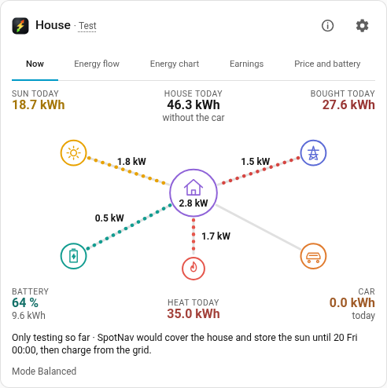
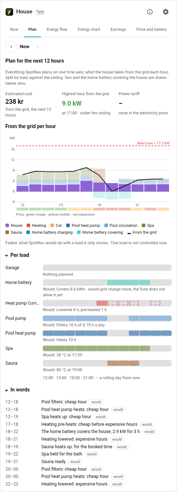
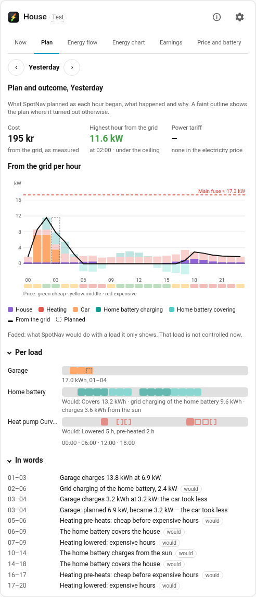
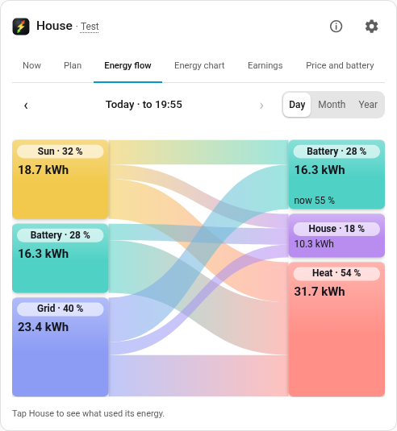
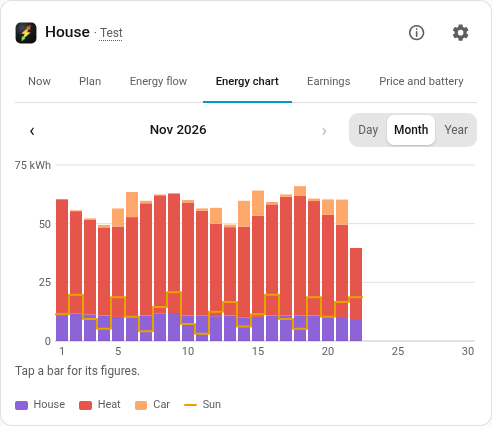
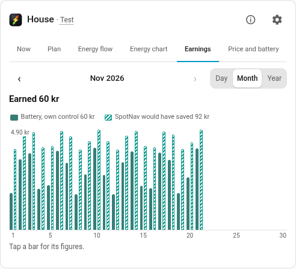
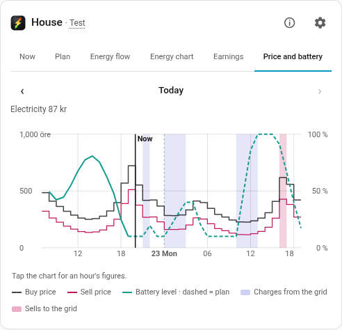

# The house card

A second card in the same bundle as the charging card, about the whole house: its load, the sun and the home battery.
Its header is the charging card's: the SpotNav mark, "House" and a muted status after it. Until battery control is on
and checked, the status says "· Test" (tap it: "SpotNav is not controlling anything yet" and what that means): the
card shows what SpotNav forecasts and what its battery plan would do, and writes to nothing. While the battery's own
optimiser runs it (Sigenergy's AI mode, for one) it says "· Own control". Once SpotNav controls the battery
([Home battery](home-battery.md)), it says what the battery does now: "· Charges from the grid", "· Holding",
"· Sells to the grid" or "· Discharging" for the action SpotNav runs, else, as the battery's own self-consumption
measures, "· Charging from the sun", "· Discharging" or "· Idle". The mode is in the Now tab, under its picture.
The card itself never writes to anything. The charging card stays about the car; the house card is where a home without a charger starts.



## Add it

Add a manual card to a dashboard:

```yaml
type: custom:spotnav-house-card
site: <the site's entry id>
```

Use `charger: <a charger's entry id>` instead and the card finds that charger's site (`site` wins if both are given).
The card is also in the card picker as "SpotNav house", set to the first charger's site, else the first site.
It reads one read-only answer from SpotNav every five minutes, and, while its Now tab is shown, the live flows every 30
seconds.

A wall screen can show one tab only, without the tab row: `tab: now`, `flow`, `graph`, `earn` or `price` (the card editor's
**Show only tab**; `all`, or leaving it out, shows the row). It is a setting of this card, not of SpotNav. In a box of
fixed height (a layout card on a wall screen, a sections view with a number of rows) one part of the shown tab takes the
box's spare height (the picture in Now, the diagram, the chart, the bars, the price chart) and the hints and footers go:
the tap hints, the notes under the earnings. Every tab fits a 650×520 box with the tab row shown.

## Settings

An administrator sees a gear in the card's header. It opens the **settings popover**, the same one the heat card's gear
and the charging card's **Settings** share, for the card's site. Its sections follow what the site has:

* **Get started**: what is left for the site: add a charger (answer **Not needed** for a home without one), an
  electricity price, the grid meter's sign, a solar forecast, the home battery, heating.
* **Electricity price**: the same rows as the charging card's: which electricity price the site uses (and **Price
  from** where there are several), the price area, VAT, energy tax and grid fee with the grid tariff beside it, the
  supplier's markup and what a sold kWh earns (shown where something is sold), and the demand charge. Without an
  electricity price, one row that adds one.
* **The site**: main fuse, import target and the meters.
* **Solar**: the solar forecast sources, as on the charging card.
* **Home battery**, when SpotNav finds one: the mode, the battery control switch, what is missing and the check
  ([home batteries](home-battery.md#spotnavs-own-battery-control-off-by-default-in-testing)).
* **Heating**, always: one line "Nothing found" until a heat pump, a heat meter or a thermostat is found; tap it to add a
  water heater on a relay. Otherwise the [heat settings](heat-pumps.md) in full: on the relay path the **Control the heat**
  switch with its line ([SpotNav's own heat control](heat-pumps.md#spotnavs-own-heat-control-relay-off-by-default)),
  the sensors with each indoor sensor's offset, the control path, hot water, the zones and the cooler night.
* **Support**: download the debug info.

## What you see

Above the tabs only the header. Then six tabs, in this order: **Now**, **Plan**, **Energy flow**, **Energy chart**,
**Earnings** and **Price and battery**. Tap one, or move with the arrow keys (Home and End for the first and last; the tabs are a
tablist for screen readers). The row says the long names while they fit the card; where they do not (a phone) it says
short ones ("Now · Plan · Flow · Chart · Earned · Price"), and in a very narrow card an icon each. The card measures the row as
drawn, so this follows the language and the font, and choosing a tab never changes the wording. A short name and an
icon keep the long name as their tooltip and for screen readers. The card remembers the tab per card in this browser.
A tab that can never fill on the site is left out: **Energy flow** without the day's energy flow, **Earnings** without
a battery, a heat pump meter, a saving or a car, and **Price and battery** without a battery and without prices. Without
a battery that tab is called **Price**.

### Now

The live flows as a picture: the house in the middle and around it only what the site has: the sun (top left), the grid
(top right), the battery (bottom left), the car (bottom right) and the heat under the house. A line runs from each to the
house, with dots running the way the power flows and its kW beside it. The dots are
amber for the sun, teal for the battery, the car's and the heat's own colours, red for an import and green for an export;
they run faster with more power. Where the browser asks for reduced motion they stand still, and a filled arrowhead on
each line's middle shows the way instead. The house's own power (the
heat included, the car not) is in its circle. The car's line is drawn only while a car is plugged in; otherwise its node
is dimmed. A house with the grid alone is one low row, the grid to the house.

In the corners, the day so far, each figure in its part's colour (a little darker on a light card, lighter on a dark
one): *Sun today*, *House today* (the heat included, the car not: where the site has a charger it says "without the
car", since a battery's own app, Sigenergy's for one, counts the charger into the house's use and so shows a higher
figure), *Bought today* with what was sold in green, the battery's level and
the energy in it, *Heat today*, and the car's level with "25.5 kWh today" under it (its energy today alone while no car
is plugged in). These are the energy flow's own figures, so they add up with the Energy flow tab. A name too long for
its corner ends in "…".

Under the picture: one sentence of what the battery does and what its plan does next ("The battery covers the house and
stores the sun until 18:00, then it sells to the grid."); while SpotNav does not control the battery it says who does and
what SpotNav would do ("The battery runs itself (Sigenergy AI) · SpotNav would …"). Then the day's money: "Today: the
battery earned 11 kr · SpotNav saved 17 kr". The battery's figure is its *arbitrage*: each kWh it gave back, over what
that energy cost to store ([the battery plan](battery-plan.md)), the same measure the battery's own app shows. SpotNav's
is against a comparison of its own per part (below). Small and grey under it: the mode, and a learning period that holds
something back ("Grid charging at most 1.4 kW while the house's peaks are being learned (9 days left)."; with no grid
charge at all, "Learning the house's peaks, 2 days left. Does not charge from the grid until then."). A heat pump meter
to choose (more than one could be it) is said here.

The live figures are read every 30 seconds while Now is shown: the grid and the chargers as load balancing reads them,
whether a car is plugged in and its level, the battery's own power, the sun from the Energy dashboard's solar power
sensors and the heat from the heat pump's meter where it is a power sensor (else the last quarter hour's mean). They are
written into the picture in place: the dots keep running and only start again when a line turns. From an older SpotNav
the picture has the day's figures and the battery's own power only, and says "no live figures yet".

### Plan

Everything SpotNav plans for the home on one time axis, from the running hour to the end of the prices known: tonight
and, once tomorrow's prices are out (about 13:00), all of tomorrow, at most 36 hours. It rolls with the clock, so late in
the evening it shows the night and tomorrow, never just what is left of today.



* **At the top**: the estimated cost from the grid over those hours, the highest hour from the grid against the ceiling
  ("at 03:00 · over the ceiling"), and where the electricity price has a power tariff, the month's peak so far.
* **The chart**: per hour what the house takes from the grid, split by load: the house, the heat pump and the water
  heater (part of the house's figure), each car, the home battery charging; below zero the sun and the home battery
  covering the house. A line is the net from the grid. The dashed line is the ceiling that applies, labelled: the import
  target or the power level, the power tariff's ceiling, else the main fuse as total power. A dot marks an hour over it.
  Under the chart a price strip: green the cheapest third of the hours, yellow the middle, red the most expensive.
* **Per load**: a lane each with the hours it runs (the heat's and the zones' lowered hours dashed) and one line of why.
  A load the [shed order](site-and-load-balancing.md#the-shed-order-under-the-ceiling) holds back right now says so
  ("Water heater paused for the ceiling until 15:00", the heat lowered *for the ceiling*).
* **In words**: the plan as a list, in time order ("01–05 Garage charges 14.8 kWh at 3.7 kW").

**Per load** and **In words** fold away under their headings: both are folded until you open them, and while folded
the heading says what is inside ("Per load · 4", "In words · 6 lines"). Tap the heading to open or fold it; the card
remembers it per site in this browser. While a car's charge does not fit under the ceiling, **Per load** is always open,
so the choices are never hidden.

**When a car's charge does not fit.** Where the import target or the power level holds the hour and the car cannot be
ready by its departure under it, the car's lane says so ("Does not fit under the ceiling (6.0 kW): 4 kWh short by
07:00") with the choices for this departure only: **Take what fits (≈ 12 kWh)**, **Later departure (17:00)** (the
earliest whole hour by which all of it fits; pressing it moves this one departure there) and **Allow the peak (≈ 12 kW,
≈ 105 kr)**, asked twice since it can cost the month. The same line and choices are on the charging card and in the
notice; see [the import target](site-and-load-balancing.md#holding-the-chargers-under-the-import-target). A shadow-only
ceiling (the power tariff's) and the main fuse never make a "does not fit": the plan is made at what the fuse allows.

A load SpotNav only watches (its control is off, or still being checked) is drawn faded and says *would*: what SpotNav
would do, never shown as done. Read from `spotnav/get_plan` while the tab is shown and again with the card's refresh;
nothing is planned anew for it.

**Days gone by.** The arrows beside the tab's title step back a day at a time, up to 7 days: **Now** (the plan above),
**Today** (midnight to midnight, the hours gone by as they were, the rest as planned, with a line at now), **Yesterday**
and so on. A past hour shows, per load, what the plan said when the hour began, what actually ran (measured) and why:
"Garage: planned 3.7 kW, charged 2.1 kW – the car took less", "Water heater paused for the ceiling". Where the outcome
differs from the plan, the planned figure is a faint dashed outline. Hours Home Assistant was not running are grey and
say so; nothing is filled in for them. The history starts when SpotNav 3.0 is installed, so the first days are short.



#### When SpotNav plans again

The plan and the control are two things. The plan picks the hours; the control follows the meters all the time: the
main fuse, the sun, the import target and the [shed order](site-and-load-balancing.md#the-shed-order-under-the-ceiling)
act within seconds. So a car can charge less than planned in an hour without the plan changing.

* **The home battery** is planned again at least once an hour, and at once when something changes: new prices, a new
  solar or house forecast, a car's plan, a setting, or a battery whose level has drifted well away from the plan (at
  most every 15 minutes for that).
* **A car** is planned again when something happens: it is plugged in, new prices are out, the departure, the target or
  the strategy changes, or its level is read. During a charging window SpotNav checks each minute that the charge keeps
  up; if it falls behind, it plans again, at most every 5 minutes and less often while that changes nothing.
* **The heat** is planned again each hour. Its rules (a cold room, the hot water, the legionella heat) apply all the time.

The days gone by keep the plan as it stood when each hour began, so a plan made again within the hour shows as a
difference between the planned and what ran.

### The period tabs

Energy flow, Energy chart, Earnings and Price and battery share one row to choose the period: "‹ Today ›" and **Day |
Month | Year**. The arrows step one period; tap the label ("Today", "Yesterday", "Wed 11 Nov", "Nov 2026", "2026") for the
calendar or the list. Today's label in Energy flow says how far its figures reach ("Today · to 17:00"). Nothing after
today is offered, and nothing more than ten years back. The period stays chosen as you switch between the four.

* **Energy flow**: where the period's energy came from and where it went (the diagram below in *Heat in the flow* and
  *How the flow is counted*). Every block has its name and its share of the period's energy in a pill at its top
  ("Car · 35 %") and its kWh under it; a column grows as wide as its widest pill needs. Tap House (or Heat) for what
  used it. Only where no diagram can be drawn yet (nothing has flowed between two blocks) the figures stand as tiles:
  *Sun*, *House*, *Discharged*, *Charged*, *Bought*, *Sold*, *Heat* and *Car*, each only where it has energy.

  

* **Energy chart**: today covers 12 hours back and 24 ahead: bars for the house's load per hour (measured before now,
  forecast after in a lighter shade), the heat in it, and an area for the sun; over a past bar a short line shows what
  the forecast was. The car is hidden until you tap it in the legend; shown, it is stacked on the hour's bar, so the
  whole bar is the hour's mean power with the car. A past day has its 24 hours. A month has a bar per day and a year a bar per
  month, as wide as the chart allows, with the house, the heat and the car stacked and the sun as a stepped line over
  them, on a kWh axis. Tap a bar or an hour for its figures; the arrow keys walk them.

  

* **Earnings**: what SpotNav saved over the period as bars, an hour, a day or a month each, stacked with a part per
  thing it controls: **Arbitrage (battery)**, **Heat** and **Car**, only those the site has (each as in *What SpotNav
  saved* below). The parts are toggles above the bars, each with its sum; the headline ("Earned 54 kr") is the sum of the
  parts shown, and the card remembers which are hidden, per card in this browser. A part that cost money goes below the
  line. The car's saving is counted where its charge started: on that day, and in a day's view in that hour. The heat's
  is an estimate for a whole day: a day's view has it in the headline, not in an hour's bar. Hourly figures are kept 40
  days and daily ones 400; an older day shows its sums and says so.
  **Before SpotNav controls the battery** (in test, or while the battery's own optimiser runs it) the battery's part is
  *Battery, own control*: what the battery earned on its own (counted in the headline, it is money the house got), and
  beside it, hatched, *SpotNav would have saved*: the same days as SpotNav's plan would have run them, from each night's
  review (the battery's own figure plus what the review says the plan's day would have cost less, or more). So the two
  can be compared before control is turned on. The would-be figure is never in the headline, a day not reviewed yet
  counts as it went, and a single day has it in words under the bars (today's comes the night after).
  **Sun**, on a site where the battery's nightly reviews value the sun: the sun's energy the house used, at the price
  then, plus what was sold. It is the same figure as *What the sun gave* in the details' Money section, from the same
  reviews, so the two always agree. It is not something SpotNav did and is never part of *SpotNav saved*, but it is
  money the house got, so it is in the headline like the others; hide it with its toggle to see SpotNav's parts alone,
  or keep it shown to compare with a battery maker's earnings figure that counts the sun. It is a whole day's figure:
  a day's view has it in the headline and its toggle, not in an hour's bar; a month or a year has it as a part of each
  day's or month's bar. The sun's days are kept as long as the reviews are.

  

* **Price and battery**: a day only (a month or a year chosen on another tab becomes the day inside it; the picker has no
  Day | Month | Year here). Under the picker a line with what the battery's figure counts ("What the battery gave back, at
  the price then, less what charging it cost") and what the electricity cost. It is not the cash flow some battery apps
  show per hour, which books a charge as a cost when it happens. The day has the
  buying price (every fee included) and the selling price per hour, with the battery's level on its own 0–100 % axis,
  dashed where it is planned; the hours the plan charges from the grid are tinted violet, those it sells more lightly.
  What the battery earned, per hour, in a period or in total, is the Earnings tab's: it is not repeated here as bars or a
  heading, but a tap on an hour still says what the battery earned in it. The battery's hourly figures are kept 40 days.
  A tap explains the figure: "08:00: discharged 3.5 kWh, worth 8.10 kr, minus 5.60 kr that the energy cost to charge =
  2.50 kr", and an hour that charged says "charged 4.2 kWh for 3.90 kr (counted when the energy is used)" (the same
  words on the Earnings tab's battery part). It will not match the battery maker's cash-flow figure to the öre: that one
  counts what is bought and sold on the grid in the hour, so a charge shows as a cost in the hour it is made, while
  SpotNav counts a kWh's cost when that kWh is used, at the average of what the stored energy cost, with the sun's
  energy valued at the sell price. Over a few days the two should be close. Days from before the breakdown was kept
  show the short figure.

  

### The details

The "i" in the header (**Details**) opens the history: a day, month or year, chosen with the same period row as the
tabs. Every figure in it is the chosen period's own and stands once; nothing is behind a switch. Its sections, in order:

* **The cost bars**: the comparison the tabs do not have: what the electricity cost, with what the battery saved against
  the same days with no battery hatched on top.
* **Share of perfect**: the battery's ways side by side (below).
* **Money**: what the period cost, and what the battery, the sun and both together saved (*The battery saved*, below).
* **SpotNav saved**: the period's sum and a row per part (its bars are the Earnings tab).
* **Forecast errors** and **Day by day**.
* **How it is counted**: what SpotNav's saving is compared with, how the flow is allocated, and the sources, among
  them the home battery's round trip ("Round-trip efficiency: 84 %, learnt", or "assumed 90 %" until it is learnt; see
  [the battery plan](battery-plan.md)).

The energy flow is not here: it is the Energy flow tab.

**Share of perfect** opens with a headline ("The battery's own control 77 % of perfect · SpotNav Balanced 74 %") and a
bar per way: the battery's own control, each of SpotNav's modes (the chosen one marked) and plain self-consumption.
Under the bars one table has a block per way, and the perfect plan last: what it *saved* against the same days with no
battery, its *cycles*, how often it *switched* between charging and discharging, and the kWh it charged *from the grid*
and sold *to the grid*. A share stands on its bar only, the money and the work in the table only. The perfect plan is the
best the battery could have done that day in hindsight, with the measured house, sun and car and the same battery,
against the same day with no battery. The rules that keep it fair:
  * Every way is measured against one perfect plan, under the most permissive rules any of them used, so none can
    beat it: where selling was possible that day (the site sent energy to the grid, or the battery's own control or a
    SpotNav mode sold) it is allowed to sell, with Max profit's rules; otherwise it does not sell either. The note
    under the shares says which.
  * Every way starts the day at the same measured level, and what is left in the battery at midnight counts at the
    next day's mean buy price (with fees) less the battery's losses: a price that is known at the time, as the next
    day's prices come at about 13:00. Until they are in, the day uses its own price and says so.
  * Only whole days count: a day with under 90 % of its quarter hours measured is an "incomplete day", with no share.
  * A share is shown only where the perfect plan saves at least 5 kr a day (5 € on a euro site); below that it says
    "too small a difference to compare". A week or a month sums the savings over its whole days first and then
    divides, so a charge on one day and the discharge it pays for on the next even out.

Before the first whole day with a perfect plan the section is *The battery's modes against self-consumption* instead:
each of SpotNav's modes and the battery's own control in money, against the battery only storing its own sun.

**The battery saved** under Money and the battery's own control in the table are both against no battery, and still
not the same sum. Money's figure is the battery app's measure: what the days really cost against the same days with no
battery (the house and the car on the grid, the sun still there), over every measured day, and the energy the battery
holds at midnight is not counted. The table counts whole days with a perfect plan only, and counts what was left at
midnight at the next day's mean buy price, so that a battery that emptied itself does not look better than one that
saved its energy for the morning. The note under the table says both sums and both day counts. Hold Money's figure up
against the battery app's own; read the table for which way of running the battery is best.

### Heat in the flow

**Heat** is the heat pump's meter and the heating zones' own meters together, each counted once; **House** is what is
left, so the totals still add up. A heating zone is a thermostat chosen under Settings → Heating → Zones: electric
floor heating or an air-to-air heat pump. There is no setting for its meter: SpotNav reads an energy sensor on the
thermostat's own device in Home Assistant, else its power sensor. A zone with neither is left out of Heat (the
diagnostics, `heat.meter.zones`, list it and why). Nothing is counted twice: a zone whose sensor is the heat pump's
meter, sits on the heat pump meter's device, or is nested inside the heat pump's meter or another zone on the Energy
dashboard, is left out, and so is a second thermostat on a device already counted.

Where Heat holds more than one source, tap **Heat** (or focus it and press Enter) for its own pie: the heat pump and each
zone by name, with kWh and %, for the day, month or year the tab shows.

The hour chart's heat (and its forecast) and *Heat today* hold the zones too, from the hour they were added. A zone
added today makes a step in the heat forecast's review, which settles within a week.

### What the house used

Tap **House** in the energy flow (or focus it and press Enter) for a pie of the house's energy over the day, month or
year shown:

* each meter of Home Assistant's Energy dashboard under **Individual devices**, by its name there (at most eight
  named slices). A meter under 1.5 % of the house, or past the eighth, goes into a light grey **Other metered** slice
  and is named under the pie. A darker grey **Unknown** slice is what no meter explains: the house less all the meters.
  There is no setting: SpotNav reads the meters the Energy dashboard already has.
* The car and the heat are not in it: the flow shows them on their own. SpotNav sorts these meters out by itself and
  counts each only there: a meter whose sensor is a charger's, the heat pump meter's or a heating zone's, or that sits on
  the same Home Assistant device as a charger or a heating zone. (The heat pump's meter is told by its sensor alone: a
  clamp meter with several channels has the heat pump on one and other circuits, such as the stove, on the others.) A
  device nested in another one counts once, in its parent.
* Where the meters add up to more than the house (a device meter that also measures the car or the heat, or meters that
  disagree), Unknown is shown as 0 and a line says by how much.
* An hour a meter cannot have used (more than the whole house used that hour, or more than the main fuse allows) is
  not counted: it is a broken statistic, typically a plug whose total drops and comes back, which Home Assistant counts
  as new energy each time. The meter is shown with its other hours, and one line names it and how many hours were left
  out, with where to repair it: Developer tools → Statistics. A meter with no believable hour is left out of the pie
  and the line says so. The same holds for the heat pie's sources.
* Where the meters add up to more than the house (a device meter that also measures the car or the heat, or meters that
  disagree), Unknown is shown as 0 and a line says by how much.
* With no individual devices the pie is Unknown alone, with a line on where to add them: Settings → Dashboards → Energy →
  Individual devices.

The figures come from the recorder's statistics, by the hour and for today's running hour by five minutes, and are read
only when the pie is opened.

#### Where a meter belongs

Some meters SpotNav cannot tie to a load: a Shelly in the fuse box on the floor heating's circuit, a plug in front of
the car's charger, or a meter that sits inside another one. An administrator taps its slice (or its name, with the
keyboard) to choose **Belongs to**: **House** (the default), **Heat**, **Car** or **Don't count**.

* **Heat**: the meter is counted in Heat (the flow's block, the hour chart and the heat pie, marked "changed by you")
  and taken out of the house pie, so House drops by as much.
* **Car**: the meter is taken out of the house pie as already counted with the car. The car's figure stays the
  chargers' own, so nothing is counted twice.
* **Don't count**: the meter is counted nowhere, for a meter already inside another one.

A meter moved out of the house is listed under the house pie with where it went and a button to bring it back. The
choice is saved per meter in the site's settings (`meter_belongs`); a household member sees the pies without the
choice. Only meters SpotNav did not sort out by itself can be moved.

### What SpotNav saved

Each part is compared with what would have happened without SpotNav, and only what SpotNav itself did counts.

* **Battery**: the battery's earnings of the day (the headline's measure), in the share of the day SpotNav controlled
  the battery. In test ("· Test" in the header), with SpotNav's control off, or while the battery runs its own
  optimiser, the battery is not part of SpotNav's saving at all: what it earned is its own, and the headline says
  "(own control)".
* **Car**: against charging at once on plug-in. The same kWh are charged from the moment the car was plugged in, at the
  power the car actually drew (the highest rate of the plug-in), until they are in or the car was unplugged, at the buy
  price of those quarter hours with every fee, as the card prices hours. The saving is what that would have cost less
  what the charge cost. A charge someone started (or one SpotNav cannot tell the start of) saves 0 but is still the
  car's; a charge that started at plug-in anyway saves about 0. The car is counted from the first charge SpotNav kept
  the plug-in time of, so the line has no car part before that. A charge is counted on the day it **started**, the same
  day the charger card's history counts it, so a charge over midnight is one figure on one day in both cards. The
  charger card's history shows the same figure per charge, day and month ("SpotNav saved 33 kr against charging at once
  on plug-in").
* **Heat** (estimated): the heat control's own review of the day: what SpotNav's lowerings of the relay took away at
  their hours' prices, less the learned rebound bought back afterwards ("Yesterday the relay lowered 3 h: 1.58 kr"), in
  the share of the relay's closed time SpotNav itself held it. What SpotNav's plan would have done in test never counts.
  A day is reviewed the night after, so today has no heat part yet.

**Nothing is counted twice.** Only the car's kWh from the grid count in its saving. The flow's rule says, hour by hour,
how much of the car's energy came from the grid, the home battery and the sun. The kWh the battery gave the car are
already in the battery's earnings (it values every kWh it gives the house, the car included, at the buy price), and the
sun's are worth the selling price whenever they are used, so both are left out of the car's saving, in what happened and
in the comparison alike. The battery's figure holds no part of the car's. An hour the flow has no figure for counts all
the car's kWh as grid on a site with neither battery nor sun, and none of them on a site with either.

The Earnings tab draws these parts as bars per hour, day or month. The details (the "i" in the card's header) have the
same parts summed per day, month and year: a *SpotNav saved* box with the total and a row per part (with the days it
covers where fewer than the period's). The heat's reviews are kept about a month, so an older day has no heat part.

### How it is counted

Last in the details, without a figure of its own:

* **What SpotNav saved is compared with**: one line per part the period has: the battery (or that it ran under its own
  control, so what it earned is not SpotNav's), the car and from which day it is counted, and the heat, an estimate.
* **How the flow is counted**: the meters do not say which source fed which use, so the split follows a fixed rule, not a
  measurement: each hour (or quarter hour) the sun goes to the house first, then the car, the battery and the grid, and
  the battery covers the house before the grid does. Where the car or the heat pump's meter could not be read every hour,
  it says so.
* **Sources**: the weather entity, outdoor temperature, holiday calendar and solar forecast the forecasts read, whether
  temperature is in the house forecast (and why not), the battery, and what is stored in it now with its average cost
  (marked estimated until the first measured energy has been used). A note lists what the plan assumed, such as the
  battery's lowest level. Where the house's load is measured as the grid less the chargers, a note says that it looks
  smaller while the battery covers the house.

What the sun gave, under Money, is the day with the sun and no battery against the same day with no sun and no battery
(the sun used in the house at the buy price, the sold sun at the sell price). The sun's production comes from the Energy
dashboard's solar statistics, read a little after midnight. *Sun and battery together* is then against a day with
neither.

The card says plainly when the battery runs its own optimiser ("SpotNav plans beside it only to compare, and writes nothing
to it") and when it is in test ("Test: SpotNav plans the battery but does not control it yet").

Money is in the price area's minor unit (öre, cent) as the plan counts it. Nothing here controls a charger or a battery. The
forecasts behind the card are described in [Forecasts](forecasts.md).
