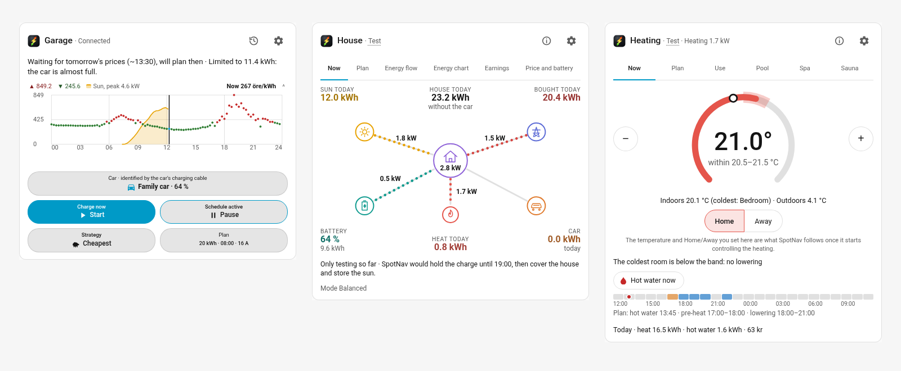

# SpotNav

**Learns your home. Plans your energy.**

Local control for your EV, battery and heating, planned around spot prices, solar and weather. Built for Home
Assistant.

SpotNav is a home energy management system (HEMS) that runs inside Home Assistant. It reads the price of
electricity for the next day or two, your grid meter, your solar production and the weather forecast. From that it
plans when the car charges, what the home battery does and when the heat pump can rest. Everything runs on your own
Home Assistant. SpotNav needs no account and no cloud service of its own.

## Start here

1. [Get started](get-started.md): install SpotNav and add your first charger or site. About ten minutes.
2. [What SpotNav does](what-spotnav-does.md): charging, the house, the battery, heat, hot water and solar, and which
   parts act today and which only show what they would do.
3. [Settings](settings.md): where each setting lives.

Is your hardware supported? See [Supported hardware](supported.md).
Something not working? See [Troubleshooting](troubleshooting.md).

## Acts or watches

SpotNav controls a device only when you have turned that part on, and only after a check that the device obeys.
Until then it runs in **shadow**: it plans, shows what it would do and what that would have saved, and writes
nothing.

| Part | By default |
| --- | --- |
| EV charging and load balancing | Acts |
| Home battery | Shadow. Control is opt-in and still in testing. |
| Heating | Shadow. Control is opt-in ("Control the heat") and starts after a check. |
| Hot water | Shadow. Goes live under "Control the heat" only after it has hit your peaks for a week. |
| Own solar forecast | Background only. Logged and scored, not used by any plan yet. |

[What SpotNav does](what-spotnav-does.md) has the details.

## The app

The SpotNav app for Android pairs with your Home Assistant and shows the same plans on your phone. See
[The SpotNav app](app.md).
