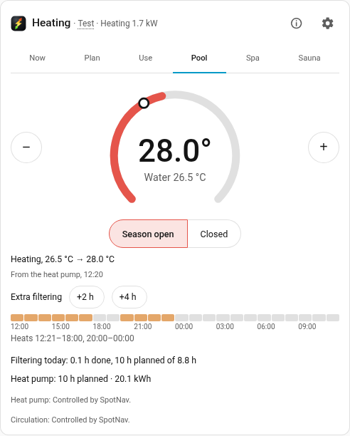
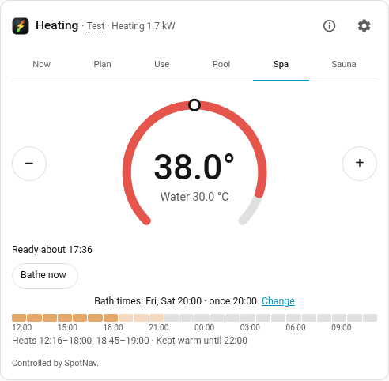
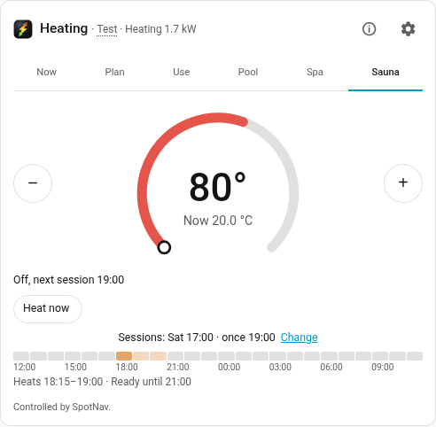
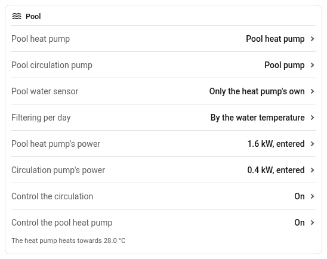
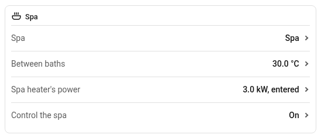
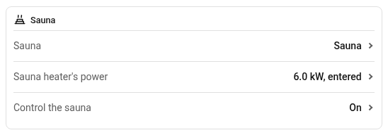

# Pool, spa and sauna

SpotNav plans a pool (its circulation pump and its heat pump), a spa and a sauna as loads that can be moved: the
filtering and the pool's heat in the sunniest or cheapest hours, the spa and the sauna warm by the times you book. The
heat card's **Pool**, **Spa** and **Sauna** tabs show the plan and what SpotNav would do ([the heat card](heat-pumps.md#the-heat-card)).

**Watched by default.** Nothing is written until an administrator turns on the load's own switch in the gear's
**Pool**, **Spa** or **Sauna** section: **Control the circulation**, **Control the pool heat pump**, **Control the spa** or
**Control the sauna**. Without it the tab says what SpotNav *would* do.

## The settings

Each load has its own section in the gear's settings, shown once it is set up or found: **Pool** (heat pump,
circulation, water sensor, filtering per day, the powers and the two control switches), **Spa** (the spa, the temperature
**between baths**, the heater's power, **Control the spa**) and **Sauna** (the sauna, the heater's power, a relay's safety
declaration, **Control the sauna**). The heat card's phones and what they hear about (**Not ready in time**, **Pool
season**) close the last of them; they cover all three. The gear on the heat card opens at the shown tab's section.
**Heating** keeps the house's own heat. As everywhere, only an administrator can change them.

## The pool's water temperature

SpotNav reads the water from the pool heat pump first (its own reading of the water coming in: the climate entity's
current temperature, or core Tuya's current temperature sensor) and from a chosen **pool water sensor** second. Found
sensors named for the pool are offered; the heat pump's own ambient, coil and outlet sensors never are.

Both usually sit on the pipe, where the water drifts towards the air once the circulation stops. So with a
circulation pump chosen, a reading only counts as the pool's once the circulation has run five minutes; until then the
last valid reading is kept, and the Pool tab says where and when it was read (**From the heat pump, 12:40**). The
fresher of the two valid readings is used, the heat pump's on a tie. The filtering need, the heat need, the learning
and the season hint only ever see these valid readings. **Without a circulation pump chosen the readings count as they
come**, so a pipe that has stood still can read low; choose the circulation pump (even watched only) to avoid that. A
sensor floating in the pool is read the same way: it only loses a little freshness.

Which integrations are found, and which routes have been tried on real equipment, is in
[Supported devices](supported.md#supported-pool-heat-pumps-spas-and-saunas). Tried so far: a Madimack pool heat pump
through Tuya Local with a Fibaro relay for the circulation, and a Balboa spa. Every other route is untested.

## What each switch does

* **Control the circulation** (any switch or input boolean): the pump runs in the plan's hours until the day's
  filtering is done, always while the heat pump runs and five minutes after.
* **Control the pool heat pump** (needs the circulation chosen): `heat` or `off` on the pump's climate entity in the
  plan's hours, and the dial's temperature written once each time you change it. Core Tuya's pool heat pump without a
  climate entity is switched by its switch and its `temp_set` number. Presets, fan modes and the cool or auto modes
  are never written; a pump you set to one of them is left alone until it reads `heat` or `off` again.
* **Control the spa**: heats for your bath times, holds the temperature between baths, never lets the water below 10 °C.
  The temperature between baths (10 to 40 °C) starts at 30 °C (or at the spa's own setpoint when that is lower), so
  the spa saves between baths; an administrator sets it higher in the gear's **Spa** section to keep it warmer, and the
  Spa tab shows it in its status (**Resting at 30 °C between baths**). The 10 °C is a fixed frost floor, not a setting,
  and is never the target. Balboa is set by its presets, **Ready** to heat and **Rest** between (Home Assistant shows
  Balboa's Rest as `off`); SmartTub and Gecko by their setpoint, never below the temperature between baths; MSpa,
  Bestway, Intex and Tuya Local's Intex by turning the heater on and off. Gecko is set through its water heater only,
  never the water-care presets. MSpa is watched while its own heat schedule (its **Scheduled for**) is set.
* **Control the sauna** (an integration's sauna, or a relay once you declare the heater's own safety measure): heats
  only for a booked session or **Heat now**.

Once the heat-up for a bath or a session has started, SpotNav keeps it and the quarter hours it planned for it: it
heats in them (the cheapest, sunniest ones with room under the ceiling), waits between them, and from the last one
on the device's own thermostat holds the temperature until two hours after the booked time. The quarters are placed
again only when a price, the room under the ceiling, the sun or your answer change (not when a forecast's last decimal
moves), or when the rate learnt since says they no longer reach the temperature; the heat-up counts what the water
loses idle between its blocks and the bath. The rate is learnt from each heat-up from the moment its reading has
risen half a degree, so a short block teaches the true rate; only when the heat-up itself is all the time left does it go straight through. A bath or a session
moved by **Later** is heated for its new time, also once the old time has passed, and only while the original
booking stands.

## The hard rules

These protect the equipment and the water and hold whatever the plan or the [shed order](site-and-load-balancing.md)
says:

* **Circulation before the heat pump.** The heat pump starts only after the circulation has read on for a minute and,
  where a flow sensor is on the pump's device, it reads flow. The heat pump goes off first; the circulation runs on
  five minutes after. The circulation reading off (or no flow, or the pump's problem sensor) turns the heat pump off at
  once; a fault keeps it off for an hour. A heat pump that cannot be read counts as running until it has read off for
  the run-on. With only the heat pump's switch on, your own circulation schedule decides when it may run. With only
  the circulation's switch on, a heat pump that says when it heats (`hvac_action`) keeps the circulation on while it
  heats and for the run-on after; one that does not say is left to its own flow switch and the tab says so (turn on
  **Control the pool heat pump** too).
* **The spa's frost floor** (10 °C, fixed): water at or below it is heated whatever else holds, to 12 °C, and then
  rested; that heat and its rest are never held back by a budget, so the floor never leaves the spa heating to the
  bath temperature.
* **The sauna**: only for a session you booked or **Heat now**; never while its door or lock reads locked, or while a
  lock you chose cannot be read (a lock that turns locked or unreadable while it heats turns it off); never longer
  than its own longest run (Harvia's on time, Saunum's session length) and never longer than 3 hours, counted over the
  continuous run (a "now" press on top of a session is the same run; a new one starts after 10 minutes off), across a
  restart; never through a relay whose safety measure is not declared. SpotNav only
  turns off a session it started, and never turns a sauna on when it hands it back.
* **Season closed: your settings back, then nothing is written at all.** When you close the season (on the card or
  with the phone's **Close the season** button) while SpotNav runs the heat pump or the circulation, your own settings
  are written back first, as when you turn the switch off: the heat pump first, the circulation after the run-on, and
  only where the device still shows SpotNav's value. A heat pump you had in heat is left off while the water stands.
  After that SpotNav writes nothing until you open the season again.
* **Your settings come back.** What the load showed before SpotNav acted is written back when you turn its switch off,
  when Home Assistant stops, and at the next start after a stop that could not (only where the device still shows
  SpotNav's last value). At a stop the circulation is kept running while the heat pump's run-on lasts, and handed back
  at the next start. A heat pump you had in heat is only set back to heat while the circulation runs; until then the
  tab says it waits.
* **A change SpotNav did not make is yours.** If you (or the app, an automation, MSpa's scheduler) change the setting,
  SpotNav writes nothing back and leaves the load to you until the next day. A temperature set at the panel stays
  yours after that too: SpotNav writes the temperature again only when you change its dial.
* **No plan is not "off".** Without prices the day's filtering still runs; if the plan stops being made, SpotNav keeps
  the pool and the spa as they are rather than turning them off, and turns off a sauna it started. An enabled automation that steers the load
  keeps SpotNav off it.
* **Every write is read back** within 90 seconds (5 minutes through a cloud). A write that does not show is counted,
  shown under the load, and pauses SpotNav's control of it until the next day.
* **Budgets** per day: at most 6 setpoint or preset writes and 12 on/off writes per entity, at most 6 starts of the
  heat pump and 8 of the circulation (2 an hour). Only the writes the budget limits count against it; the day's last
  write is never spent on turning the spa's heat off, so a spent budget leaves it heating, never parked in Rest. A shed
step's write is never held back by the budget. Between baths SpotNav only starts an idle cycle (Ready, then Rest
at the idle temperature) where its Rest still fits the day's writes, and on a bath day it keeps four of them for the
bath, so a spent budget never leaves an idle spa heating to the bath temperature. The heat pump runs at least 30 minutes and rests 10; the circulation
  runs 30 and rests 15. A write a hard rule needs (the heat pump off, the circulation on for the run-on, the spa's
  frost floor) is never held back by a budget.
* **Through a cloud** (core Tuya, Aquatemp, WarmLink, Fairland, iAquaLink, SmartTub, MSpa, Bestway, Huum, Harvia):
  only the plan's slow changes. Such a load never steps in the shed order, nor is turned off through the
  circulation's step.

## Under the ceiling

Where SpotNav controls a load locally, the [priority list](site-and-load-balancing.md) sheds it under the import target
or a power level: the pool's heat pump first, then the circulation beyond the day's filtering need (the hours are
moved, never dropped: the need is still met before its deadline), the spa's heat between baths (never below its 10 °C frost
floor), and further up a booked bath and a sauna session. A watched or cloud load only shows the step it would
take.

## A bath or a session that will not be ready

Bath and session times are booked like a car's departures: weekly times on their weekdays, and one date. When the
time left, the import target, a power level or the main fuse keeps a bath or a session from reaching its temperature
in time, the tab says why and how warm it gets, and offers **Take what fits** (heat as far as it can), a later time
(the earliest whole hour where it all fits; left out when none does) and, under the import target or a power level,
**Allow the peak** (never past the main fuse). The house card's Plan tab and one notice per phone gather every load
that will not be ready across the site, cars included ([notifications](notifications.md#not-ready-in-time-across-the-site)).
Unanswered, the site's [priority list](site-and-load-balancing.md#the-priority-list) decides.

## What the tabs say

Under each load: **Controlled by SpotNav** (with what it waits for: the circulation, the run-on, the spa's lowest
temperature, a lock, the longest run), **Paused until …** with why (a write that did not read back, the day's writes or
starts used up, a fault, an automation, unreadable, a mode SpotNav does not change, MSpa's own schedule), or **Handed
back to you until …** after a change SpotNav did not make, and how many writes did not read back.
