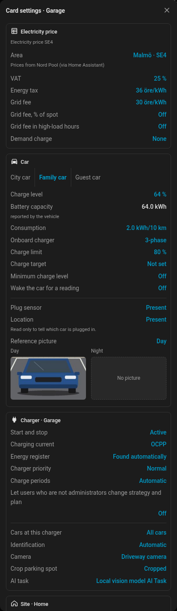

# Settings

All of SpotNav's settings are in one place: the **settings popover**. Open it from the charging card's **Settings**,
or from the gear on the house card or the heat card. The three cards share the same sections for the electricity
price, solar, the home battery and heating.

SpotNav keeps settings few. Most things are found or learned, not asked for.

## Who may change what

- **Administrators** change every setting.
- **Everyone** who sees a card may start and stop charging, use **Hot water now**, and change **Display**.
- An administrator can let other users change the strategy and the plan of one charger.

## The sections

Rows marked **site-wide** apply to every charger and card on the same site.

| Section | What is there | Read more |
| --- | --- | --- |
| **Get started** | What is left to set up, one row each. **Not needed** hides a row. | [Get started](get-started.md) |
| **Electricity price** (site-wide) | Price area, VAT, energy tax, grid fee, the supplier's markup, what a sold kWh earns, the demand charge. | [Prices](prices.md), [The electricity price](price-device.md) |
| **Car** | The car's charge level sensor, battery size, consumption, onboard charger phases, charge limit. | [Target state of charge](target-soc.md) |
| **Which car is plugged in?** | Identification: automatic, always ask, or off. Optional camera. | [Which car is plugged in?](vehicle-identification.md) |
| **Charger** | Its entities, how SpotNav controls it, phase switching for solar, who may change the plan. | [The charging card](card.md#charger-entities) |
| **Site** (site-wide) | Main fuse and margin, load balancing, car or battery first, the import target, the meters. | [Site and load balancing](site-and-load-balancing.md) |
| **Solar** (site-wide) | The solar forecast sources. | [Solar](solar.md) |
| **Home battery** (site-wide) | The mode, **Battery control**, its checklist and its check. Shown when SpotNav finds a battery. | [Home batteries](home-battery.md) |
| **Heating** (site-wide) | Sensors and their offsets, the control path, **Control the heat**, hot water, zones (each with its own switch), the water heater and **Control the water heater**, cooler night, setback when away. | [Heat pumps](heat-pumps.md) |
| **Notifications** | Which phones are told about what. | [Notifications](notifications.md) |
| **Display** | Chart time axis and price unit, for this device only. | [The charging card](card.md#display) |
| **Support** | Automations, debug info, **Beta tester**, the hardware test. | [Troubleshooting](troubleshooting.md), [Beta testing](beta-testing.md) |

## Settings outside the card

A few choices are made when you add a charger or a site, and can be changed later from **Settings → Devices &
services → SpotNav → Configure**. See [Setup in detail](setup.md#change-these-choices-later).
