# Setup in detail

This page walks through the whole setup in Home Assistant, dialog by dialog. For the short version, see
[Get started](get-started.md). It assumes you installed SpotNav from **Settings → Marketplace** (Home Assistant
2026.11 and newer) or from HACS (older versions, then restart Home Assistant). SpotNav
itself needs no account; the prices come from a source you add in Home Assistant (below).

There are four steps, and only the first is required:

1. [Add a charger](#1-add-a-charger).
2. [Add a site](#2-add-a-site-optional) if you want load balancing or solar charging.
3. [Add the card](#3-add-the-card).
4. [Pair the app](#4-pair-the-app-optional) if you want to use the SpotNav app.

Add the charger first and the site second. The site's dialog then lists the charger and can
include it straight away. If the site came first, add the charger later: the last dialog of the
charger flow offers to join the site (see [Add the charger to an existing
site](#add-the-charger-to-an-existing-site)).

Everything else, such as the energy to charge and the departure time, is set in the
[card](card.md). No dialog asks for the price area: SpotNav makes the installation's
[electricity price](price-device.md) by itself (below), and the card's **Electricity price** section
changes it.

### First-run defaults

A new charger starts with a working card instead of an empty form. When the charger is added,
SpotNav fills in only what Home Assistant already knows:

- **Electricity price**: the first charger or site added makes the installation's electricity
  price, a device of its own named after its area ("Electricity price SE4"), with the area's
  suggested VAT, energy tax and grid fee. The area is the one for Home Assistant's country; a
  country with several areas (Sweden, Norway and Denmark) gets the area nearest to Home Assistant's
  configured location. Every charger and site added later uses the same electricity price, without
  a question. With no country, an unlisted country or a location far from every area, nothing is
  made: choose the area in the card, which makes it then. Great Britain is left empty too: choose
  your region in the card, where **Find my region** looks it up from your postcode (see below).
- **Amps**: the charger's own maximum when it states one, otherwise 16, and never above the site's
  main fuse minus its safety margin.

The card says so: "Suggested from your location and charger – check
Settings." Check the values in **Settings** and change any that are wrong. Nothing you have saved is ever overwritten, and a
value you clear is not filled in again.

### Where the prices come from

Your Home Assistant fetches the prices itself ([Prices](prices.md#where-prices-come-from)). When the
first charger or site is added and its area has no source yet, the dialog shows one step, **Electricity
prices**, before it finishes:

- **An area Nord Pool trades** (the Nordic and Baltic countries, Germany/Luxembourg, the Netherlands,
  Belgium, France, Austria, Poland, Romania, Bulgaria): a link opens Home Assistant's own dialog for the
  built-in **Nord Pool** integration. The area and currency you pick there do not matter: SpotNav asks for
  the area it needs. Or enter your own ENTSO-E key instead.
- **Another European area**: your own free **ENTSO-E key**. Register at
  [transparency.entsoe.eu](https://transparency.entsoe.eu/), then e-mail transparency@entsoe.eu with the
  subject "Restful API access" and your account's e-mail address in the text. Once access is granted (it
  can take a few days), generate the security token under **My Account → Web API Access** and paste it in. One key
  serves the whole installation.
- **Spain – PVPC**: a link adds Home Assistant's own **PVPC** integration.
- **Great Britain**: a link to the **Octopus Energy** integration, installed through HACS, with your Agile
  meter.

Every field in the step is optional. You can do it later: until the area has a source, the card's
**Settings → Electricity price** shows the same step as a notice.

### Great Britain: Octopus Agile

In Great Britain SpotNav plans on Octopus Energy's **Agile** prices, one region per GSP group (`GB-A`
to `GB-P`), and is meant for Agile customers. In the card's **Settings, Electricity price**, tap the area and pick your
region under Great Britain ("GB C – London"), or type your postcode under **Find my region**: Home
Assistant asks Octopus Energy's public lookup directly, and the postcode is not sent anywhere else,
stored or logged. The rates themselves come from your own meter through the
[Octopus Energy](https://github.com/BottlecapDave/HomeAssistant-OctopusEnergy) integration (from HACS). The Agile price is all-in, so VAT, energy tax and grid transfer show as
*Included in the price* and nothing is added. The price source, Octopus Energy (Agile), is linked
there. SpotNav is not affiliated with Octopus Energy.

**Not on Intelligent Octopus Go.** Octopus does not allow a third party to control the charging of a
car on Intelligent Octopus Go; its customers must opt out of other apps' smart charging. Do not use
SpotNav to control charging on that tariff. More in [supported price areas](supported.md#supported-price-areas).

## 1. Add a charger

Go to **Settings, Devices & services, Add integration** and search for **SpotNav**. The first
dialog asks what to add.

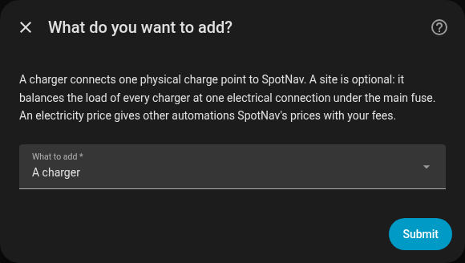

Choose **A charger**. (A third choice, **Resolve a detected vehicle**, appears only when SpotNav
found a car with several battery readings and needs you to say which one is the state of charge.)

The next dialog asks how to find the charger.

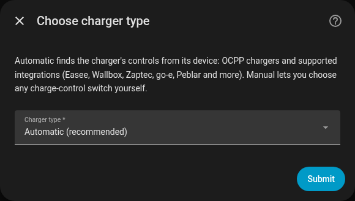

- **Automatic (recommended)** is the default and the right choice for every charger listed on the
  [supported hardware page](supported.md). SpotNav reads the charger's own integration and finds
  the controls itself.
- **Manual** works with any charger that exposes a switch. See
  [the manual path](#the-manual-path).

### Automatic: pick the device

With **Automatic**, choose the charger's device from the list. The list shows device
names and their area.

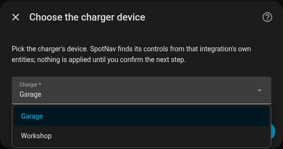

For an OCPP charger the list shows the connectors, not the charge point or the central system, so
a charge point with two connectors appears twice and you add each connector on its own. For other
integrations a device is listed when it has at least one entity.

SpotNav then finds the charge control, the current setting, the energy meter and the status
sensor from that device's entities. It matches entities by the integration and the entity's key,
never by name.

If the charger has its own smart, solar or load-balancing mode switched on, SpotNav stops and asks
you to turn it off in the charger's own integration or app first: two controllers on one charger
fight each other. Turn it off and continue. There is also a tick box to continue anyway if you
accept that they may fight. If the integration is evcc or openWB, SpotNav warns that they may own
the charger and suggests nothing.

Smart charging that runs in a cloud app is not visible to Home Assistant, so SpotNav cannot warn
about it. If the charger is linked to Tibber (or another app) for smart charging, turn that off:
the Easee setup step says so. Home Assistant's Tibber integration only reads a linked charger and
exposes no control, so there is nothing to detect.

### Confirm what was found

When SpotNav finds one unambiguous answer it shows it and asks you to confirm instead of asking
you to fill in a form.

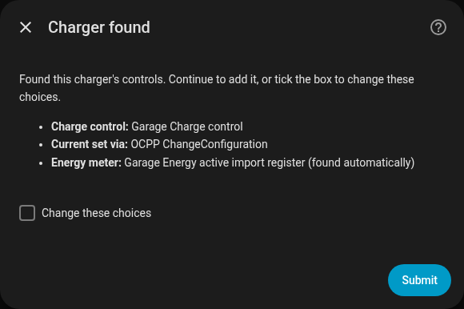

For an OCPP connector the dialog names the charge control, how the current is set and the energy
meter, which is found automatically. Choose **Submit** to add the charger.

How the current is set is decided by asking the charge point, not by its make or model. SpotNav
asks for the `AssignedCurrent` configuration key. If the charge point has it for this connector,
the current is set through OCPP `ChangeConfiguration`. If it answers without it, the connector's own
session current limit number is used when there is exactly one, and otherwise SpotNav does not set
the current. If the charge point does not answer at all, for example because it is not connected
yet, nothing is decided and you get the form below with a message asking you to wait until the
charger is connected and submit again, or to choose yourself.

### Change these choices

When the device offers more than one charge control, or the charge point could not be asked yet,
SpotNav shows the entities form straight away. Otherwise tick **Change these choices** and submit
to see it.

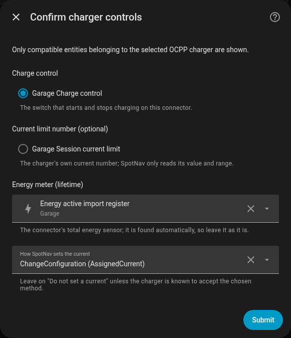

For an OCPP connector the form has:

- **Charge control**: the switch that starts and stops charging on this connector.
- **Current limit number (optional)**: the connector's own current number.
- **Energy meter (lifetime)**: the connector's total energy sensor. It is found automatically, so
  leave it as it is unless it is wrong.
- **How SpotNav sets the current**: **Do not set a current**, **ChangeConfiguration
  (AssignedCurrent)** or the charger's current number. Leave it on **Do not set a current** unless
  you know the charger accepts the method.

For a charger found through another integration the confirm dialog is this form directly, titled
with the device name: **Charge control**, **Charging current number (optional)**, **Set the
charger current**, **Energy register (optional)**, **Status sensor that says it is charging
(optional)** and, where SpotNav knows a per-session register only, a tick box to use it. Change or
clear anything that is wrong. **Set the charger current** stays off unless you choose it, and then
SpotNav writes the current only as the charger's write limits allow (see
[supported hardware](supported.md)). If the integration ships useful entities disabled, a tick box
offers to enable them, and it is on by default.

The energy register is looked for again after setup: at every Home Assistant start, and as soon as
the charger's integration registers or first reports one (a charger that was offline when you added
it often has none yet). A charger found through another integration then stores it as if you had
confirmed it; an OCPP connector uses its own automatically, as before. If you cleared a suggested or
stored register, or chose **None** under **Energy** in the card, SpotNav keeps that and looks for
nothing; the card then lists the register it finds under **To check**, so you can choose it.

Where the charger's integration has no lifetime register at all (myenergi zappi, ABB Terra AC, Ohme,
ChargePoint, Hypervolt), SpotNav counts the energy from the charger's own power sensor instead, as it
does for a charger behind a smart plug. A stored register that SpotNav now knows is not the charger's
lifetime one (a per-session or daily counter, or one phase of three) is replaced at the next start by
the lifetime register, or by the charger's power where there is none; with neither, it is kept. A
register of another integration is always kept, and so is one you choose in the card from 2.2.0 on (an
older choice of such a counter is replaced once: choose it again to keep it).

A charge control or current number can belong to only one SpotNav charger. Choosing one that
another SpotNav charger already uses is refused.

### Add the charger to an existing site

If you already have one site, the last dialog of the charger flow offers to add the new charger to
it. To add a charger after the site, go to **Settings, Devices & services, SpotNav, Add entry**,
choose **A charger**, and answer yes when it offers to join the site.

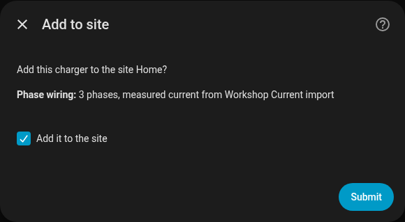

The dialog appears only when exactly one site exists. SpotNav offers to add the charger only when
it can tell how it is wired: three phases and exactly one measured-current source found on the
charger's device. Then the dialog shows the wiring it would use and a tick box, **Add it to the
site**, which is on by default. Otherwise the dialog says SpotNav cannot tell how the charger is
wired, so it is not added automatically; add it from the site's settings (see [Change these
choices later](#change-these-choices-later)).

### Sigenergy DC charger

Sigenergy's DC charger (EVDC) on a hybrid inverter is added like any other charger, through the
[Sigenergy ESS integration](https://github.com/TypQxQ/Sigenergy-Local-Modbus) (2.0.3 or newer). In
**Automatic**, pick the device named after the inverter with **DC Charger** at the end: the
integration's plant, inverter and battery devices are not offered. SpotNav suggests its Start and Stop
buttons, its **Max Charging Power Limit** with **The charger's power limit in kW**, its total charged
energy and its running state.

How it differs from an AC charger:

- **Power, not current.** SpotNav still plans and balances in amperes per phase, and writes the power
  three phases carry at the site's voltage between phases: one ampere is 0.69 kW at 400 V, so 16 A is
  11.1 kW. The charger's rating is the most it is given, and the card shows the planned power in kW.
  The lowest step is SpotNav's usual 6 A, 4.2 kW at 400 V.
- **Load balancing.** The charger draws through the inverter, from the battery, the sun or the grid,
  so the fuse sees only what the inverter imports. Load balancing reads the site's grid meter as
  always, and reads the charger's own output power as its draw, spread evenly over the three phases.
  When the site would go over its fuse, the power limit is lowered as a current would be. The house
  card shows the car as a load of its own, so the battery plan does not take its energy for the house.
- **The car's level.** The charger reads the car's state of charge only while it charges. Before a
  session it shows 0 %, which SpotNav takes as unknown. A car integration, where there is one, is
  preferred; the charger's reading fills in during a charge when the car's is not fresh.
- **No phases.** A DC charger charges the battery past the car's own charger, so the car's onboard
  phases do not limit it and there is no phase switching.
- **Three-phase only.** Sigenergy's hybrid inverters with a DC charger are three-phase installations,
  and SpotNav writes the power of three phases. On one phase the same power would draw three times
  the current SpotNav counts, so the site's wiring step does not accept one phase for a DC charger,
  and a charger wired as one phase is never given a power limit.
- **Its rating.** The most it is given is its **Rated Charging Power** sensor. When that sensor is
  unavailable, reads 0 or is disabled, SpotNav uses the last rating it read (kept across restarts);
  with none, it never raises the limit above what the charger already carries. Keep the rated and
  output power sensors enabled; SpotNav offers to enable them when they are not.
- **Never above the fuse.** Load balancing measures what the inverter imports, after the battery and
  the sun, so with a home battery the room can look far larger than the fuse. When the battery
  reaches its floor, all of the car's power lands on the grid at once. So SpotNav never gives a DC
  charger more than the power of three phases at the main fuse less the safety margin: on a 20 A
  fuse with a 1 A margin at 400 V, 19 A, 13.2 kW. Once the site's own battery import limit has been
  confirmed to act (battery control, test T3), that limit holds the grid and the cap is lifted.
- **Started only with its limit set.** SpotNav presses **Start** only once the power limit for the
  session is in effect, or the limit the charger already carries is no higher than what the site
  allows. Otherwise the charger would start at whatever its limit was, up to its whole rating.

Until it has been tested on real hardware, SpotNav drives it carefully:

- a pause presses **Stop**; SpotNav never writes 0 kW to pause it;
- it never writes a power limit below 1.5 kW;
- it writes the limit at most every 10 s, and waits 30 s after a write before it raises the power;
- when the fuse needs the power lowered within those 10 s, it presses **Stop** instead. The log says
  "DC charger stopped to protect the fuse (write interval)", and the debug report counts these stops;
- the running state **Ended** is read as neither a car plugged in nor a car gone.

**For the tester.** The debug report (gear, **Settings**, **Support**) shows every power limit,
Start and Stop SpotNav sent, with the charger's output power 5, 15, 30 and 60 s later. With it, these
can be answered:

1. Does a limit of 0 kW pause the charge, or must Stop be pressed?
2. What is the lowest power it holds? Set the limit to 1.5, 3 and 4 kW and note the output.
3. How fast does it follow a new limit, up and down?
4. What does the grid meter show while the car charges from the house battery?
5. What does the running state show after Stop with the car still plugged in, and after it is unplugged?

### Renaming a charger

Renaming a charger's entry under **Settings, Devices & services, SpotNav** changes the name shown
in the card and the app. It does not change any entity id.

### The manual path

Choose **Manual** for any charger that exposes a switch. The form asks for:

- **Charge control**: the switch that starts and stops charging.
- **Charging current (optional)**: a number entity that sets the current.
- An optional energy meter sensor (a total energy sensor), which lets SpotNav know how much energy
  a charge has already delivered.
- An optional **power sensor (smart plug)**, for a charger that is only a plug with a charger behind
  it. See [a dumb charger behind a smart plug](supported.md#a-dumb-charger-behind-a-smart-plug).

### When detection finds nothing

If the list of devices is empty, SpotNav stops with the message that no supported charger was
found. Set up the charger's own Home Assistant integration first, then add it here, or choose
**Manual**.

If you pick a device whose integration SpotNav knows but cannot command, the flow says SpotNav
cannot start or stop the charger and that it can only be read. The
[supported hardware page](supported.md) lists which integrations are which. A device that
SpotNav knows is not a charger, such as a heater or an outlet controller, is never offered in the
list.

## 2. Add a site (optional)

A site is one electrical connection, usually your main fuse, shared by one or more chargers. You
need it for [load balancing and solar charging](site-and-load-balancing.md). A charger can belong
to only one site.

Go to **Settings, Devices & services, Add integration, SpotNav** and choose **A site (load
balancing)**.

A site with no charger is fine: a home with only a battery or heating starts with the
[house card](house-card.md), whose gear opens the site's settings (Get started, price, site, home battery, heating).
The charging card needs a charger. The site's setup steps (including the confirmation) and the charging card's editor
say how to add one: **Add a charger: Settings, Devices & services, SpotNav, Add entry, Charger; it will offer to join
this site.** Get started in the settings popover offers it too, and **Not needed** keeps that row away.

### The basics

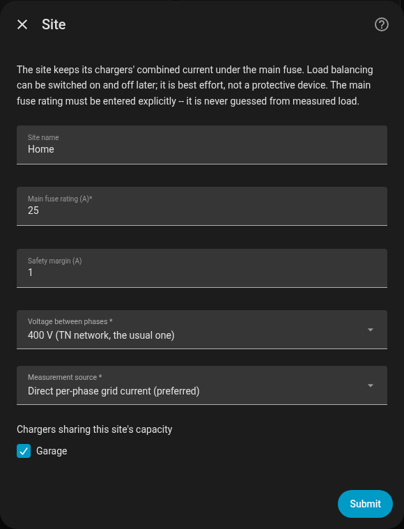

- **Site name**.
- **Main fuse rating (A)**: always entered by you, never guessed from measured load.
- **Safety margin (A)**: kept below the fuse rating. It starts at 1 A.
- **Measurement source**: **Direct per-phase grid current (preferred)**, or **Derived from power
  and voltage**. Derived is more exact when the meter also reports its own current, apparent or
  reactive power, and otherwise the current is estimated.
- **Chargers sharing this site's capacity**: pick the chargers on this fuse. A charger already on a
  different site is not offered. When there is only one charger it starts selected.

### The grid meter

SpotNav now scans Home Assistant's entity registry, including entities their integration ships
disabled, for grid meters. If it finds any, it lists them.

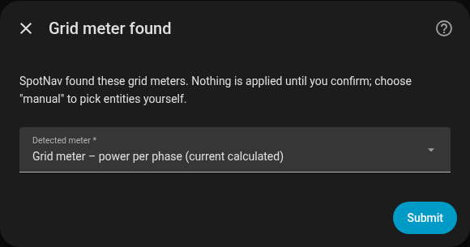

Choose the meter that measures your main feed, or **Choose manually** to pick entities yourself.
If the meter needs entities its integration ships disabled, a tick box, on by default, enables
them. SpotNav enables only entities the integration disabled, never ones you disabled yourself.
Nothing is applied until you confirm.

### Site found

When the meter, the chargers' measured currents and the wiring are all found without ambiguity,
SpotNav shows a summary instead of the full form.

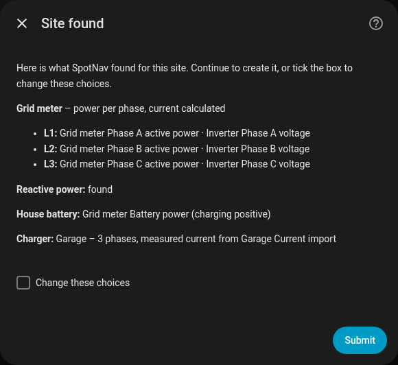

The summary has one line for the measurement, the voltage, reactive power if found, the house
battery (or that there is none), and each charger with its phases and the sensor
its current is measured from. Submit to create the site, or tick **Change these choices** to see
the full form with everything pre-filled.

The site is created with **load balancing off**. Turning load balancing on is a separate, later
decision (see [the card](card.md#the-settings-popover)).

### When the meter is not found

If SpotNav finds no grid meter, or finds one but cannot complete the summary (for example a
charger with no single measured-current sensor), it goes on with the forms.

Manual measurement has two shapes. Choose **one entity with the three phase currents as
attributes** when a single entity carries them (the Easee Equalizer does). Choose **three separate
entities, one per phase** when each phase is its own sensor, which is typical for P1 readers. A
sensor without a device class can be picked, which a DIY meter reader needs. SpotNav checks the
unit instead: current in A or mA, power in W or kW, voltage in V, reactive power in var or kvar,
and apparent power in VA or kVA; a sensor in another unit is refused.

- In direct mode **Site current source suggestions** lists current sources found among existing
  entities, **Choose manually (three separate entities, one per phase)**, **Enter one entity + its
  phase attributes manually**, and **Skip for now (configure later)**. The last one lets you create
  the site now and add the measurement later.
- **Site current from one entity** is for a meter that carries the whole site's current as per-phase
  attributes of one entity: pick the entity, name the attribute that holds each phase, and choose
  the unit of those attributes, **A** or **mA**. SpotNav checks the attribute names against the
  entity's state and its recent history and asks you to tick **save anyway** only when it could
  verify nothing.
- **Phase wiring and measurement entities** asks, for each charger, whether it is three-phase or on
  one phase, and for a single-phase charger which phase. It also asks, when not already chosen, for
  the per-phase sensors: a current sensor per phase in direct mode, or a power sensor and a voltage
  sensor per phase in derived mode, with optional export power, reactive power, apparent power and
  current. Two tick boxes say how your meter's signs work: **The grid current is signed (export is
  negative)** and **Grid power is export-positive (negate it)**, which applies to the per-phase
  power in derived mode and to the total grid power in either mode. In the card's site editor,
  direct mode also has **Total grid power**, needed for solar and hybrid charging, and with
  signed currents for full load balancing, when the phases only report current (and an optional separate export sensor). Each charger
  also has an optional measured-current source, chosen from what SpotNav found on the charger's
  device, entered manually, or skipped. Never use a commanded current there: a car can draw less
  than its setpoint.

A charger's own measured current can also be three separate entities, one per phase (the Charge
Amps integration and similar). SpotNav suggests them automatically when they are on the charger's
device.

If both an Easee Equalizer and a real grid meter, such as a P1 reader, are found, SpotNav lists the
meter first. Prefer the meter: the Equalizer reports a derived figure and balances load by itself.
If SpotNav does the load balancing, turn off the charger's own smart charging and the Equalizer's
load balancing, because two controllers on one charger fight each other.

For a single-phase charger, choose its phase, or leave it on Automatic (follows the charger), the
default, when the phase moves, as with an Easee Equalizer: SpotNav then follows the phase the charger's
own measured current shows, and reckons it on the most loaded phase while it cannot tell.

## 3. Add the card

The card is served by the integration itself. There is no dashboard resource to add, and nothing to
update after an upgrade except reloading the browser once.

After the first install the card may be missing from the card picker until the browser page is
reloaded with Ctrl+Shift+R. In the Home Assistant companion app, reset the frontend cache instead
(in the app's settings, under Troubleshooting).

Open a dashboard, choose **Add card**, stay on **By card** and search for **SpotNav**. The
picker shows a preview. If you have exactly one charger, the preview is the real card for it.

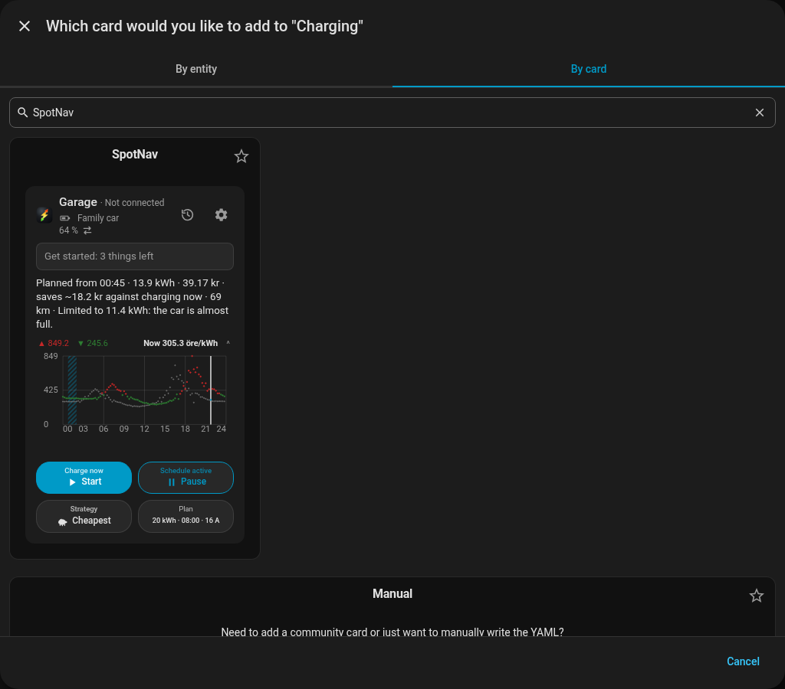

Add it and pick the charger in the card's editor. By hand, in YAML:

```yaml
type: custom:spotnav-card
charger: <charger config entry id>
```

The card is described in [The card](card.md).

The same bundle has two more cards, for a site: **SpotNav house** (`type: custom:spotnav-house-card`, see
[The house card](house-card.md)) and **SpotNav heating** (`type: custom:spotnav-heat-card`, see
[Heat pumps](heat-pumps.md#the-heat-card)). Each takes `site: <the site's entry id>`, or `charger:` to use that
charger's site.

## 4. Pair the app (optional)

1. In the SpotNav app choose **Log in to Home Assistant** and enter your Home Assistant address.
2. The app shows a six-digit code. Home Assistant shows a new item under **Settings, Devices &
   services** named after the phone, with the same code.
3. Check that the codes match and choose **Approve**. **Deny** refuses the request.

A pairing request expires after five minutes; start again on the phone. No Home Assistant password
or access token is ever stored on the phone. Approving hands over the homes and chargers of this instance,
each with its own private webhook secret, so a home without a charger can use the app too. A charger added to the
home later shows up in the app by itself. Treat webhook ids as secrets. See
[Connect the app](api.md#connect-the-app).

**Disconnect all phones.** In a card's **Settings**, **Support**, an administrator can disconnect every paired
phone at once: every phone then has to be paired again. Charging and heating go on as before.

**A charger without a home.** When the installation has no home (site) yet, the charger's **Settings** offer
**Make a home of this**. It asks for the main fuse and, once you confirm, makes a home around the charger, so the
house, battery and heat pages can follow. The meter for load balancing is chosen later in the home's settings.

## Change these choices later

- **A charger's entities.** Open the charger's card, then **Settings**, then **Charger
  entities, Change charger entities**. Administrators can also use **Configure** on the charger's
  entry under **Settings, Devices & services, SpotNav**, which shows **Charge control**, **Charging
  current (optional)**, the energy meter and **Set the charger current**.
- **A site.** Use **Configure** on the site's entry. The first page, **Site settings**, has the
  site's basics, load balancing, whether the car may take the home battery's share, car or home battery first, the home
  battery power sensor and the solar forecast sources, each with a line on what it does, and last the
  switch **Next: change meter and phases**.

  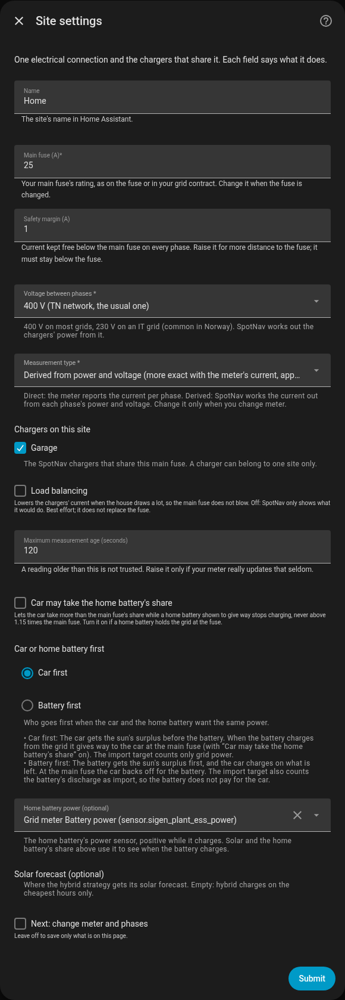

  With that switch off, saving changes only this page and keeps the stored measurement and
  wiring. SpotNav opens the measurement and wiring step anyway when the measurement mode changed,
  when chargers were added or removed, or when the measurement is incomplete.
- **The site's entities**, from the card: **Site, Change site entities**.
- **Removing a charger.** Deleting a charger's entry under **Settings, Devices & services, SpotNav**
  gives the charger back as SpotNav found it, as far as SpotNav knows. Just before SpotNav first set
  the charger's current, it noted the current the charger had then; when you remove the charger,
  SpotNav sets that current again, once, so a charger that stores the current in flash takes it too.
  When SpotNav did not know it (it could not be read then, or the charger was added before SpotNav
  2.4.2), the current is left as it is. SpotNav turns the charger back on only if SpotNav itself had
  stopped it (a plan waiting, the sun, load balancing, a target reached); a stop you made in the card
  or the app, or one made outside SpotNav, is left as it is. A restart, a reload or disabling the
  entry changes nothing on the charger.

See [Diagnostics and troubleshooting](troubleshooting.md) if something does not behave as expected.
