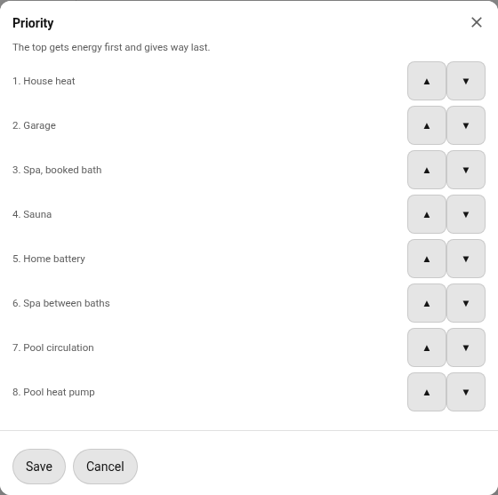

# Site and load balancing

A **site** (*your home* in the setup) is the second kind of SpotNav entry. It represents one electrical connection,
typically your main fuse, shared by one or more SpotNav chargers. It is what makes the house card,
the home battery, the heating, load balancing, [solar charging and hybrid](strategies.md) possible. A charger can belong to only
one site.

## In short

- **What it does for you.** A site is your home's connection to the grid, behind the main fuse. It gives you the
  house card, the home battery, the heating, charging from the sun, and load balancing: SpotNav lowers or pauses a
  charger so the house stays under the main fuse.
- **What you need.** Your main fuse rating and a grid meter in Home Assistant that reads each phase (a current per
  phase, or power and voltage per phase). For solar charging and an import target, also the grid's total power with a
  direction.
- **What to do.** Add **Your home** in the SpotNav integration, confirm the meter SpotNav finds, and include your
  chargers. A new site only calculates. Turn on **Load balancing** when SpotNav should act on the chargers.
- **Best effort.** Load balancing is not a protective device. Your main fuse is still what protects the house.

| Setting | Where | Default | What it does |
| --- | --- | --- | --- |
| Main fuse (A) | Site dialog, or the card's site section | Entered by you | The limit on every phase. Never guessed from measured load. |
| Safety margin (A) | Beside the main fuse | 1 A | Kept free below the fuse. |
| Load balancing | The site's **Configure**, or the card (administrators) | Off | Lowers a charger's current, or pauses it, to keep every phase under the fuse less the margin. See [Active load balancing](#active-load-balancing). |
| Car may take the home battery's share | The site's settings | Off | For a home battery that holds the grid at its setpoint: the car may step into the battery's share when the battery gives way. |
| Priority | The cards' settings, the site's section | House heat, the cars, the spa, ... | Who gets energy first and gives way last. See [The priority list](#the-priority-list). |
| Import target (kW) | The card's settings, beside the main fuse | Off | Holds the chargers so each clock hour's mean import stays under it. See [Demand charge and import target](#demand-charge-and-import-target). |
| Total grid power | The site editor | Found where the integration has it | Needed for solar and the import target on a site that measures phase currents. See [Total grid power](#total-grid-power). |
| Home battery power, solar forecast sources | The site | Optional | Used by solar and hybrid charging. See [Solar and forecast settings](#solar-and-forecast-settings). |

The long rule lists (how each charger's phase and current are read, every rule of active load balancing, every rule
of the import target's hold, meter detection and signs) are on [Load balancing in detail](load-balancing-details.md).

## Add a site

**Settings, Devices & services, Add integration, SpotNav, Your home (house, battery, heat, load balancing).** The dialogs are
shown in [Set up SpotNav](setup.md#2-add-your-home). You provide:

- **Main fuse rating (A).** Always entered by you; it is never guessed from measured load.
- **Safety margin (A)** kept below the fuse rating. It starts at 1 A. It can also be changed in the
  card, in the site dialog next to the main fuse; it must stay below the fuse.
- **Measurement source** for the site's per-phase current:
  - *Direct*: a sensor per phase reporting current, or one entity carrying every phase as
    attributes (you name the attribute for each phase and its unit, A or mA). The flow suggests
    candidates from entities already in Home Assistant; nothing is applied until you confirm.
  - *Derived*: current computed from each phase's active power and voltage, with the meter's own
    current, apparent power or reactive power when it has them. Without any of those the current
    is estimated, which is marked as such.
- **Chargers on this site**, and for each charger whether it is three-phase or single-phase, and for
  a single-phase charger its phase: L1, L2, L3 or **Automatic (follows the charger)**, the default.
  Automatic is for a charger whose phase is not fixed, such as one behind an Easee Equalizer, which
  moves a one-phase charge to another phase from one session to the next. How SpotNav finds the phase of an Automatic charger: see
  [Charger wiring and measured current](load-balancing-details.md#charger-wiring-and-measured-current).
- Optionally, each charger's own **measured current** (its per-phase sensors). Never use a
  commanded current here: a car can draw less than its setpoint, and crediting a setpoint would
  overstate how much of the site's load is the charger's.
  Easee's terminals, chargers with their own current sensors and a charger without any measured current are
  described in [Charger wiring and measured current](load-balancing-details.md#charger-wiring-and-measured-current),
  with how solar runs on an incomplete phase measurement.

After the basics, SpotNav looks for your grid meter in the entity registry (see
[Meter detection](#meter-detection-signs-and-estimated-current)). When it finds the meter and
everything else it needs, it shows a **Site found** summary to confirm; otherwise it shows the
forms above. A new site is created with load balancing off. A site always calculates once it has a
measurement: the calculation only reads, and solar's per-phase fuse caps and the view of what load
balancing would do depend on it. (Earlier versions had a switch for the calculation and settings for load
balancing's deadband and dwell and yield stepping's ceiling. They are gone: a site stored with the
calculation off calculates all the same, and the others are fixed at their former defaults, whatever a site
had stored.)

A charger added later is offered to the site when exactly one site exists, if SpotNav can tell how
the charger is wired (see [Set up SpotNav](setup.md#add-the-charger-to-an-existing-site)).

Everything can be changed later under the site's **Configure** and, for entities, in the card's
settings popover. In **Configure** the first page, **Site settings**, holds the basics, load balancing
and solar, each field with a line on what it does, and ends with the switch **Next: change meter and
phases**. Left off, saving keeps the stored measurement and wiring; the measurement step opens anyway
when the measurement mode changed, when chargers were added or removed, or when the measurement is
incomplete. A site with nothing configured yet reports "not configured" and does
nothing.

## What the site calculates

For every phase the site works out what is left for chargers:

    headroom = main fuse - safety margin - other load

where *other load* is the site's measured total minus the chargers' own measured current on
that phase. Each charger gets a proposed current from the headroom on its phases, in one pass,
between the charger's minimum (6 A by default; a Sigenergy DC charger's is its lowest power, 1.5 kW,
2.17 A at 400 V) and its own limits.

Measurements older than the *maximum measurement age* (default 120 s) are not trusted. On a site that
derives its current from power, a phase's active power that has not changed for longer than that
still counts as fresh (a still value, not a lost one) while Home Assistant keeps hearing from it and
the same phase's voltage, or the reactive or apparent power the site reads for it, changed within the
maximum age: some meters (a Sigenergy with the grid held at about 0 W by its battery) leave a phase's
power unchanged for minutes while the meter is live. The last value is kept, and it is trusted for
holding and lowering a charger only, never for raising one: while a phase the charger draws on sits
still, load balancing keeps the current last written to the charger rather than raise it
(`held_still_no_raise` in the diagnostics; never the lower current a car that has just started still
draws, so a start is never paused for it), and no yield step or battery probe raises it either; nor
does a still value widen the room an increase may take. A charge load balancing paused is resumed as
ever, at its minimum when the measured current leaves room. Once the phase's power changes again, raises are judged as ever.
A phase whose power is unavailable or unknown, whose age Home Assistant cannot tell, or whose other
readings sit still too, is stale as before. The diagnostics
show such a phase under `phase_signed_active_power_held_still` (`held_still`, with the companion
reading and its age; the entity is the one the site's settings name for that phase). And if
the chargers together claim more current than the site's total (beyond a small tolerance) the
whole result is reported as invalid rather than corrected silently. Results are exposed as
sensors and in [diagnostics](troubleshooting.md):

- **Capacity state** on the site: **Measuring** when the site's measurement is healthy, otherwise why
  not (**Not set up**, **Measurement missing**, **Measurement stale**, **Measurement invalid**). Its **Activity** attribute (`site_activity`) says it in a word: **Measuring, load
  balancing off**, **Measuring, load balancing on** or **Not measuring**.
- **Proposed current** per charger, with the charger's share in its **State** attribute: **Fits**,
  **Limited** (lowered to the headroom), **Below the minimum current** (the headroom is too small for the
  charger's minimum), **Not charging** (`not_requesting`: the charger asks for no current, so there is
  nothing to fit), **Requested current unknown** or **Measurement invalid**.

## Active load balancing

By default the site only calculates. Turn on **Load balancing** (the site's **Configure**, or in the
card by an administrator) to let SpotNav lower a charger's current to keep the site under its fuse.
It is best effort and is not a protective device. Turning it off gives back any current it had lowered.

What it does, in short:

- **An overload is lowered at once**: a lower current, a pause when the room left is below the charger's minimum,
  or a safety stop if the charger cannot take it in time.
- **Other changes are damped** (2 A deadband, 60 s dwell), so the charger does not dither. A step up stops one amp
  short of the room there is, and a start never gives the car more than the site has room for now.
- **A lost meter reading steps the car to its minimum** until the reading is back.
- **A paused charge starts again** once every phase it uses has room for its minimum and one amp more for 60 s, while
  the charge is still wanted. At most two resumes go out in ten minutes.
- **It needs to know which way each phase flows** (import or export) to lower a car that is not over the fuse.
  Without that it works on the measured current alone, and the card says what to set.
- **Car may take the home battery's share** (off by default) lets the car step into a home battery's share of the
  fuse once the battery is seen to give way.
- **Every change is logged** in the site's diagnostics (`regulator_decision_log`).

Every rule in full: [The rules active load balancing follows](load-balancing-details.md#the-rules-active-load-balancing-follows).

### Chargers that can only be switched on and off

A charger whose current SpotNav cannot set (Monta, myenergi zappi, Ohme, go-e legacy, ChargePoint, NexBlue,
a charger behind a smart plug, or any charger whose current control is not turned on) draws a
current of its own. Load balancing reckons it as one load of that size, its **switched current**, and
pauses or resumes it whole. There is no setting for it; SpotNav learns it, from the first of:

1. **Its own measurement**: the charger's current sensors (the highest phase), or a smart plug's power
   divided by its phases times 230 V, read while it charges and the car draws at least 2 A. A rise is
   taken quickly and a fall slowly, so a car tapering off at the end of a charge does not make the next
   charge look small.
2. **The site meter's step**, for a charger with neither: when SpotNav switches it on or off, the change
   in the site's phase currents on the phases it is wired to, less what the other chargers' own readings
   changed by, from the reading just before the command to the first reading after it that has held
   still (within 0.5 A for ten seconds, from ten seconds after the switch, within two minutes). A step
   is used only when it is the same on every phase the charger is wired to, the other phases stayed
   quiet, it is at least 2 A, and it is not above the charger's maximum (its current setting's upper
   bound, else the main fuse). It is trusted once a second step agrees with it (an on and an off, or the
   same edge again). An "Automatic" single-phase charger learns no step until it is wired to a phase.
3. **The charging current you set** (*Laddström* in Auto, else the plan's current, else the last one
   asked for), before anything is learned; 16 A when none is set. It is the current you told SpotNav the
   charger uses and what the plan already reckons with.

The current and where it came from are in the charger's diagnostics (`switched_current`). With it:

- **It never blocks the other chargers.** Its request is its switched current, never "unknown".
- **An import overload pauses it whole.** While a phase is over the limit on a net import and such a
  charger takes part, the overload is resolved in one pass, from the bottom of the [priority list](#the-priority-list) up (before the list is saved: Last first, then Normal,
  then First; within each priority: the chargers whose current can be set are lowered, at most to their
  minimum; if the site is still over, the switch-only chargers are paused whole, through the same
  balancing pause as any other charger; only then are the chargers whose current can be set paused. An
  electric car at 10 A beside a 10 A switch-only charger, 10 A over, ends at its minimum with the other
  one paused, not paused itself while the other runs on. If the switch-only charger's pause cannot be
  sent (its command fails or is refused), the chargers held at their minimum for it are paused in that
  same pass. It is never paused on a merely tight margin, and on an export or unclear overload nothing is
  done, as for any charger. A site of only such chargers is protected the same way.
- **It is resumed whole.** A charge load balancing paused, or a start it held back for want of room, is
  started again once every phase it uses has room for its whole switched current plus 1 A, for the
  dwell (60 s), with the usual limit on resumes. A start goes out only where the site has room for all of
  it. A charger that cannot report whether a car is plugged in (a plain switch, an OCPP charger whose connector
  status cannot be found, or a status sensor SpotNav cannot map for its platform) is resumed while the charge is
  still wanted; a charger that can report it must say a car is there. This holds for any paused charger, not only
  a switch.
- **A lost measurement does nothing to it.** It cannot be stepped to a minimum, and pausing it on a meter
  that merely went quiet would stop charges with no overload shown; it is treated as a charger already at
  its minimum.
- A charger with no reading of its own is taken to draw its whole switched current while it is on, the
  safe side for the fuse.
- The card never says it is limited to a current, and its capabilities say load balancing can only pause
  the charge.

## The priority list

One list per site, **Priority** in the cards' settings (gear → the site's section, administrators only): every
load the site has, one row each, **the top gets energy first and gives way last**. Each charger is its own row; the
other rows are house heat, a spa heating for a booked bath, a sauna, house cooling, the water heater, the home
battery, a spa between baths, the pool's circulation beyond the day's filtering need and the pool's heat pump (a row
shows only once the site has that load). Move a row with its up and down buttons and save. The apps show the list,
read only.

The default, top to bottom: **house heat, the cars, the spa with a booked bath, the sauna, house cooling, the water
heater, the home battery, the spa between baths, the pool's circulation, the pool's heat pump.** The list is read in
both directions:

- **The sun's surplus and the fuse's headroom, from the top down.** The battery's place against the cars is what
  used to be *car or home battery first*: above every car is *battery first* (the battery takes the surplus first,
  the car backs off for it at the main fuse, and the import target counts the battery's discharge as import), below
  them *car first* (the default). Between chargers, the higher one is served first: each phase's headroom is handed
  out to them one after the other, and the higher one keeps what it asks for while the lower one gets what is left.
  Of the chargers on solar (or on hybrid outside a plan window and short of their target, or past it and below the
  car's own known limit), the highest is offered the whole surplus; the next is offered only what the first cannot
  use: surplus too small for the first one to start on, or more than it takes (its maximum current, or less when the
  car draws less). A charger that is paused, on another strategy, or known to be unplugged takes no part, and its
  draw counts as house load.
- **Giving way, from the bottom up.** When the site is over its limit and load balancing has to cut, the lowest
  charger is cut first, in the same pass; a charger high in the list keeps its current as long as the others can give
  way. Under the import target's ceiling the loads give way in the [shed order](#the-shed-order-under-the-ceiling),
  which is the list read from the bottom.

Hard rules and deadlines always come before the list: a car's minimum level and a person's Start, the water heater's
full heat and legionella rules, a spa's 10 °C frost floor, the heat control's limits and the main fuse.

**From an earlier version.** Until the list is first saved, the old settings count exactly as before: the site's
*car or home battery first* and each charger's *Charger priority* (First, Normal, Last; chargers with the same
priority in the order they joined the site). The list starts from them: the cars in that order, the battery above
them under *battery first*. Saving the list stores it and drops the old settings; an app that still shows them reads
them from the list (the top car *First*, the bottom one *Last*, a car alone *Normal*). An app's change of a charger's
priority moves its row (*First* to the top of the cars, *Last* to their bottom, *Normal* among the others by their
priorities) and stores the list, and the app reads back what it set, until the list itself is saved again. A charger
that joins later goes below the last car; one that leaves is dropped.

**Saving the list decides who is cut first among chargers that were all *Normal*.** Before, chargers of one
priority shared a class: in an overload the one that joined the site first was cut first. Once the list is saved
(in the card, or by an app's change of *car or home battery first* or of a charger's priority) every charger has its
own place, and the lowest one is cut first. Put the charger that should keep its current at the top.

## Solar and forecast settings

Set on the site, used by the [solar and hybrid strategies](strategies.md): the battery's place in the
[priority list](#the-priority-list) (above the cars is *battery first*, below them *car first*; it also decides who
goes first at the main fuse and what the import target counts), an optional **home battery power** sensor (positive
means charging), and the **solar forecast sources** for hybrid.

The site's **Solar surplus** sensor shows, in watts, the power a car could take from the sun at the
site now, from these settings and the site's grid readings, also on a site without chargers; see
[Solar](strategies.md#solar).

## Total grid power

Solar and hybrid need the grid's signed power. A derived site has it per phase. A direct site
(a current per phase, no direction, such as a Tibber Pulse) has it only when you give it the
meter's **total grid power**, as one signed sensor (positive = import, or tick *Grid power is
export-positive*) or as an import and an export sensor (combined as import minus export; a missing
half makes the total missing, never zero). Units W and kW are read; anything else is refused at
read time. The total is detected where the integration has it (see
[supported hardware](supported.md)) and is edited in the site editor, field *Total grid power (for
solar)*; a derived site may also have one, which it ignores for the surplus.

The total only decides the surplus; the fuse protection and load balancing stay per phase on the
measured currents. Swedish and most Nordic meters settle the phases summed, so the surplus is the
total export. The solar controller spreads the total evenly over the phases the charger uses (a
third each for three phases, the whole total on the charger's phase for one phase), assumes 230 V
per phase and caps the result by that phase's fuse headroom on top of what the car already draws.
A stale (older than the maximum measurement age, unless Home Assistant keeps hearing from the
sensor) or missing total is an unknown surplus, never zero export. The site sensor's
`solar_capable` and `solar_reason` attributes and the diagnostics' `grid_power` block show the
state; `solar_reason` is `needs_total_grid_power` when a direct site lacks it.

## Demand charge and import target

A site measures each clock hour's mean import, for a [demand charge](prices.md#a-demand-charge) on its
electricity price and for its own **import target**. A demand charge is measured and shown only. The import target
holds the site's chargers, through load balancing, so the hour stays under it (see
[Holding the chargers under the import target](#holding-the-chargers-under-the-import-target)).

- **What is measured.** The net import from the grid, from the same signed grid power solar reads: a derived
  site's per-phase power, or a direct site's [total grid power](#total-grid-power). Export within an hour lowers
  that hour's import, as on the meter; a negative reading counts as no import. A direct site without the total
  cannot measure: the price section says so under the demand charge, and "Get started" asks for the site's total
  grid power while a demand charge or an import target is set.
- **Hours.** Each reading is held until the next one, for at most two minutes. An hour is its import energy over
  the time it was measured, on the clock of the electricity price's area (Home Assistant's own where the site has
  no electricity price); the repeated hour in October is two hours, as on the meter. An hour with more than ten
  minutes without a usable reading is kept but never sets a peak. The running hour is kept at most once a minute
  and the month's hours when an hour ends, so a restart keeps them; the minutes the restart took count as missing.
  At the first hour of a new month the month starts again; the month before is kept beside it. What the house
  imports without the chargers' measured power is kept beside each hour too, and whether the import target held a
  charger's current down or paused a charger in it.
- **Two years of days.** Beside the hours the site keeps, per day, its highest hour (with the house's part of it and
  the hour it started), whether the import target held or paused a charger that day, and per month each part's
  counted peaks and figure, for 24 months. They are written as each hour ends. The months before SpotNav measured are filled once from Home Assistant's statistics (below).
- **Where to see it.** The charge history's [Power view](card.md#power) shows a month day by day, with the import
  target as a line and the days it held or paused a charger marked, and a tapped day's hours; it is offered where the
  site measures its import.
- **Import target.** An optional hourly mean of import, in kW, set in the card's Settings beside the main fuse
  (*Import target*, off until set). It is written without restarting load balancing. While it is set, a line under
  it shows the hour running now against it, *This hour: 4.2 of 6.0 kW* (the mean over the minutes measured so far);
  where the month's peak lifts the target this hour, against that level: *This hour: 2.8 of 6.6 kW – the month's
  peak (import target 6.0 kW)*. Its editor suggests a target (see
  [A suggested import target](#a-suggested-import-target)).
- **The Demand-charge peak sensor.** While the site's electricity price has a demand-charge part, the site has a
  *Demand-charge peak* sensor (kW): the first part's figure this month. Its attributes are every part with its
  figure, its peaks and how many days counted, and the running hour. It goes away with the last part.
- **Diagnostics.** The site's diagnostics (and the debug bundle) carry a `demand` block: every hour of the month
  (`[start, kW, house kW, incomplete, held, paused, floor kW]`: kW the mean over the time measured, floor kW the import over the whole hour with any gap counted as none; an hour from Home Assistant's statistics has an eighth column, `1`; `complete_hours` lists the starts of those that are [complete](#earlier-months-from-home-assistants-statistics)), each part's figure and peaks, the running hour with its gaps, the
  import target, and `backfill` (when the [earlier months](#earlier-months-from-home-assistants-statistics) were
  read, what came of it and how many hours were filed).

### A suggested import target

When the import target's editor opens (administrators), SpotNav reads Home Assistant's hourly statistics of the
last three months (fewer where less exists) and suggests a target, for example *The house alone: usually at most
2.4 kW in an hour each day, at most 3.7 kW (Sat 17 Oct). Suggestion: 6.5 kW – the car then gets about 4.0 kW in
most hours.* **Use** fills the field; nothing is saved until *Save*.

- **What is read.** The hourly mean of the site's grid power (a direct site's total grid power, or an
  import/export pair, negated where the meter is export-positive; a derived site's per-phase power less each phase's
  export entity), and what each charger drew: its energy register's hourly change, else its power sensor's mean,
  else its measured current's mean per phase times 230 V. Only sensors with long-term statistics count (a
  `measurement` sensor, or a `total`/`total_increasing` register); W, kW and MW, A and mA, Wh, kWh and MWh are
  converted. The house alone is the grid's mean less the chargers', never below zero. A charger without statistics
  is named, and the grid alone stands for the house then (the charging is counted as the house's).
- **The rule.** The house's **typical** daily peak: the median over the days of each day's highest hourly mean of
  the house alone (only within the hours a demand-charge part counts when every part has hours of its own, else all
  hours), plus the car's minimum power on this site (the smallest charger's minimum current times its phases times
  230 V), rounded up to the next 0.5 kW. Not the highest peak: on the few evenings the house alone goes above the
  target (a sauna), the car is paused, the bill's peak is the one the house set anyway, and the month's peak then
  lifts the target for the rest of the month. A target at the highest peak would pay for a level only that evening
  needed. The house's highest hour is shown beside it, and what the car gets at the suggestion in a typical charging
  hour: the suggestion less the house's median hourly mean between 18:00 and 06:00, never below its minimum.
- **Never invented.** With no recorder, no long-term statistics of the grid power, fewer than seven days of them or
  no charger on the site, there is no suggestion and the editor says why.
- **Solar.** The statistics are hourly means: an hour that exported in one half and imported in the other nets out,
  so with solar the house's import is read lower than the meter billed it in such hours. Evening and night hours,
  which set the peaks, are not affected.
- The answer is kept for ten minutes per site, so opening the editor again does not read the statistics again.

### Earlier months from Home Assistant's statistics

Once, when a site first measures, the hours before SpotNav measured are filled from the same statistics, three
months back: the running month's and the month before's as hours, older months as day summaries. An hour's import is
the grid's mean (never below zero), the house's part as above where the chargers are known. They are marked as from
Home Assistant's statistics (paler in the [Power view](card.md#power), and `imported` in the API), with no holds or
pauses and never as incomplete; an hour the statistics lack is simply missing. An hour SpotNav measured itself is
never overwritten: nothing at or after its first measured hour is filled. The demand-charge parts' counted peaks and
figures count them, only approximately what the meter billed. **Only complete hours of the running month may lift
the import target**: an hour for which Home Assistant's 5-minute statistics have all twelve rows for every grid
power sensor (they are kept ten days by default, Home Assistant's `purge_keep_days`, so only the last ten days
before SpotNav first measured), at the mean of those twelve rows, counts for the month's free level like a measured
hour. Other hours from the statistics never do: an hourly mean of a sensor that was unavailable part of the hour is
the mean of the rest, possibly above what the meter billed. The house's typical load (for the departure's check and
the plans) is worked out from SpotNav's own measured hours only. Where nothing could be read (no
statistics of the grid power yet) the Power view asks again at most once a day while no earlier month is kept.

### Holding the chargers under the import target

While a site has an import target and load balancing is on, SpotNav holds the chargers so the clock hour's mean
import stays under the target, less a small margin (the larger of 0.1 kW and 2 %). The main fuse's rules always
come first and are never loosened.

- **The month's peak lifts the target** for the running hour, where a [demand charge](prices.md#a-demand-charge)
  already paid for that level.
- **Several chargers** share what the hour has left, down the [priority list](#the-priority-list). A charger is never
  held below its minimum current: it is paused to the end of the hour instead.
- **The car's minimum level comes first**: below it SpotNav charges at once and the target never holds it. The sun's
  charge is never held either.
- **When the car cannot be ready by its departure** under the target, the plan's *If the car cannot be ready in
  time* decides: **Ask** (the default: your phone is told, with *Take what fits*, *Later departure* and *Allow the
  peak*), **Release the import target** or **Keep the import target**. *Release the import target for this charge*
  in the card, the app or the notice sets it aside for that charge.
- **Plans count on the target**: a plan buys the quarter hours the held charge needs.
- **Not applied** while load balancing is off or the site cannot measure the hour.

Every rule, with the status lines and the diagnostics:
[Holding the chargers under the import target](load-balancing-details.md#holding-the-chargers-under-the-import-target).

### The shed order under the ceiling

When the running hour (or quarter hour, where the tariff counts quarters) is heading over the ceiling the import
target holds (the target or the power level, lifted to the month's peak, less its margin), the loads give way from
the bottom of the site's [priority list](#the-priority-list) up, and come back from the top down. With the default
list:

**pool heat pump → pool circulation beyond the day's need → spa between baths → home battery → water heater → house
cooling → sauna → spa with a booked bath → car → house heat**

It is judged on the import target's own projection of the hour, never on a second one, and it acts only below that
ceiling: the main fuse keeps its own, faster protection and is never this order's. The power tariff's soft ceiling is
shadow only and sheds nothing. Where a load stands decides how far over it is judged: above every car, with every car
the hold may pause paused (as house heat by default); below a car, with the cars at what they want (as the water
heater); below the home battery, also without what the battery's discharge covers now (under *car first*). The pool,
the spa, the sauna and house cooling take their steps as *would* only in this version: shown and logged, never
written, and they hold no other step back. With the default list:

1. **Home battery.** Nothing new: a battery covering the house already lowers what the grid reads, so its help always
   counts first. The steps below go on only while the hour stays over after it (its floor, its power limit, or no
   battery).
2. **Water heater** (a [plain water heater on a switch](hot-water.md#a-plain-water-heater-on-a-switch) with **Control
   the water heater** on): paused to the end of the hour once the hour has stayed over for a minute, only in one of
   its cheap windows and only where the window's time left still covers what the heater needs in it. Every
   [hard rule](hot-water.md#a-plain-water-heater-on-a-switch) wins: full heat every 20 hours, never off 8 hours, on
   without a plan or a reading, the day's switchings. It is never paused once 16 hours have passed since its last full
   heat (or none is known), never in the unmetered night window, and only on a meter SpotNav trusts: what it gives
   is what that meter reads the element drawing now, so a heater without a trusted meter is never shed. Where the
   hold would otherwise pause the car for the rest of the hour, the water heater is paused at once instead: a few
   minutes' pause of the heater is cheaper than a car paused for the hour. Its draw is then counted as gone for the
   car (for at most a few minutes, until the meter shows it), never in the hour's last ten minutes.
3. **Car.** The import target's hold as above, unchanged: it now takes only what is left after the water heater.
4. **Heat.** One step lower (the relay or SG Ready contact, the heating curve offset, the controlled zones 1 °C) once
   the hour is over even with the cars paused, through the heat control's own rules: at least 45 minutes, at most 3
   hours in a row and 6 hours a day, never in a cold room or at −15 °C or colder. Only where
   [heat control](heat-pumps.md#spotnavs-own-heat-control-relay-off-by-default) is on.

A step is put back after five minutes with the hour under by half a kW counting what the load would take again, the
higher load in the list first (the heat before the water heater by default). A step that ended is not taken again in the same hour, nor within 15 minutes; nothing
is shed for 15 minutes after a start. A load SpotNav only watches (control off) takes the same steps as *would* only:
shown, never written. Without the import target's budget (no target or power level, outside the level's hours, load
balancing off) every step is put back at once.

Nothing new is sent to the phones: the [does-not-fit notice](#holding-the-chargers-under-the-import-target) remains
the ask for the car. The heat card and the house card's [Plan tab](house-card.md#plan) say what is held ("Water
heater paused for the ceiling until 15:00", "Controlling: lowering the heat for the ceiling until 15:30"). The site's
diagnostics carry a `shed_order` block (the steps, the projection, what was blocked and a log), and the site's change
log has each step taken and put back.

## A switched load (water heater), in shadow

In the site's options (**Next: switched load (water heater)**) you can name one load on a switch, its rated
power, how long it must run and, optionally, a temperature sensor and the lowest temperature it may fall to. In
this version SpotNav only works out when it would switch it, in the cheapest hours under the main fuse and the
import target, and shows that in the site's diagnostics; it never switches it.

The runtime is due **within any 28 hours**, not every 24. With a strict 24 hours a run would have to come back by
the same clock time each day and could never follow the cheap hours when they move later (cheapest at 03:00 one
night, at 05:00 the next). Within 28 hours a run may drift a few hours later from one day to the next, and the need
is still met in every 28-hour stretch, so the load never goes more than 28 hours less its runtime without running.
Below the lowest temperature it runs at any price; the fuse always comes first.

## Meter detection, signs and estimated current

SpotNav looks for your grid meter and home battery in Home Assistant and offers them in the site editor and the
setup; nothing is applied until you confirm. It knows each integration's sign conventions, checks a sign set the
wrong way round against the chargers' own steps (the card's *Get started* list then offers to turn it over), and
marks a current worked out from power as **estimated**. In full:
[Meter detection, signs and estimated current](load-balancing-details.md#meter-detection-signs-and-estimated-current).
